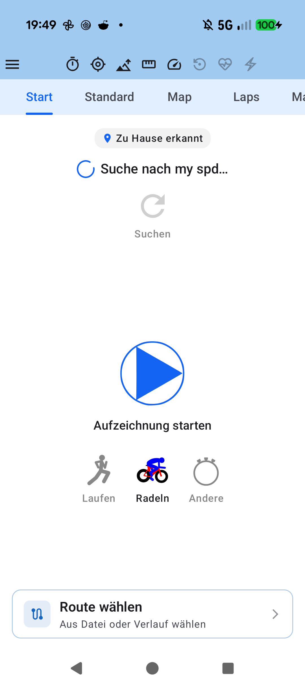
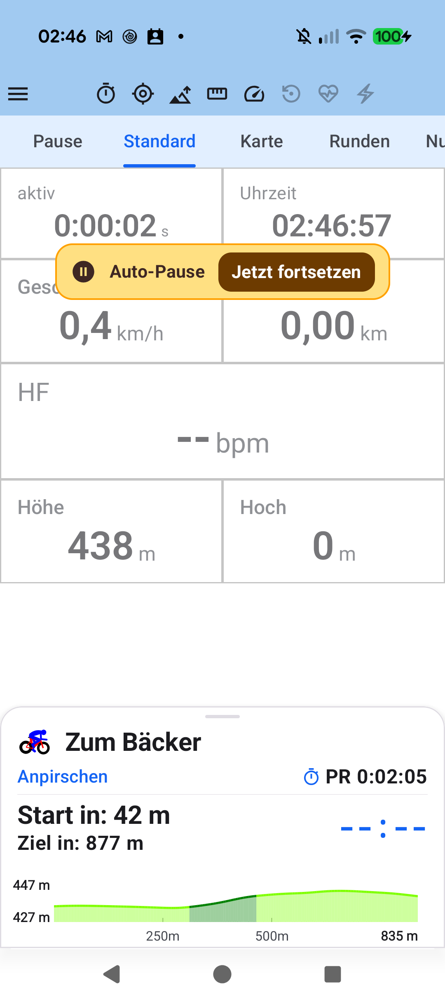
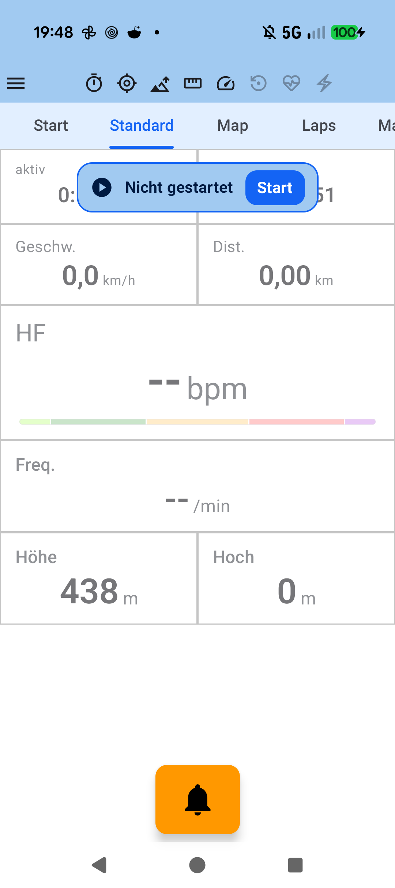

# Kapitel 1: Schnellstart & Erstes Training

## 1.1 Überblick & Berechtigungen

aTrainingTracker ist sofort nach der Installation einsatzbereit. Um präzise GPS-Tracks und unterbrechungsfreie Sensor-Telemetrie aufzuzeichnen, benötigt die App folgende Berechtigungen:

1. **Standort (Immer zulassen)**: Ermöglicht die GPS-Aufzeichnung auch dann, wenn der Bildschirm gesperrt ist oder eine andere App im Vordergrund läuft.
2. **Körperliche Aktivität**: Für die Schrittzählung und Bewegungserkennung.
3. **Geräte in der Nähe (Bluetooth)**: Zur Erkennung und Verbindung von BLE-Sensoren (Herzfrequenz, Wattmesser, Trittfrequenz).
4. **Akku-Optimierung deaktivieren**: Um zu verhindern, dass Android den Hintergrunddienst während langer Trainingseinheiten beendet.

---

## 1.2 Aufzeichnung starten, pausieren & beenden

- **Start**: Drücken Sie im Tab *Steuerung* auf das grüne **Start**-Symbol oder nutzen Sie die Schnellstart-Kachel im Cockpit.
- **Auto-Pause**: Erkennt aTrainingTracker, dass Sie an einer Ampel anhalten, wechselt der Status automatisch auf *Auto-Pause*. Der Zähler für Netto-Trainingszeit und Distanz wird präzise angehalten.
- **Manuelle Pause**: Über die Pause-Taste können Sie das Training jederzeit manuell unterbrechen.
- **Speichern**: Nach Trainingsende drücken Sie auf **Stopp** und bestätigen das Speichern. Das Training wird sofort in der lokalen SQLite-Datenbank abgelegt und steht für die Auswertung bereit.

---

## 1.3 Automatische Sportart-Erkennung

aTrainingTracker unterscheidet zwischen Radfahren (*Bike*), Laufen (*Run*) und weiteren Sportarten (*Other*). Wenn Sie einen Trittfrequenz- oder Leistungsmesser gekoppelt haben, schaltet die App automatisch auf Radfahren. Bei reiner Schrittfrequenz wird Laufen gewählt. Sie können die Sportart jederzeit vor oder während des Trainings manuell anpassen.

---

[Vorheriges Kapitel: Inhaltsverzeichnis](index.md) | [Nächstes Kapitel: Sensoren & Hardware](02-sensors-dual-protocol.md)
