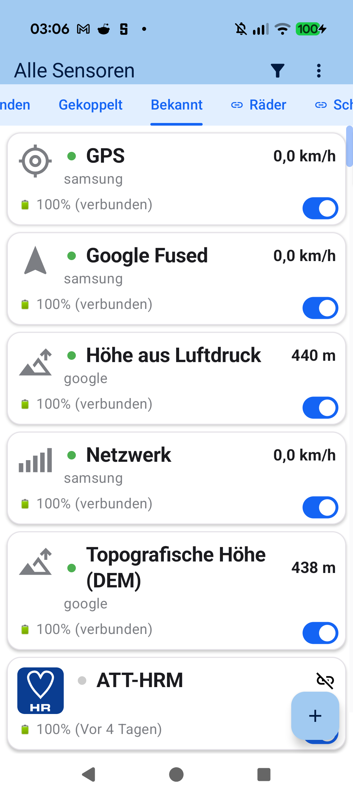
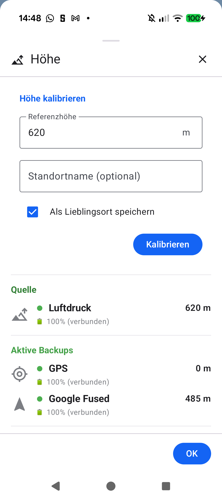
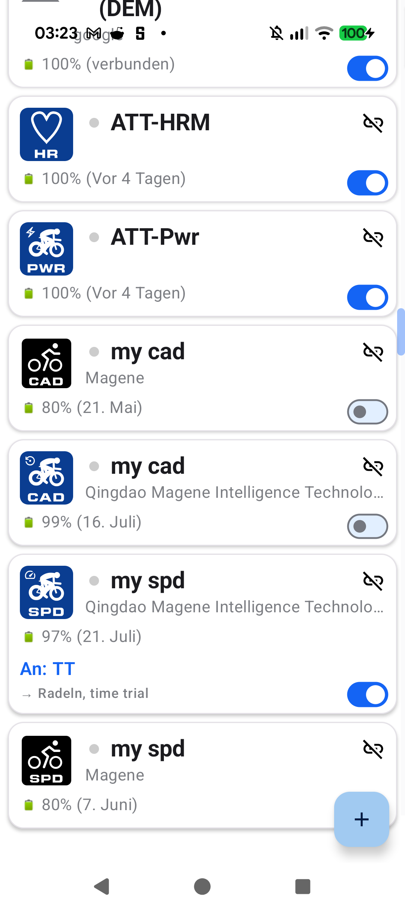

# Kapitel 2: Sensoren, Geräte & Dual-Protokoll-Hardware (BLE & ANT+)

<table>
<tr>
<td width="65%" valign="top" markdown="1">

## 2.1 Kopplung von Bluetooth LE- und ANT+-Sensoren

**aTrainingTracker** verfügt über eine vielseitige Multi-Protokoll-Engine zur parallelen Verbindung von Bluetooth Low Energy (BLE) und nativen ANT+-Sensoren:

- **Unterstützte Profile**:
  - Herzfrequenzbrustgurte & optische Sensoren (BLE Heart Rate & ANT+ HRM)
  - Rad-Leistungsmesser (BLE Cycling Power & ANT+ PWR, einschließlich L/R-Balance)
  - Trittfrequenz- & Geschwindigkeitssensoren (BLE CSC & ANT+ BSC)
  - Running Dynamics & Laufsensoren (BLE RSC & ANT+ Stride)
- **Suchlauf & Verwaltung**:
  Öffne im Menü **Meine Sensoren** (Reiter *Gekoppelt* / *Bekannt*). Die App sucht automatisch nach aktiven Sendern in Reichweite. Mit dem Schalter aktivierst oder trennst du einzelne Sensoren schnell und unkompliziert. Über das `+`-Symbol fügst du neue Sensoren hinzu.

</td>
<td width="35%" valign="top" align="center">
  
   <em>Übersicht aller bekannten & gekoppelten Sensoren</em>
</td>
</tr>
</table>

---

<table>
<tr>
<td width="65%" valign="top" markdown="1">

## 2.2 Smartphone-Sensoren & Barometrische Höhenkalibrierung

Reine GPS-Höhenmessungen unterliegen atmosphärischen und geometrischen Schwankungen ($\pm 15\text{--}30\text{ m}$). Wenn dein Smartphone ein Barometer besitzt, nutzt **aTrainingTracker** diesen präzisen Drucksensor:

- **Bekannte Orte (*Lieblingsorte*)**: Hinterlege feste Referenzpunkte (z. B. dein Zuhause oder den Startpunkt deiner Hausrunde) mit bekannter Meereshöhe. Sobald du dort ein Training beginnst, kalibriert die App den barometrischen Höhenmesser absolut und driftfrei.
- **Manuelle Kalibrierung**: Im Menü oder über das Höhen-Symbol kannst du jederzeit das Bottom-Sheet **Höhe kalibrieren** aufrufen, die aktuelle Referenzhöhe eingeben und diesen Standort optional direkt als Lieblingsort speichern.
- **Backup-Quellen**: Neben dem Barometer stehen GPS und Google Fused Location als automatische Ausfallabsicherung bereit.

</td>
<td width="35%" valign="top" align="center">
  
   <em>Dialog zur manuellen & ortsbasierten Höhenkalibrierung</em>
</td>
</tr>
</table>

---

<table>
<tr>
<td width="65%" valign="top" markdown="1">

## 2.3 Sensor-Priorität, Ausfallschutz & Batteriestatus

Wenn mehrere Sensoren für denselben Messwert verfügbar sind (z. B. Wattmessung via BLE und ANT+, oder Geschwindigkeit via Radsensor vs. GPS):

1. **Hardware-Sensor schlägt GPS**: Die exakte Raddrehung über einen Radsensor hat immer Vorrang vor GPS-Geschwindigkeit (Tunnel, dichte Wälder).
2. **Unterbrechungsfreier Ausfallschutz (*Failover*)**: Reißt ein Signal kurzzeitig ab, übernimmt nahtlos das alternative Funkprotokoll oder das GPS, ohne dass Lücken in deiner Aufzeichnung entstehen.
3. **Batteriestand-Überwachung**: Für alle gekoppelten Sensoren wird der aktuelle Ladezustand in Prozent (mit Datumsstempel des letzten Kontakts) angezeigt, sodass du rechtzeitig vor leeren Knopfzellen gewarnt wirst. Zudem siehst du direkt die Zuordnung zur aktiven Ausrüstung (z. B. *„An: TT"*).

</td>
<td width="35%" valign="top" align="center">
  
   <em>Batteriestatus & Ausrüstungsverknüpfung gekoppelter Sensoren</em>
</td>
</tr>
</table>

---

[Vorheriges Kapitel: Schnellstart](01-quick-start.md) | [Nächstes Kapitel: Ausrüstung & Sensor-Matrix](03-equipment-sensor-matrix.md) | [Zurück zur Übersicht](index.md)
