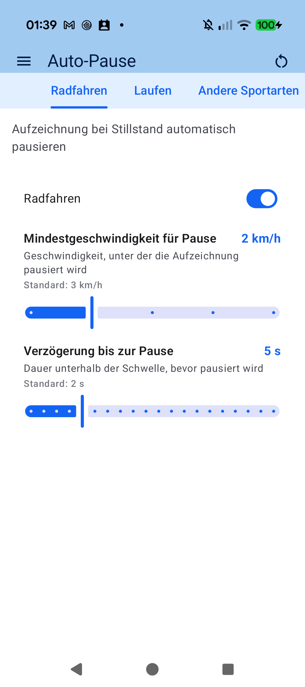
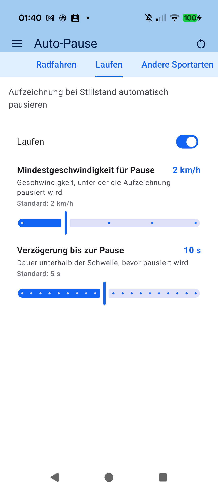

# Kapitel 3: Ausrüstung & Sensor-Matrix

<table>
<tr>
<td width="65%" valign="top" markdown="1">

## 3.1 Verwaltung von Fahrrädern & Laufschuhen

Für Sportler mit mehreren Rädern (z. B. Rennrad, Gravelbike, Mountainbike) oder verschiedenen Laufschuhen bietet **aTrainingTracker** eine zentrale Ausrüstungsverwaltung unter **Ausrüstung** (*Räder & Schuhe*):

- **Fahrräder (*Räder*)**: Hinterlege jedes Rad mit individuellem Namen, Sportart-Zuordnung (z. B. *Radeln*, *MTB*, *Time Trial*), optionaler Strava-Ausrüstungs-ID sowie den fest verknüpften Sensoren.
- **Laufschuhe (*Schuhe*)**: Verwalte alle deine Trainingsschuhe nach Modell und Einsatzbereich.
- **Vollständige Historie**: Die App erfasst automatisch Gesamtdistanz, aktive Fahr-/Laufzeit, Höhenmeter, Anzahl der absolvierten Trainingseinheiten sowie Datum der ersten und letzten Nutzung.

</td>
<td width="35%" valign="top" align="center">
  
   <em>Ausrüstungsübersicht für Fahrräder mit Gesamtkilometern</em>
</td>
</tr>
</table>

---

<table>
<tr>
<td width="65%" valign="top" markdown="1">

## 3.2 Die Sensor-Ausrüstungs-Matrix

Wenn du dedizierte Leistungsmesser oder Geschwindigkeits-Sensoren an bestimmten Rädern montiert hast, musst du diese vor einer Fahrt nicht manuell umkonfigurieren:

- **Automatische Erkennung**: Weise Sensoren fest einem Fahrrad oder Laufschuhpaar zu (im Sensor-Menü oder direkt in der Ausrüstungs-Matrix). Sobald die App das Signal empfängt, wählt sie automatisch das passende Rad oder den passenden Schuh als aktive Ausrüstung aus.
- **Keine Fehlbuchungen**: Verhindert zuverlässig, dass Kilometer einer Mountainbike-Runde versehentlich dem Rennrad oder Straßenlaufschuhen gutgeschrieben werden.
- **Strava-Synchronisation**: Beim automatischen Upload werden die Aktivitäten direkt mit dem richtigen Ausrüstungsteil synchronisiert.

</td>
<td width="35%" valign="top" align="center">
  
   <em>Schuhverwaltung & Zuordnung von Sportarten</em>
</td>
</tr>
</table>

---

## 3.3 Warum 1 oder 2 Laufradsensoren neben GPS?

Moderne Smartphones bieten GPS-Ortung, doch Satellitensignale unterliegen Abschattungen, Mehrwegeffekten und Filterverzögerungen. Die Koppelung physikalischer Laufrad-Geschwindigkeitssensoren (über ANT+ oder Bluetooth LE) bringt entscheidende physikalische Vorteile:

- **1 Laufradsensor + GPS**:
  - **Verzögerungsfreie Geschwindigkeit**: Unmittelbare Geschwindigkeitsanzeige bei Antritten und Sprints ohne GPS-Glättungsverzögerung.
  - **Koppelnavigation (Dead Reckoning)**: Exakte Geschwindigkeits- und Distanzerfassung unter dichtem Blätterdach, in Tunnels, Häuserschluchten und alpinen Kehren bei schwachem Satellitenempfang.
  - **Präzise Steigungsanzeige (Steigung %)**: Die Kombination aus hochauflösender Laufrad-Geschwindigkeit und barometrischem Höhenverlauf ermöglicht eine exakte, jitterfreie Steigungsprozentanzeige in Echtzeit.
- **2 Laufradsensoren (Vorder- + Hinterrad) + GPS**:
  - **Indirekte Reifendrucküberwachung (iTPMS)**: Sinkender Reifendruck verringert den wirksamen Abrollradius, sodass sich das Rad mit Druckverlust relativ schneller dreht. Durch vergleichende Analyse der relativen Radumdrehungen über ein 150–250 m Auswertefenster erkennt die App schleichenden Druckverlust frühzeitig (differenziert nach Vorder- vs. Hinterrad).
  - **Unabhängige Abrollumfangskalibrierung**: Das GPS kalibriert automatisch beide Laufräder unabhängig voneinander unter realer Gewichtsbelastung.
  - **Multisensor-Odometriefusion**: Redundante Sensordaten gewährleisten lückenlose Distanzerfassung auch bei temporären Sensorbatterie- oder Funkunterbrechungen.
- **Positions-Badge in der Matrix**: In der Ausrüstungs-Sensor-Matrix werden Laufradsensoren mit einem kompakten Positions-Badge gekennzeichnet (**V** für Vorderrad, **H** für Hinterrad). Ein Antippen der Zelle öffnet den Auswahldialog; integrierte Schutzregeln verhindern versehentliche Doppelbelegungen desselben Rads.

---

[Vorheriges Kapitel: Sensoren & Hardware](02-sensors-dual-protocol.md) | [Nächstes Kapitel: Live-Cockpit & Tabs](04-live-cockpit-tabs.md) | [Zurück zur Übersicht](index.md)
