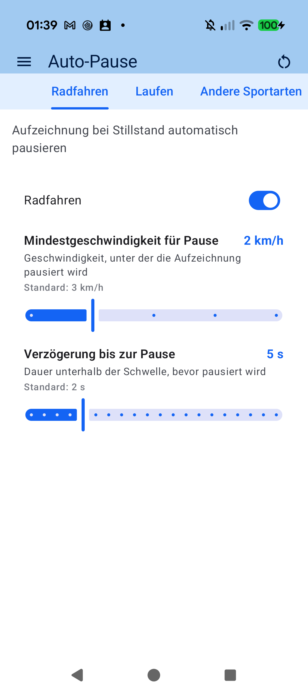
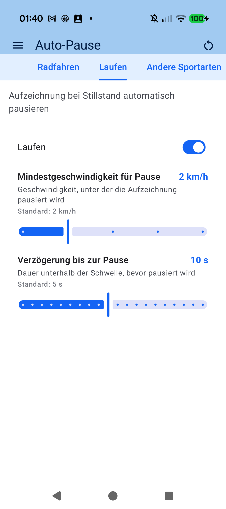

# Kapitel 3: Ausrüstung & Sensor-Matrix

## 3.1 Verwaltung von Fahrrädern & Laufschuhen

Für anspruchsvolle Sportler mit mehreren Fahrrädern (z. B. Rennrad, Gravelbike, Mountainbike) oder verschiedenen Laufschuhen bietet aTrainingTracker eine zentrale Ausrüstungsverwaltung:

- **Fahrräder (*Bikes*)**: Erfassen Sie jedes Rad mit individuellem Namen, Leergewicht, Radumfang und Standard-Fahrstil.
- **Laufschuhe (*Shoes*)**: Verfolgen Sie die aufgelaufene Gesamtkilometerleistung jedes Schuhpaars, um rechtzeitig vor Dämpfungsverschleiß gewarnt zu werden.
- **Kilometerstände & Historie**: Alle absolvierten Trainingseinheiten werden automatisch auf das gewählte Ausrüstungsteil gebucht.

---

## 3.2 Die Sensor-Ausrüstungs-Matrix

Wenn Sie unterschiedliche Leistungsmesser oder Geschwindigkeits-Sensoren an verschiedenen Rädern montiert haben, müssen Sie diese nicht vor jeder Ausfahrt manuell umstellen:

- **Feste Zuordnung**: Weisen Sie Sensoren direkt einem bestimmten Fahrrad zu (z. B. *Stages Power* an Rennrad, *Quarq* an Gravelbike).
- **Automatische Rad-Erkennung**: Sobald aTrainingTracker ein Signal Ihres Rennrad-Wattmessers empfängt, wird das Rennrad automatisch als aktive Ausrüstung für diese Einheit ausgewählt.
- **Keine Fehlbuchungen**: Vermeidet, dass Mountainbike-Kilometer versehentlich auf das Rennrad verbucht werden.

---

[Vorheriges Kapitel: Sensoren & Hardware](02-sensors-dual-protocol.md) | [Nächstes Kapitel: Live-Cockpit & Tabs](04-live-cockpit-tabs.md)
