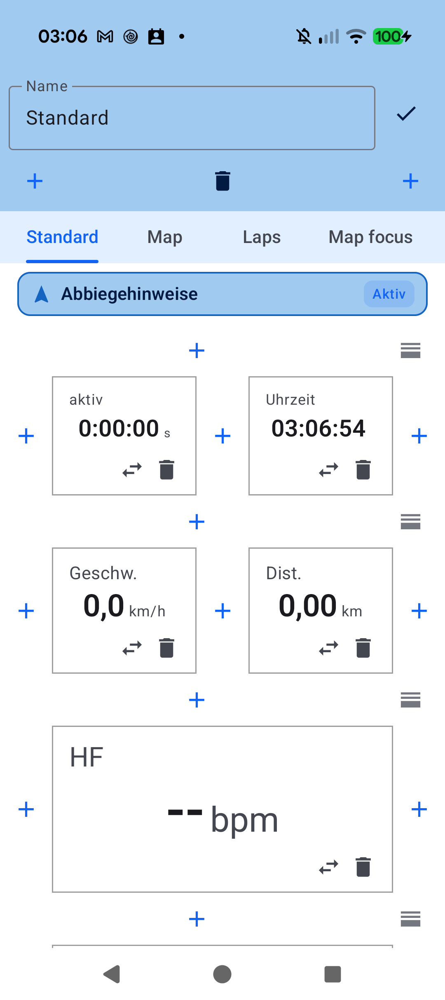
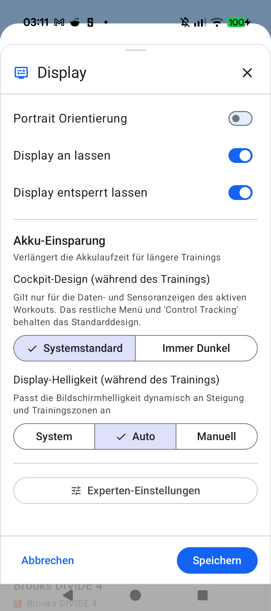
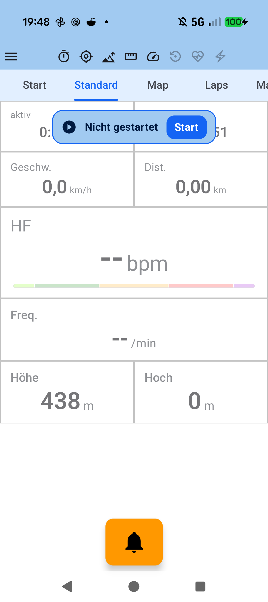

# Kapitel 4: Anpassbares Live-Cockpit & Tracking-Tabs

<table>
<tr>
<td width="65%" valign="top" markdown="1">

## 4.1 Rasterlayouts & Cockpit-Konfiguration

Das Live-Cockpit von **aTrainingTracker** lässt sich über den visuellen Editor vollständig an deine persönlichen Sehgewohnheiten und Lenkerhalterungen anpassen:

- **Zeilen- & Spalten-Editor**:
  - Über die blauen **`+`-Buttons** fügst du neue Zeilen hinzu oder teilst Zeilen in 1, 2, 3 oder mehr nebeneinander liegende Datenfelder auf.
  - Mit dem Tauschen-Symbol (**`⇄`**) vertauschst du Kacheln intuitiv per Fingertipp.
  - Ein Klick auf den Papierkorb (**`🗑️`**) entfernt nicht mehr benötigte Felder.
- **Mehrere Tracking-Tabs & Modulsteuerung**:
  - Lege individuelle Ansichten für verschiedene Schwerpunkte an (z. B. *Standard*, *Karte*, *Runden*, *Kartenfokus*).
  - Aktiviere pro Tab flexibel Module wie **Abbiegehinweise**, die Live-Karte, den Runden-Button oder Strava Live-Segmente.

</td>
<td width="35%" valign="top" align="center">
  
   <em>Visueller Layout-Editor mit Zeilen- & Spalten-Buttons</em>
</td>
</tr>
</table>

---

<table>
<tr>
<td width="65%" valign="top" markdown="1">

## 4.2 AMOLED-Modus, Zonenbalken & Intelligenter Auto-Dimmer

Damit dein Smartphone-Display auch auf langen Ausfahrten durchhält und nicht blendet:

- **AMOLED-Dunkelmodus**: Schont bei OLED-Displays den Akku durch echtes Tiefschwarz (`#000000`) im Cockpit während des Trainings.
- **Farbcodierte Zonenbalken**: Aktuelle Herzfrequenz- und Leistungszonen werden direkt unter den Live-Messwerten visualisiert (Z1 Grau bis Z7 Dunkelrot), sodass du deine Intensität im Augenwinkel kontrollieren kannst.
- **Intelligente Display-Helligkeit (*Auto-Dimmer*)**:
  - Im Auto-Modus dimmt das Display die Hintergrundbeleuchtung bei gleichmäßiger Fahrt automatisch ab.
  - Sobald ein wichtiger Trainingsmoment eintritt – wie steile Anstiege, Überschreiten hoher HF-/Watt-Schwellen, bevorstehende Abbiegehinweise oder Segmentstarts –, blendet das Display automatisch wieder voll auf.

</td>
<td width="35%" valign="top" align="center">
  
   <em>Einstellungen für AMOLED-Dunkelmodus & Auto-Dimmer</em>
</td>
</tr>
</table>

---

<table>
<tr>
<td width="65%" valign="top" markdown="1">

## 4.3 Die integrierte elektronische Fahrradklingel

Um Spaziergänger oder andere Radfahrer frühzeitig und freundlich zu warnen, ohne eine klobige mechanische Klingel am Carbonlenker montieren zu müssen:

- **Harmonischer Klingelton**: Erzeugt einen warmen Zweiton-Klingellaut über den Smartphone-Lautsprecher.
- **Immer erreichbar**: Der auffällige orange Klingel-Button bleibt in allen Tracking-Zuständen (*Bereit*, *Tracking*, *Pause*) am unteren Bildschirmrand verfügbar.
- **Tipp- & Dauerfunktion**: Ein kurzes Antippen löst ein einzelnes Klingeln aus; durch Gedrückthalten ertönt die Klingel kontinuierlich.

</td>
<td width="35%" valign="top" align="center">
  
   <em>Orangener Klingel-Button im Live-Cockpit</em>
</td>
</tr>
</table>

---

[Vorheriges Kapitel: Ausrüstung & Sensor-Matrix](03-equipment-sensor-matrix.md) | [Nächstes Kapitel: Karten, Routen & Segmente](05-maps-routes-climbs-segments.md) | [Zurück zur Übersicht](index.md)
