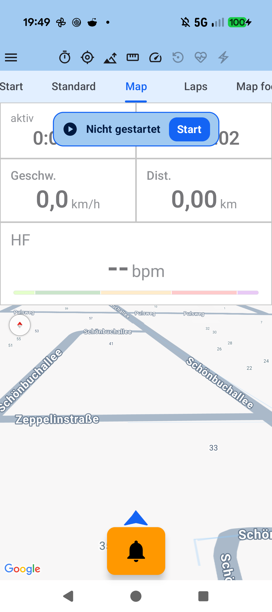
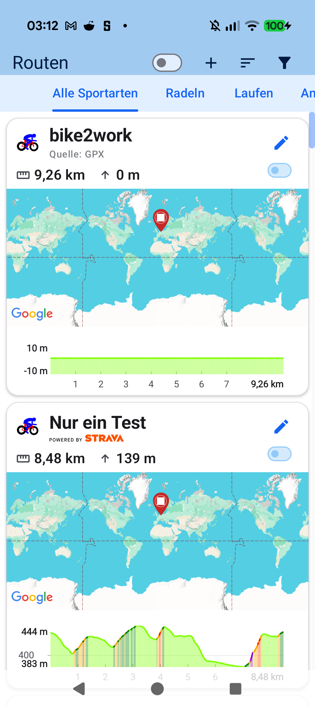
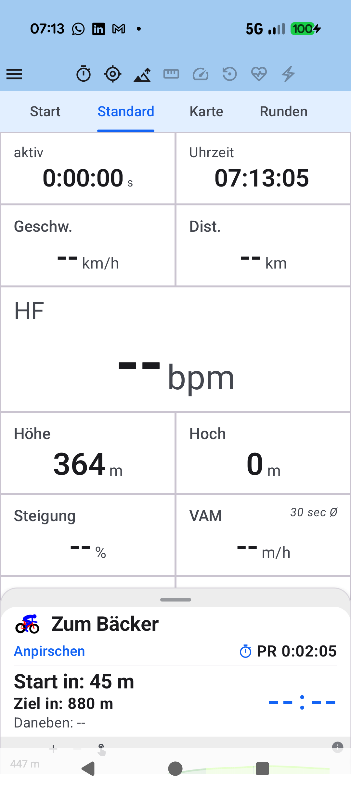

# Kapitel 5: Karten, GPX-Routen, Höhenprofile & Strava Live Segmente

<table>
<tr>
<td width="65%" valign="top" markdown="1">

## 5.1 GPX-Routen importieren & Streckenführung

Fahre oder laufe geplante Strecken mit verlässlicher visueller Orientierung auf Google Maps ab:

- **Einfacher Strecken-Import**:
  - Lade `.gpx`-Dateien direkt aus Downloads, Messengern oder Tourenportalen (Komoot, Strava, RideWithGPS) in **Routen**.
  - Wähle eine geplante Strecke als aktive Route für dein Training aus.
- **Folgemodus (*Follow Track*) & Navigation**:
  - Die geplante Route wird farblich über die Karte gelegt; dein aktueller Standort wird mit Fahrtrichtungspfeil zentriert.
  - **Abbiegehinweise (*Turn-by-Turn*)**: Blendet bevorstehende Richtungswechsel rechtzeitig ein.
  - **Off-Route-Warnung**: Verlässt du den Track, warnt dich die App optisch mit einem Richtungspfeil zurück zur Strecke.
  - **Rückweg**: Funktionen wie *„Zurück zum Start"* oder *„Nach Hause navigieren"* helfen dir jederzeit bei der Orientierung.

</td>
<td width="35%" valign="top" align="center">
  
   <em>Live-Kartenansicht mit Richtungspfeil & Datenkacheln</em>
</td>
</tr>
</table>

---

<table>
<tr>
<td width="65%" valign="top" markdown="1">

## 5.2 Interaktives Höhenprofil & Steigungskategorien

Entlang der gewählten Route analysiert **aTrainingTracker** das Höhenrelief der Strecke im Voraus:

- **Dynamisches Höhenprofil**: Visualisiert bevorstehende Anstiege und Abfahrten entlang der Gesamtdistanz.
- **Steigungs-Farbcodierung**: Flache Passagen erscheinen in sanftem Grün, moderate Steigungen in Gelb und steile Rampen in leuchtendem Orange und Rot.
- **Offizielle Bergwertungen**: Bei synchronisierten Strava-Segmenten werden offizielle Radsport-Kategorien (*CAT 4*, *CAT 3*, *CAT 2*, *CAT 1*, *HC*) automatisch übernommen und im Profil markiert.

</td>
<td width="35%" valign="top" align="center">
  
   <em>Routen-Übersicht mit farbcodiertem Höhenprofil</em>
</td>
</tr>
</table>

---

<table>
<tr>
<td width="65%" valign="top" markdown="1">

## 5.3 Strava Live Segmente in Echtzeit

Messe dich während der Fahrt direkt mit deinen Bestzeiten und Vereinskollegen:

- **Automatische Annäherungswarnung**: Sobald du dich einem markierten Strava-Segment näherst, blendet **aTrainingTracker** am unteren Displayrand automatisch das Live-Segment-Cockpit ein (*„Anpirschen"*).
- **Echtzeit-Vergleich**: Verfolge Sekunde für Sekunde und Meter für Meter deinen Vorsprung oder Rückstand auf deine persönliche Bestzeit (*PR*), den Streckenrekord (*KOM/QOM*) oder dein Zeitziel.
- **Segment-Höhenprofil**: Ein interaktiver Balken zeigt dir die verbleibende Distanz und Steigung bis zur Ziellinie des Segments an.

</td>
<td width="35%" valign="top" align="center">
  
   <em>Live-Segment-Vorschau mit Countdown & Höhenprofil</em>
</td>
</tr>
</table>

---

[Vorheriges Kapitel: Live-Cockpit & Tabs](04-live-cockpit-tabs.md) | [Nächstes Kapitel: Lieblingsstrecken & Clustering](06-automatic-route-clustering.md) | [Zurück zur Übersicht](index.md)
