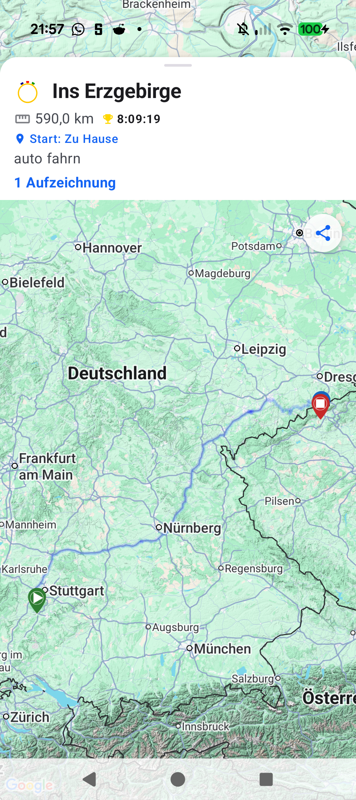
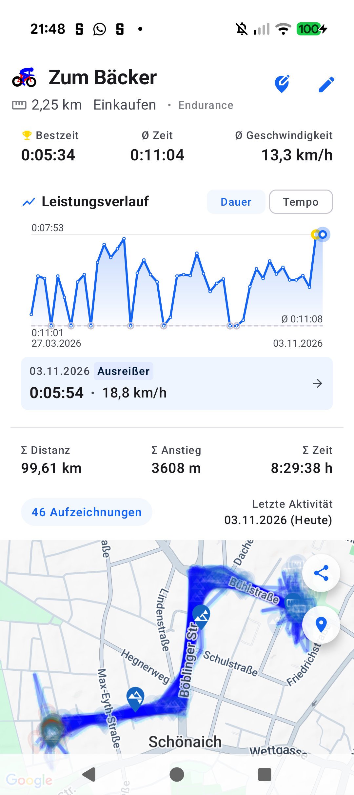

# Kapitel 6: Lieblingsstrecken & Automatische Routen-Clustering

## 6.1 Die automatische Streckenerkennung

Die meisten Athleten haben feste Hausrunden, Feierabendstrecken oder Standard-Trainingsrouten. aTrainingTracker erkennt diese Muster vollkommen autonom im Hintergrund:

- **Geometrischer Ähnlichkeits-Algorithmus**: Nach Abschluss jeder Aktivität vergleicht ein spatialer Clustering-Algorithmus (Fréchet-Distanz & Hausdorff-Metrik) den aufgezeichneten GPS-Track mit früheren Einheiten.
- **Cluster-Bildung (*Lieblingsstrecken*)**: Werden 2 oder mehr Workouts auf demselben Streckenverlauf erkannt, werden sie automatisch zu einem gemeinsamen Strecken-Cluster zusammengefasst.
- **Automatische Workout-Benennung**: Benennen Sie einen Cluster einmalig (z. B. *"Isarrunde"* oder *"Hausberg-Intervall"*), erhalten alle zukünftigen Einheiten auf dieser Strecke automatisch denselben aussagekräftigen Titel.

---

## 6.2 Cluster-Karten & Historischer Performance-Vergleich

- **Strecken-Heatmap**: Auf der Übersichtskarte werden Ihre Lieblingsstrecken farblich hervorgehoben. Dicke Linien visualisieren häufig gefahrene Routen.
- **Langzeit-Trends**: Verfolgen Sie, wie sich Ihre Durchschnittsgeschwindigkeit, Wattleistung oder Herzfrequenz auf derselben Standardstrecke über Monate und Jahre hinweg entwickelt.
- **Filterung nach Sportart**: Cluster lassen sich nach Radfahren, Laufen oder Wandern filtern, um spezifische Leistungssteigerungen isoliert zu betrachten.

---

[Vorheriges Kapitel: Karten & GPX-Routen](05-maps-routes-climbs-segments.md) | [Nächstes Kapitel: Physiologie & Zonen](07-physiology-training-zones.md)
