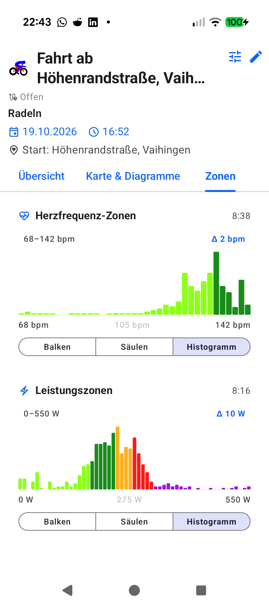
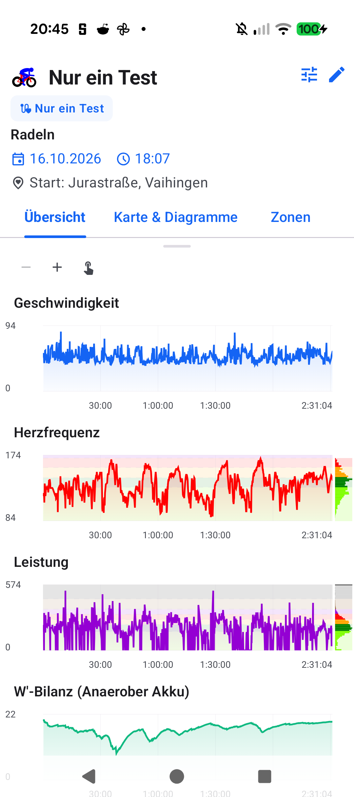
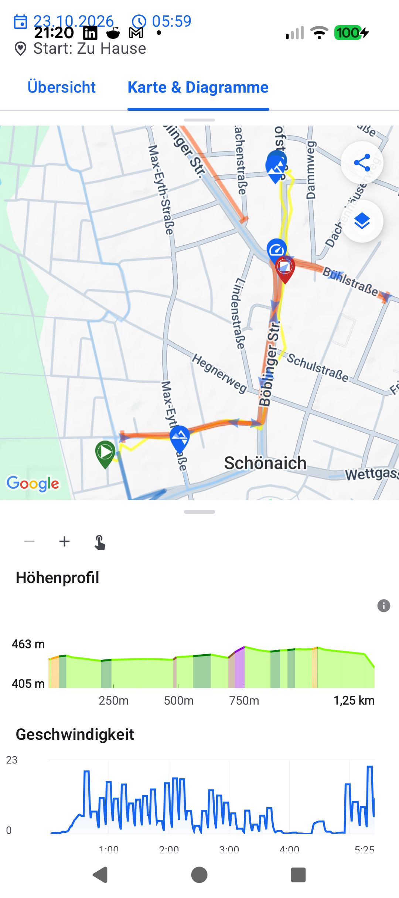

# Kapitel 7: Physiologie, Trainingszonen & Leistungsanalyse

## 7.1 Coggan 7-Zonen-Modell, FTP, CP & W'

Präzise Trainingssteuerung erfordert wissenschaftlich fundierte Schwellenwerte. aTrainingTracker unterstützt modernste sportwissenschaftliche Modelle:

- **Funktionelle Schwellenleistung (FTP)**: Basis für die 7 Coggan-Leistungszonen (von *Z1 Aktive Erholung* über *Z4 Schwellenbereich* bis *Z7 Neuromuskuläre Leistung*).
- **Critical Power (CP) & Anaerobe Arbeitskapazität (W')**:
  - `CP`: Höchste dauerhafte aerobe Leistungsgrenze in Watt.
  - `W'`: Die endliche anaerobe Energiereserve oberhalb von CP in Kilojoule (kJ).
  - **Integrierter 2-Punkt CP/W'-Schätzer**: Geben Sie einfach zwei All-Out-Bestleistungen ein (z. B. 3 Minuten und 12 Minuten), um CP und W' exakt zu berechnen.
- **Herzfrequenzzonen**: Berechnung nach Karvonen (unter Berücksichtigung von Ruhe- und Maximalpuls).

---

## 7.2 Wissenschaftliche Leistungsmetriken: NP, IF, TSS, W'bal & EF

Während und nach der Fahrt liefert aTrainingTracker tiefe physiologische Einblicke:

- **Normalized Power ($\text{NP}$)**: Gewichtete Wattleistung, die den physiologischen Stress ungleichmäßiger Belastungen (Antritte, Abfahrten) widerspiegelt.
- **Intensity Factor ($\text{IF}$)**: Verhältnis von NP zu Ihrer FTP ($\text{IF} = \text{NP} / \text{FTP}$).
- **Training Stress Score ($\text{TSS}$)**: Maß für die physiologische Gesamtdosis der Einheit:
  $$\text{TSS} = \frac{t \times \text{NP} \times \text{IF}}{\text{FTP} \times 3600} \times 100$$
- **Skiba Anaerobe Batterie ($W'_{\text{bal}}$)**: Zeigt in Echtzeit an, wie viele Kilojoule Ihres anaeroben Tanks noch verfügbar sind und wie schnell er sich bei Fahrten unterhalb von CP wieder erholt.
- **Effizienzfaktor ($\text{EF}$) & Aerobe Entkopplung ($\text{Pw:Hr}$)**: Verhältnis von Leistung zu Herzfrequenz. Ein Anstieg von $\text{Pw:Hr} > 5\%$ in der zweiten Hälfte signalisiert kardiovaskuläre Drift und Ermüdung.

---

## 7.3 Performance Management Chart (PMC)

Der integrierte PMC visualisiert Ihren langfristigen Trainingsaufbau nach dem Banister-Impuls-Reaktions-Modell:

- **Fitness ($\text{CTL}$ - Chronic Training Load)**: Exponentiell geglättete Trainingsbelastung der letzten 42 Tage.
- **Ermüdung ($\text{ATL}$ - Acute Training Load)**: Akute Erschöpfung der letzten 7 Tage.
- **Form ($\text{TSB}$ - Training Stress Balance)**: Differenz zwischen Fitness und Ermüdung ($\text{TSB} = \text{CTL} - \text{ATL}$). Ein positiver Wert signalisiert Renntauglichkeit (Peak Form).

---

[Vorheriges Kapitel: Lieblingsstrecken](06-automatic-route-clustering.md) | [Nächstes Kapitel: Workout-Auswertung & Perioden](08-workout-aftermath-periods.md)
