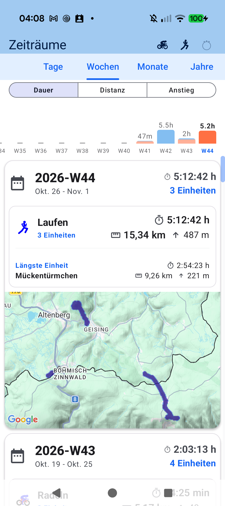
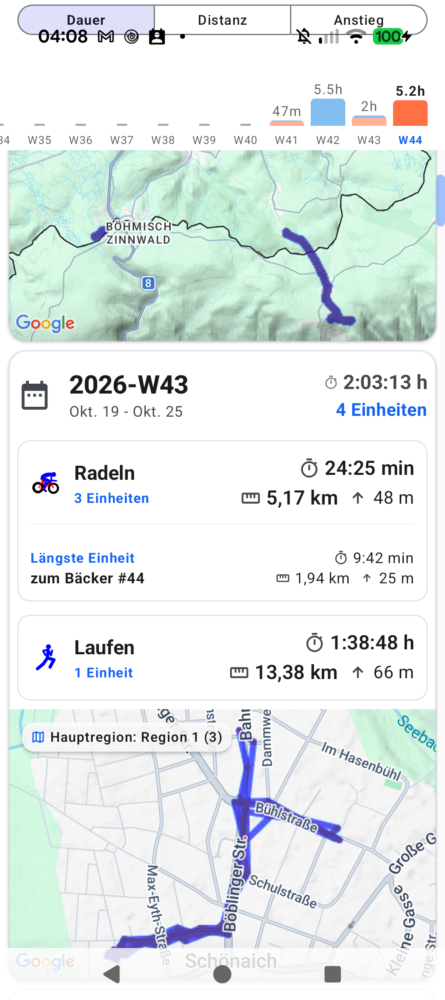
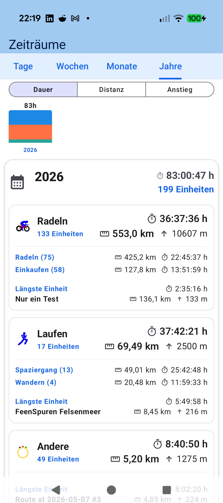

# Kapitel 8: Workout-Auswertung, Perioden 2.0 & Jahresstatistiken

## 8.1 Detaillierte Workout-Nachbereitung & Telemetrie-Charts

Nach dem Speichern einer Trainingseinheit öffnet sich die ganzheitliche Auswertung:

- **Synchronisierte Telemetrie-Graphen**: Verfolgen Sie Geschwindigkeit/Pace, Herzfrequenz, Watt und Höhenverlauf mit vertikal synchronisiertem Scrubbing-Cursor über die gesamte Trainingsdauer.
- **Zonen-Histogramme**: Untersuchen Sie, wie viele Minuten Sie in jeder Herzfrequenz- und Watt-Zone verbracht haben.
- **Rundentabellen (*Laps*)**: Analysieren Sie manuelle Runden-Splits oder automatische 1-km/5-km-Abschnitte mit Durchschnittswerten für Watt, Puls und Trittfrequenz.

---

## 8.2 Perioden 2.0: Wochen-, Monats- & Jahresansichten

Um Trainingszyklen und Saisonverläufe zu überblicken:

- **Kalender-Aggregation**: Wechseln Sie nahtlos zwischen Wochen-, Monats- und Jahresansichten.
- **Sportart-Filter**: Betrachten Sie Rad- und Laufumfänge getrennt oder kombiniert.
- **Metriken im Wandel**: Vergleichen Sie Gesamtdistanz, Höhenmeter, Trainingszeit und akkumulierten TSS gegenüber früheren Vergleichszeiträumen.

---

## 8.3 Jahres-Aktivitätsgitter (*Yearly Activity Grid*)

Nach Vorbild des modernen GitHub-Beitragsrasters visualisiert das Jahres-Aktivitätsgitter jeden Tag des Kalenderjahres:

- **Farbintensität**: Je dunkler das grüne Kästchen, desto intensiver oder länger war das Training an diesem Tag.
- **Lückenlose Motivation**: Fördert die Kontinuität und macht Trainingspausen oder Phasen hoher Belastung auf einen Blick sichtbar.
- **Tages-Inspektion**: Ein Fingertipp auf ein Quadrat öffnet die Liste aller an diesem Datum absolvierten Aktivitäten.

---

[Vorheriges Kapitel: Physiologie & Zonen](07-physiology-training-zones.md) | [Nächstes Kapitel: Datensouveränität & Export](09-export-cloud-sync.md)
