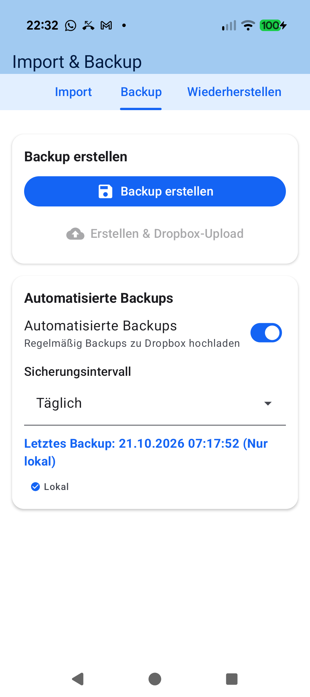
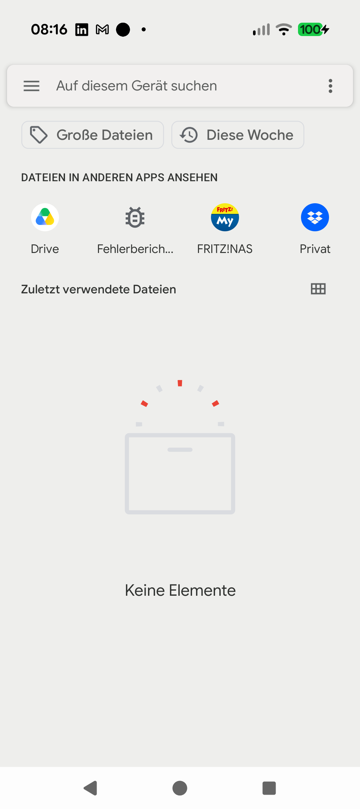
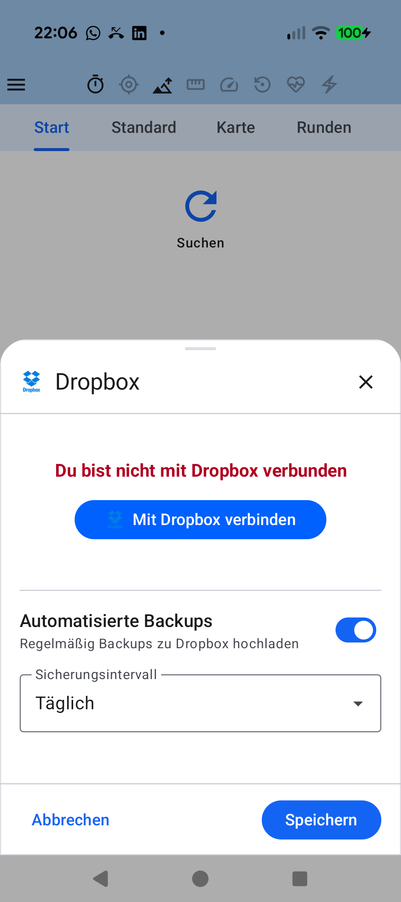

# Kapitel 9: Datensouveränität, Export & Cloud-Synchronisation

## 9.1 100% Lokale SQLite-Datenhoheit

aTrainingTracker basiert auf dem Grundsatz absoluter Privatsphäre und digitaler Selbstbestimmung:

- **Kein Account-Zwang**: Sie müssen kein Konto anlegen, keine E-Mail-Adresse angeben und kein Passwort merken.
- **Lokale Speicherung**: Sämtliche Workouts, GPX-Punkte, Sensorkalibrierungen und Ausrüstungsdaten liegen in einer standardkonformen SQLite-Datenbank auf Ihrem Gerät.
- **Kein Tracking & keine Werbung**: Weder aTrainingTracker noch Drittanbieter lesen Ihre Daten aus.

---

## 9.2 Offene Dateiformate: FIT, TCX, GPX & CSV

Ihre Daten gehören Ihnen. Jedes Workout lässt sich jederzeit in alle gängigen Industrie-Formate exportieren:

- **`.fit` (Flexible and Interoperable Data Transfer)**: Das binäre Garmin/Dynastream-Standardformat mit vollständiger Sensor-Telemetrie (Watt, Trittfrequenz, Balance, Herzfrequenz).
- **`.tcx` (Training Center XML)**: XML-basiertes Format mit Runden-Splits und GPS-Trackpoints.
- **`.gpx` (GPS Exchange Format)**: Universeller Standard für Kartendienste und Routenplaner.
- **`.csv`**: Tabellarischer Rohdatenexport für eigene Auswertungen in Excel, R oder Python.

---

## 9.3 Automatische Backups (Dropbox / Google Drive) & 1-Klick-Upload

Um Ihre Trainingshistorie vor Geräteverlust oder Neuinstallationen zu schützen:

- **Nahtlose Cloud-Backups**: Konfigurieren Sie tägliche oder wöchentliche Backups direkt in Ihren persönlichen Dropbox- oder Google Drive-Speicher.
- **WLAN-Only Option**: Schont das mobile Datenvolumen durch Upload nur bei aktiver Wi-Fi-Verbindung.
- **1-Klick-Synchronisation**: Laden Sie absolvierte Aktivitäten mit einem Fingertipp zu Strava oder TrainingPeaks hoch.

---

[Vorheriges Kapitel: Workout-Auswertung & Perioden](08-workout-aftermath-periods.md) | [Zurück zur Übersicht](index.md)
