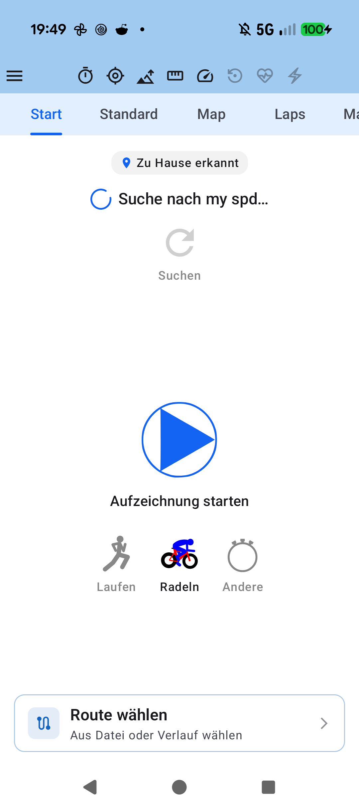
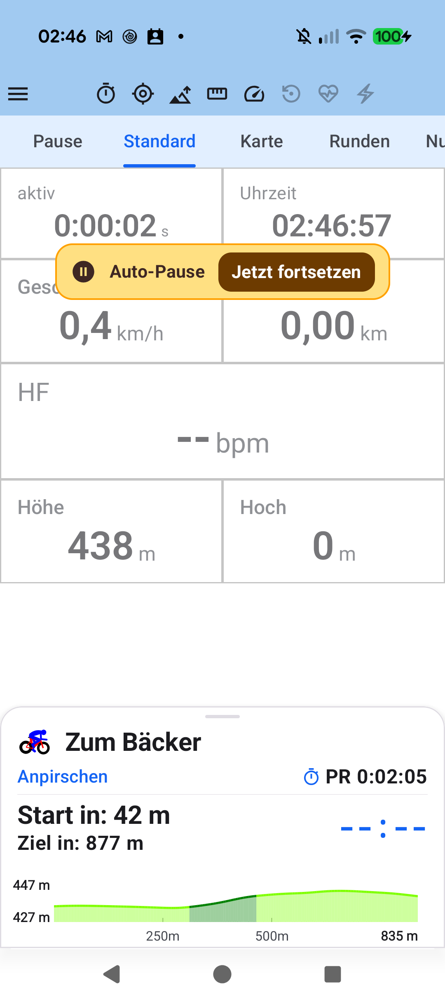
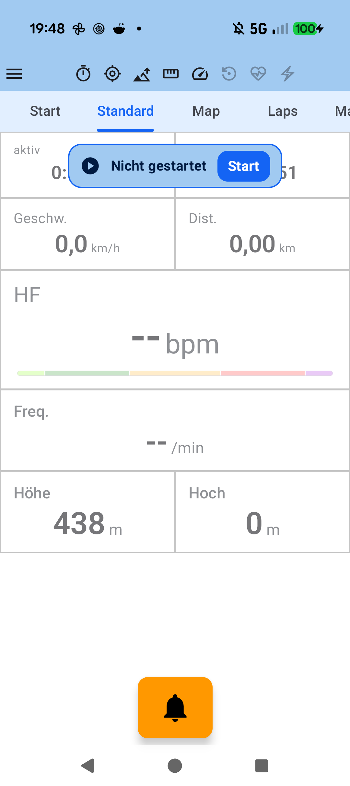

# Chapter 1: Quick Start & First Ride/Run

## 1.1 Overview & Essential Permissions

aTrainingTracker is designed for immediate readiness with minimal friction. To ensure unbroken GPS tracks and uninterrupted telemetry streams during long outdoor workouts, grant the following permissions on initial launch:

1. **Location ("Allow all the time")**: Required for foreground and background track recording while the screen is locked or navigation runs in the background.
2. **Physical Activity**: Allows activity transition recognition and step counting.
3. **Nearby Devices (Bluetooth)**: Grants discovery and communication with BLE sensors (Heart Rate, Power Meters, Cadence).
4. **Disable Battery Optimization**: Prevents Android from terminating the tracking service during multi-hour endurance sessions.

---

## 1.2 Starting, Pausing & Saving Workouts

- **Start**: Tap the green **Start** icon on the *Control Tracking* screen or use the quick-action button in the cockpit.
- **Auto-Pause**: If you stop at a traffic light or junction, the tracking engine immediately detects zero speed and transitions to *Auto-Pause*, freezing elapsed moving time and distance accumulation.
- **Manual Pause**: Toggle pause at any time using the central Cockpit controls.
- **Finish & Save**: Tap **Stop** to review session statistics and confirm saving. Your complete session telemetry is immediately persisted into the local SQLite database.

---

## 1.3 Automatic Sport-Type Detection

aTrainingTracker distinguishes between Cycling (*Bike*), Running (*Run*), and Other athletic disciplines (*Other*). Connecting a cycling power meter or cadence sensor triggers automatic bike mode, whereas cadence data from running dynamics switches to running mode. You can also manually switch sports at any time.

---

[Previous: Table of Contents](index.md) | [Next: Sensors & Dual-Protocol Hardware](02-sensors-dual-protocol.md)
