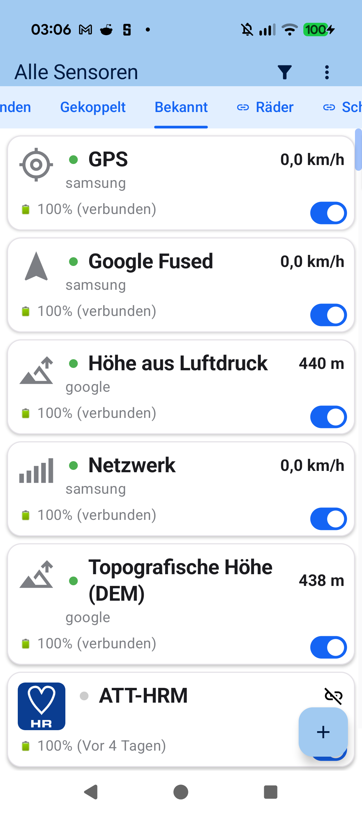
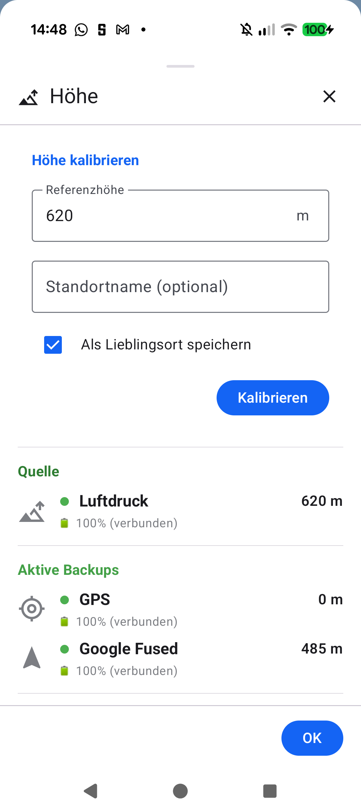
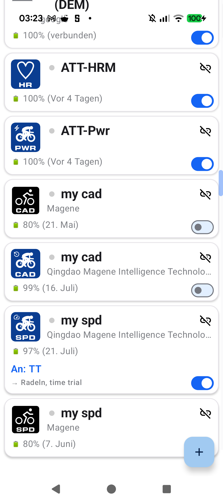

# Chapter 2: Sensors, Devices & Dual-Protocol Hardware (BLE & ANT+)

<table>
<tr>
<td width="65%" valign="top" markdown="1">

## 2.1 Bluetooth LE & ANT+ Dual-Protocol Pairing

**aTrainingTracker** features a versatile multi-protocol sensor engine supporting simultaneous Bluetooth Low Energy (BLE) and native ANT+ device connectivity:

- **Supported Profiles**:
  - Heart Rate monitors & optical armbands (BLE Heart Rate & ANT+ HRM)
  - Cycling Power meters (BLE Cycling Power & ANT+ PWR, including Left/Right balance)
  - Cadence & Speed sensors (BLE CSC & ANT+ BSC)
  - Running Dynamics & Footpods (BLE RSC & ANT+ Stride)
- **Scanning & Management**:
  Open **My Sensors** (*Meine Sensoren*) from the navigation drawer (tabs *Paired* / *Known*). The app automatically scans for active transmitters in range. Use the toggle switches to connect or disconnect individual sensors effortlessly. Tap the `+` button to pair new devices.

</td>
<td width="35%" valign="top" align="center">
  
   <em>Overview of all known and paired telemetry sensors</em>
</td>
</tr>
</table>

---

<table>
<tr>
<td width="65%" valign="top" markdown="1">

## 2.2 Smartphone Sensors & Barometric Altitude Calibration

Raw GPS altitude measurements are subject to atmospheric and geometric satellite dilution ($\pm 15\text{--}30\text{ m}$). If your smartphone includes an onboard barometer, **aTrainingTracker** harnesses this high-precision pressure sensor:

- **Known Locations (*Lieblingsorte*)**: Define fixed reference coordinates (such as your home or regular route trailhead) with known true elevation. Starting a workout there calibrates the barometric altimeter absolutely with zero initial drift.
- **Manual Calibration**: At any time, open the **Calibrate Altitude** bottom sheet from the menu or altitude indicator icon, enter your current elevation, and optionally save the spot as a Known Location.
- **Backup Fallback Sources**: In addition to barometric pressure, GPS altitude and Google Fused Location stand ready as automated fallback backbones.

</td>
<td width="35%" valign="top" align="center">
  
   <em>Altitude calibration dialog with reference elevation input</em>
</td>
</tr>
</table>

---

<table>
<tr>
<td width="65%" valign="top" markdown="1">

## 2.3 Sensor Priority, Redundancy Failover & Battery Telemetry

When multiple sensors report the same telemetry metric simultaneously (e.g. power via BLE and ANT+, or speed via wheel sensor vs. GPS):

1. **Hardware Wheel Sensor Beats GPS**: Direct wheel rotation counting always takes precedence over satellite Doppler speed (essential in tunnels and dense forests).
2. **Seamless Failover**: If a radio link drops temporarily, the alternate protocol or internal GPS sensor instantly takes over without leaving gaps in your track record.
3. **Battery Monitoring**: Battery percentages and the timestamp of the last handshake are displayed for all paired transmitters, alerting you well in advance before coin cells deplete. Gear links (e.g. *"On: TT"*) are also visible at a glance.

</td>
<td width="35%" valign="top" align="center">
  
   <em>Battery telemetry and equipment assignments for paired sensors</em>
</td>
</tr>
</table>

---

[Previous Chapter: Quick Start](01-quick-start.md) | [Next Chapter: Equipment & Sensor Matrix](03-equipment-sensor-matrix.md) | [Back to Table of Contents](index.md)
