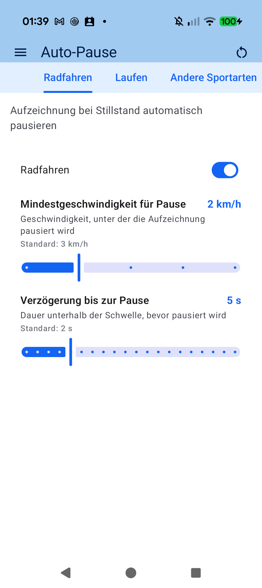
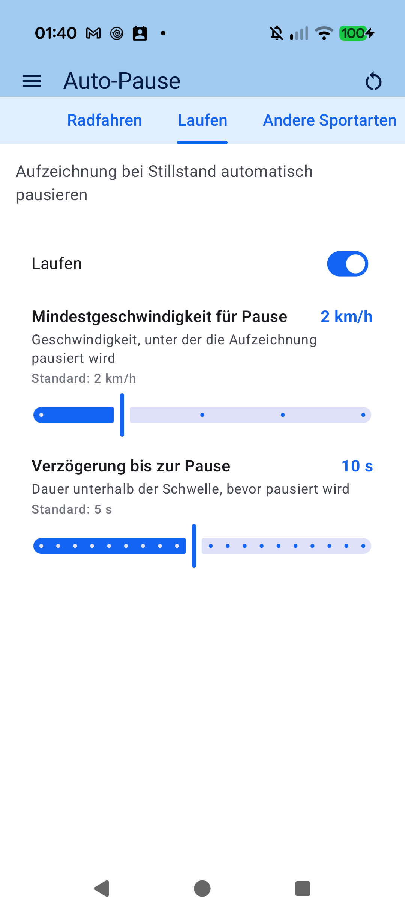

# Chapter 3: Equipment & Sensor Matrix

<table>
<tr>
<td width="65%" valign="top" markdown="1">

## 3.1 Managing Multiple Bicycles & Running Shoes

For athletes maintaining a fleet of bikes (Road, Gravel, Mountain, Time Trial) or rotating shoe pairs, **aTrainingTracker** provides centralized equipment lifecycle tracking under **Equipment** (*Bikes & Shoes*):

- **Bicycles (*Bikes*)**: Register each bike with a custom name, associated sport disciplines (e.g. *Bike*, *MTB*, *Time Trial*), optional Strava Gear ID, and linked telemetry sensors.
- **Running Shoes (*Shoes*)**: Manage your running footwear roster categorized by model and discipline.
- **Complete Usage Tracking**: The app automatically aggregates lifetime distance, active moving time, total elevation climbed, workout count, and dates of first and most recent use.

</td>
<td width="35%" valign="top" align="center">
  
   <em>Bike garage overview with lifetime distance & hours</em>
</td>
</tr>
</table>

---

<table>
<tr>
<td width="65%" valign="top" markdown="1">

## 3.2 The Sensor-to-Gear Matrix

If you operate dedicated power meters, cadence pods, or wheel sensors across different bicycles, there is no need to manually select your gear before heading out:

- **Automatic Gear Selection**: Bind individual sensors directly to a bike or pair of shoes (via the sensor details or the interactive equipment matrix). As soon as **aTrainingTracker** receives telemetry from that sensor, it selects the corresponding gear item automatically.
- **Accurate Mileage Accounting**: Eliminates erroneous accounting, ensuring gravel or trail miles never accidentally accrue onto your road bike or racing flats.
- **Strava Gear Sync**: Uploaded activities automatically sync to the matching equipment on Strava.

</td>
<td width="35%" valign="top" align="center">
  
   <em>Shoe roster and discipline assignments</em>
</td>
</tr>
</table>

---

## 3.3 Why 1 or 2 Wheel Sensors Alongside GPS?

Modern smartphones provide GPS positioning, but satellite signals suffer from satellite geometry delays, canopy attenuation, and multi-path reflections. Pairing physical wheel speed sensors (via ANT+ or Bluetooth LE) provides distinct advantages:

- **1 Wheel Sensor + GPS**:
  - **Zero-Lag Speed**: Instantaneous speed response during sudden sprints and sharp accelerations without GPS filter lag.
  - **Dead Reckoning Continuity**: Exact speed and distance progression under dense forest canopy, in tunnels, urban canyons, and switchback descents where satellite visibility drops.
  - **Precise Live Grade (Slope %)**: Combining wheel-derived instantaneous ground speed with barometric altimeter vertical delta delivers a crisp, responsive live gradient display.
- **2 Wheel Sensors (Front + Rear) + GPS**:
  - **Indirect Tire Pressure Monitoring (iTPMS)**: As tire pressure drops, effective rolling radius decreases, causing the deflating wheel to rotate faster. By comparing relative front vs. rear wheel revolution deltas over a 150–250 m baseline window, the app detects slow punctures before rim damage or safety hazards occur (identifying whether pressure loss is in the front or rear tire).
  - **Independent Circumference Calibration**: GPS auto-calibrates individual tire circumferences under real riding weight and inflation levels.
  - **Multi-Sensor Odometry Fusion**: Redundant odometry fusion maintains high-accuracy distance tracking even if one sensor encounters intermittent battery or connection drops.
- **Mounting Position Badging in Matrix**: In the Equipment-Sensor Matrix, wheel speed sensors display a compact mounting badge (**F** for Front Wheel, **R** for Rear Wheel). Tapping the cell allows quick reassignment or unlinking, with built-in guardrails preventing duplicate front or rear assignments on the same bicycle.

---

[Previous Chapter: Sensors & Hardware](02-sensors-dual-protocol.md) | [Next Chapter: Live Cockpit & Tabs](04-live-cockpit-tabs.md) | [Back to Table of Contents](index.md)
