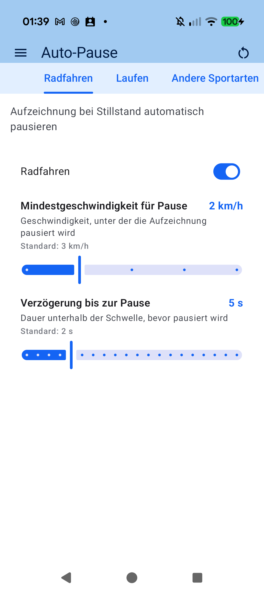
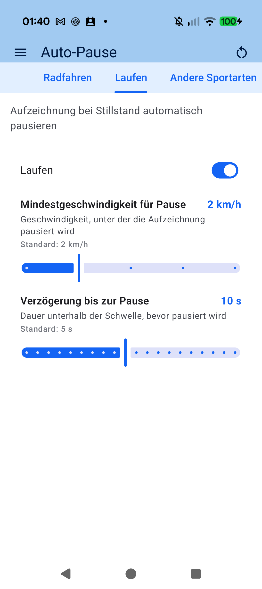

# Chapter 3: Equipment & Sensor Matrix

## 3.1 Managing Multiple Bicycles & Running Shoes

For multi-sport athletes maintaining a fleet of bikes (Road, Gravel, MTB, TT) and rotating shoe pairs, aTrainingTracker provides comprehensive equipment lifecycle management:

- **Bicycles**: Record individual bike profiles with custom names, frame weight, tire circumference, and default sport discipline.
- **Running Shoes**: Track accumulated mileage per shoe pair to retire worn-out midsoles before repetitive strain injuries occur.
- **Mileage Accumulation**: Completed workouts automatically increment odometer totals on the assigned gear item.

---

## 3.2 The Sensor-to-Gear Matrix

If you operate dedicated power meters or speed pods across different bikes, you never have to reconfigure sensor assignments before pressing Start:

- **Hardware Binding**: Associate sensors directly with specific bicycles or shoes (e.g. *Stages Left* to Road Bike, *Quarq DZero* to Gravel Bike).
- **Auto-Detection by Sensor Presence**: The instant aTrainingTracker connects to the road bike's power meter, it activates the Road Bike profile and applies its specific wheel circumference and FTP profile.
- **Error-Free Mileage Tracking**: Eliminates inaccurate distance calculation from mismatched wheel sizes or accidental gear misattribution.

---

[Previous: Sensors & Dual-Protocol Hardware](02-sensors-dual-protocol.md) | [Next: Live Cockpit & Tracking Tabs](04-live-cockpit-tabs.md)
