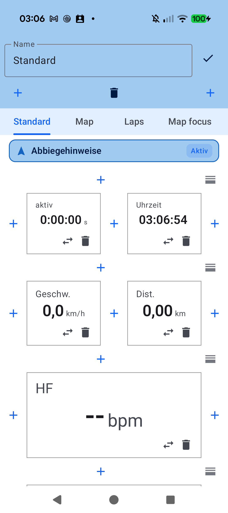
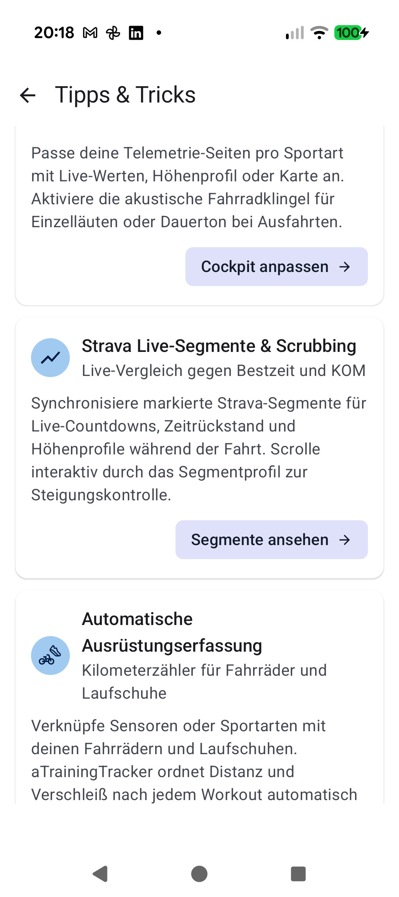

# Chapter 4: Customizable Live Cockpit & Tracking Tabs

## 4.1 Grid Layouts & Relative Tile Widths (1x, 2x, 3x)

The aTrainingTracker live telemetry cockpit adapts fully to your eye-level ergonomics, handlebar cockpit mounts, and data priorities:

- **Modular Column Widths**:
  - `1x`: Compact slot for secondary metrics (Time of Day, Sensor Battery, Ambient Temperature).
  - `2x`: Dominant gauge tile for primary numbers (Instantaneous Speed, Heart Rate, 3s Power).
  - `3x`: Full-width banner for visual zone gauges, real-time progression graphs, and lap tables.
- **Multiple Tracking Tabs**:
  Configure separate specialized views (e.g. *Standard Cockpit*, *Map Navigation*, *Interval Splits*). Swipe smoothly between tabs or duplicate established layouts across different sports.

---

## 4.2 AMOLED Dark Mode, Zone Gauges & Voice Announcements (TTS)

- **Pure AMOLED Dark Mode**: Conserves battery life on OLED displays and eliminates night-ride glare with true `#000000` pitch-black surfaces.
- **Color-Coded Zone Gauges**: Heart rate and cycling power tiles highlight the active physiological zone dynamically (Z1 Grey to Z7 Dark Red) for glanceable intensity verification.
- **Voice Announcements (TTS)**: Periodic spoken cues read aloud lap times, average speeds, heart rate thresholds, and navigation maneuvers through connected headphones.

---

## 4.3 Integrated Electronic Bike Bell

To alert pedestrians and other cyclists courteously without clamping heavy brass bells onto aero handlebars:

- **Acoustic Two-Tone Synthesis**: Generates a natural, dual-frequency metallic chime (*"Brriiiing!"*) directly through your smartphone speaker.
- **Always-Accessible Cockpit Control**: The vibrant bell button remains responsive across all states (*Ready*, *Tracking*, *Paused*). Single tap triggers an alert chime; press-and-hold produces a continuous warning roll.

---

[Previous: Equipment & Sensor Matrix](03-equipment-sensor-matrix.md) | [Next: Maps, Routes & Live Segments](05-maps-routes-climbs-segments.md)
