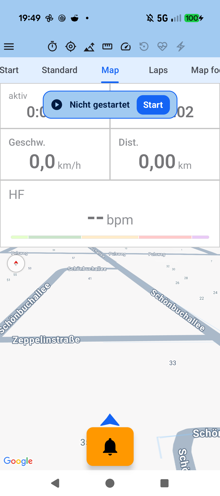
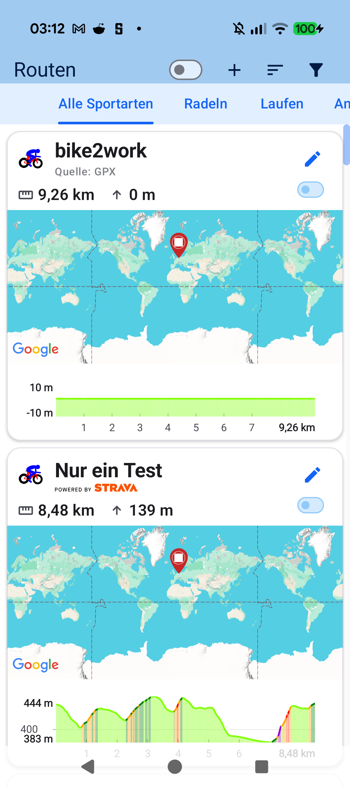
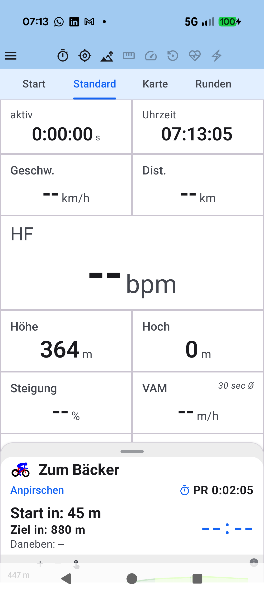

# Chapter 5: Maps, GPX Routes, Climb Profiles & Strava Live Segments

<table>
<tr>
<td width="65%" valign="top" markdown="1">

## 5.1 GPX Route Import & Map Navigation

Navigate planned routes with confidence using intuitive visual guidance powered by Google Maps:

- **Effortless Course Import**:
  - Load `.gpx` tracks directly from downloads, messaging apps, or tour portals (Komoot, Strava, RideWithGPS) into **Routes**.
  - Select any imported route as the active course for your training session.
- **Follow-Track Guidance & Navigation**:
  - The planned route polyline overlays the live map while your real-time GPS position centers with a bearing orientation arrow.
  - **Turn-by-Turn Guidance**: Displays upcoming maneuvers and street turns well in advance.
  - **Off-Route Alerts**: If you take a wrong turn, a directional recovery arrow guides you back onto the designated track.
  - **Return Navigation**: Features such as *"Back to Start"* and *"Navigate Home"* ensure you never lose your bearings.

</td>
<td width="35%" valign="top" align="center">
  
   <em>Live map view with direction arrow & telemetry tiles</em>
</td>
</tr>
</table>

---

<table>
<tr>
<td width="65%" valign="top" markdown="1">

## 5.2 Interactive Climb Elevation Profiles & Gradients

Along your loaded course, **aTrainingTracker** inspects and renders the upcoming terrain relief in advance:

- **Dynamic Elevation Profiling**: Visualizes climbs and descents plotted against total remaining course distance.
- **Gradient Color-Coding**: Flat sections appear in gentle green, moderate inclines in yellow, and steep ramps in vibrant orange and red.
- **Climb Categories**: For synchronized Strava segments, official cycling climb categories (*CAT 4*, *CAT 3*, *CAT 2*, *CAT 1*, *HC*) are imported and highlighted directly along the profile.

</td>
<td width="35%" valign="top" align="center">
  
   <em>Route overview card with color-coded elevation profile</em>
</td>
</tr>
</table>

---

<table>
<tr>
<td width="65%" valign="top" markdown="1">

## 5.3 Real-Time Strava Live Segments

Challenge your personal records and local rivals in real time during outdoor rides:

- **Automatic Proximity Alert**: Approaching a starred Strava segment automatically slides up the live segment countdown sheet (*"Anpirschen"*).
- **Live Comparison**: Track your time delta and distance gap against your personal best (*PR*), the course record (*KOM/QOM*), or target goals.
- **Segment Elevation Scrubbing**: An interactive profile preview illustrates remaining distance and gradient up to the segment's finish line.

</td>
<td width="35%" valign="top" align="center">
  
   <em>Live segment countdown preview with elevation profile</em>
</td>
</tr>
</table>

---

[Previous Chapter: Live Cockpit & Tabs](04-live-cockpit-tabs.md) | [Next Chapter: Automatic Route Clustering](06-automatic-route-clustering.md) | [Back to Table of Contents](index.md)
