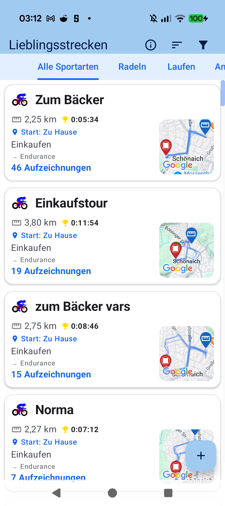
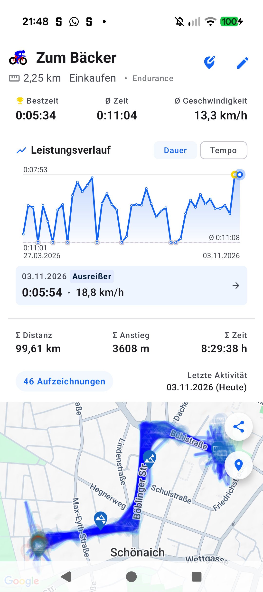

# Chapter 6: Favorite Routes & Automatic Route Clustering

<table>
<tr>
<td width="65%" valign="top" markdown="1">

## 6.1 Automatic Route Recognition Engine

Athletes naturally develop regular training circuits, commuting corridors, and weekend loops. **aTrainingTracker** detects and groups these recurring courses completely autonomously:

- **Autonomous Spatial Clustering**: After completing any workout, an onboard spatial matching engine compares the recorded trajectory against your historic GPS database.
- **Favorite Route (*Lieblingsstrecken*) Grouping**: When identical courses are traversed repeatedly, they are automatically organized into cohesive route clusters.
- **Auto-Naming with Sequential Numbering**:
  - Name a favorite route once (e.g. *"Zum Bäcker"*), and every subsequent session on that trajectory inherits that descriptive title.
  - Sequential workout iteration counters (e.g. *"Zum Bäcker #44"*) and milestone celebration jubilee dialogs track your long-term athletic consistency.

</td>
<td width="35%" valign="top" align="center">
  
   <em>Overview list of automatically clustered favorite routes</em>
</td>
</tr>
</table>

---

<table>
<tr>
<td width="65%" valign="top" markdown="1">

## 6.2 Cluster Detail View & Longitudinal Performance

Tapping on any cluster opens a comprehensive retrospective inspection view:

- **Performance Progression (Duration vs. Pace)**: Compare your completion times and velocities across every historical repetition of that specific loop.
- **Automated Outlier Detection**: Sessions interrupted by excessive traffic, shopping stops, or mechanical punctures are automatically tagged as **Outlier** (*Ausreißer*) to keep benchmark averages clean.
- **Aggregate Analytics & Track Heatmaps**: View best times, lifetime mileage, elevation gain, and repeating polyline heatmaps overlaid directly on the map.

</td>
<td width="35%" valign="top" align="center">
  
   <em>Performance curve with outlier tagging & polyline heatmap</em>
</td>
</tr>
</table>

---

[Previous Chapter: Maps, Routes & Segments](05-maps-routes-climbs-segments.md) | [Next Chapter: Physiology & Training Zones](07-physiology-training-zones.md) | [Back to Table of Contents](index.md)
