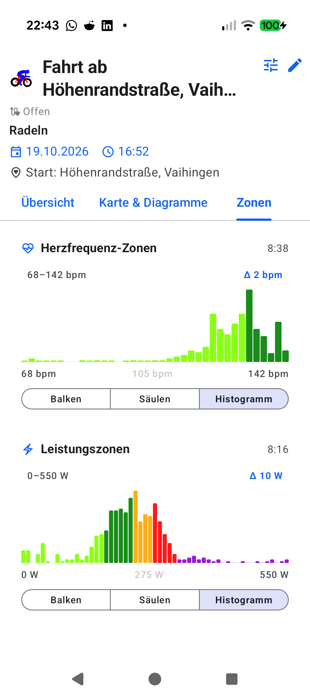
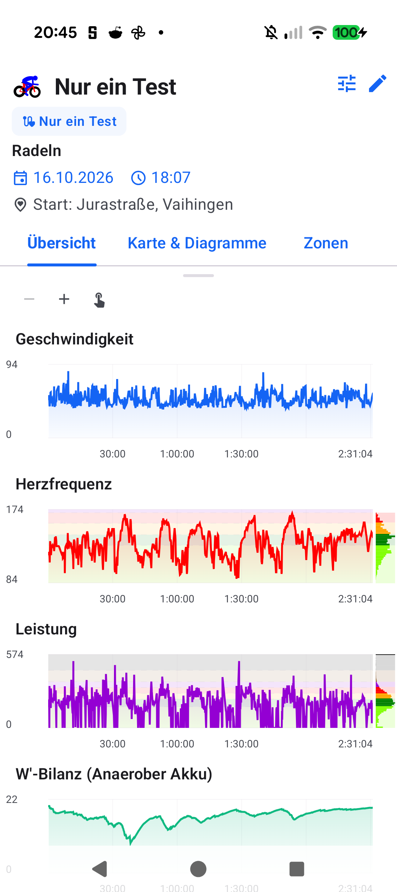
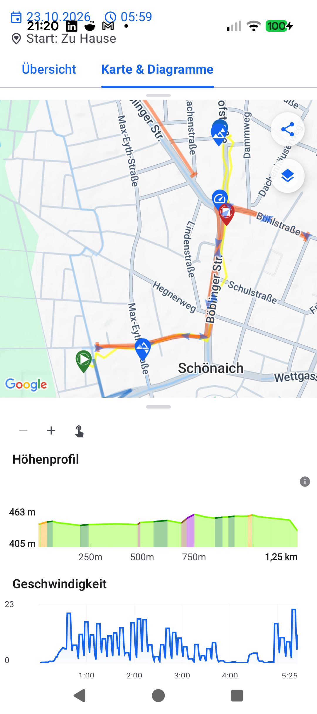

# Chapter 7: Physiology, Training Zones & Performance Analytics

## 7.1 Coggan 7-Zone Power Model, FTP, CP & W'

Structured training demands rigorous physiological anchors. aTrainingTracker incorporates peer-reviewed exercise physiology models directly into your pocket:

- **Functional Threshold Power (FTP)**: Foundation for Coggan's classic 7-zone power distribution (from *Z1 Active Recovery* through *Z4 Lactate Threshold* to *Z7 Neuromuscular Power*).
- **Critical Power (CP) & Anaerobic Work Capacity (W')**:
  - `CP`: True asymptote of sustainable aerobic metabolism.
  - `W'`: Finite anaerobic energy battery available above CP, measured in kilojoules (kJ).
  - **Built-In 2-Point CP/W' Estimator**: Enter any two maximal all-out efforts (e.g. 3-minute and 12-minute bests) to compute CP and W' algebraically.
- **Heart Rate Zones**: Calculated via Karvonen Heart Rate Reserve formulas incorporating resting and maximum pulse rates.

---

## 7.2 Scientific Telemetry Metrics: NP, IF, TSS, W'bal & EF

In real time and post-session analysis, aTrainingTracker surfaces professional athletic metrics:

- **Normalized Power ($\text{NP}$)**: 4th-power weighting reflecting the disproportionate metabolic strain of surges, climbs, and coasting.
- **Intensity Factor ($\text{IF}$)**: Relative training intensity scaled to threshold ($\text{IF} = \text{NP} / \text{FTP}$).
- **Training Stress Score ($\text{TSS}$)**: Universal training dose quantification:
  $$\text{TSS} = \frac{t \times \text{NP} \times \text{IF}}{\text{FTP} \times 3600} \times 100$$
- **Skiba Anaerobic Battery ($W'_{\text{bal}}$)**: Real-time dynamic gauge displaying remaining anaerobic energy and its exponential reconstitution when coasting or cruising below CP.
- **Efficiency Factor ($\text{EF}$) & Aerobic Decoupling ($\text{Pw:Hr}$)**: Ratio of power output to heart rate. An aerobic decoupling index exceeding $5\%$ across steady-state rides highlights cardiac drift and dehydration.

---

## 7.3 Longitudinal Performance Management Chart (PMC)

The integrated PMC monitors seasonal aerobic conditioning using Banister impulse-response mathematics:

- **Fitness ($\text{CTL}$ - Chronic Training Load)**: 42-day exponentially weighted rolling training stress.
- **Fatigue ($\text{ATL}$ - Acute Training Load)**: 7-day rolling acute exhaustion.
- **Form ($\text{TSB}$ - Training Stress Balance)**: Balance metric ($\text{TSB} = \text{CTL} - \text{ATL}$). Positive values represent supercompensated racing form.

---

[Previous: Route Clustering & Intelligence](06-automatic-route-clustering.md) | [Next: Workout Aftermath & Periods 2.0](08-workout-aftermath-periods.md)
