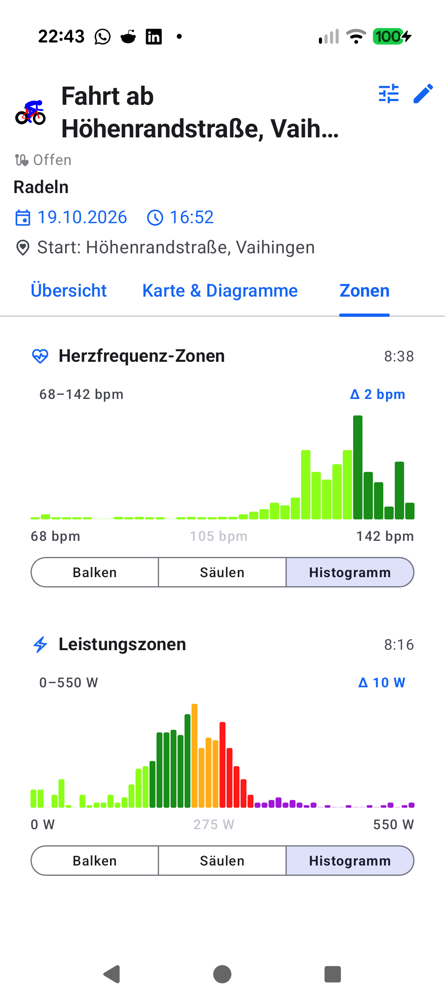

# Chapter 8: Workout Aftermath, Periods 2.0 & Annual Analytics

<table>
<tr>
<td width="65%" valign="top" markdown="1">

## 8.1 Detailed Workout Retrospective & Telemetry Charts

Following session completion and storage, **aTrainingTracker** opens a holistic retrospective breakdown:

- **Three Dedicated Retrospective Tabs**:
  - **Overview**: Core aggregates (duration, distance, climbing, calories, averages, gear).
  - **Map & Charts**: Synchronized time-series curves for speed, elevation, heart rate, power, and Skiba W'bal with synchronized touch scrubbing.
  - **Zones**: Detailed zone breakdowns for heart rate and power, toggleable between **Bars**, **Columns**, and **Histogram**.
- **Manual Laps**: Inspect interval splits and lap triggers with dedicated power, cadence, and heart rate metrics.

</td>
<td width="35%" valign="top" align="center">
  
   <em>Heart rate and power zone distribution in post-workout analysis</em>
</td>
</tr>
</table>

---

<table>
<tr>
<td width="65%" valign="top" markdown="1">

## 8.2 Periods 2.0: Weeks, Months & Years

To understand periodization cycles and long-term athletic volume across calendar boundaries:

- **Calendar Aggregation**: Transition smoothly between weekly, monthly, and yearly summaries.
- **Weekly & Monthly Cards**:
  - Summarizes duration, distance, and elevation gain paired with daily mini-bar charts.
  - Highlights the longest session of each period with route map previews and telemetry summary.
- **Sport Filtering**: Filter by cycling, running, or other activities to isolate specific training disciplines.

</td>
<td width="35%" valign="top" align="center">
  
   <em>Weekly cards with activity bar charts & route maps</em>
</td>
</tr>
</table>

---

<table>
<tr>
<td width="65%" valign="top" markdown="1">

## 8.3 Yearly Activity Contribution Grid

Under the annual view, the **Yearly Activity Grid** visualizes every single calendar day of the training season:

- **Sport Color-Coding**:
  - Contribution cells are color-coded based on the primary discipline of the day: **Blue** for cycling, **Orange** for running, and **Turquoise** for other activities.
- **4-Level Quartile Intensity**:
  - Color saturation scales across four intensity quartiles (from subtle pastel to deep saturated hues).
  - Promotes athletic consistency, turning workout adherence and rest intervals into a compelling visual mosaic.

</td>
<td width="35%" valign="top" align="center">
  
   <em>Annual activity grid with sport-coded 4-quartile intensity blocks</em>
</td>
</tr>
</table>

---

[Previous Chapter: Physiology & Training Zones](07-physiology-training-zones.md) | [Next Chapter: Data Sovereignty & Export](09-export-cloud-sync.md) | [Back to Table of Contents](index.md)
