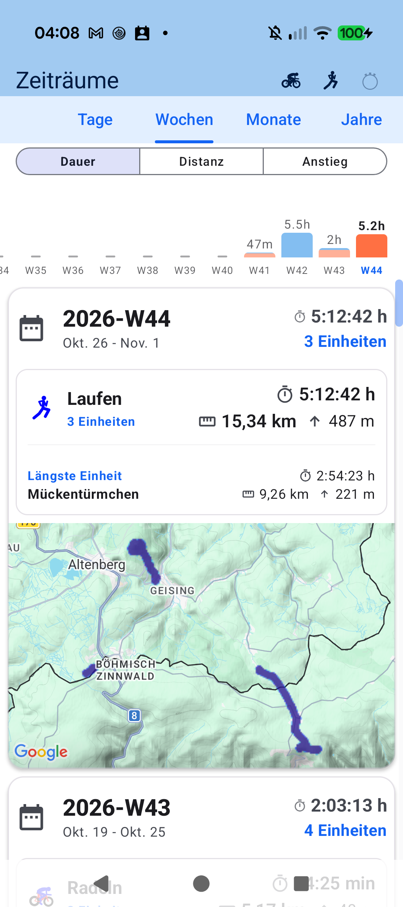
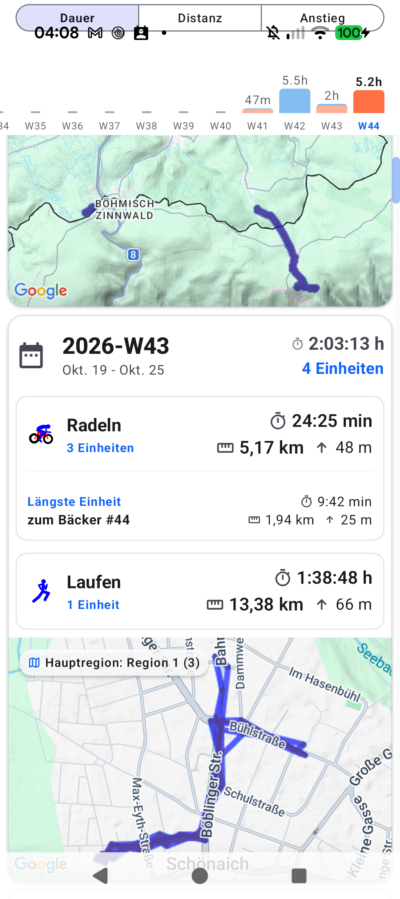
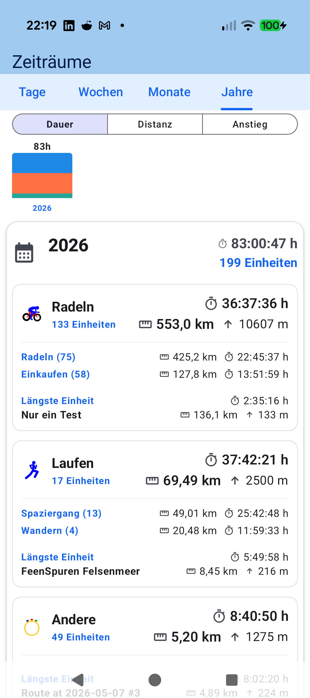

# Chapter 8: Workout Aftermath, Periods 2.0 & Lifetime Statistics

## 8.1 Detailed Workout Inspection & Synchronized Charts

Following session completion, aTrainingTracker opens a holistic retrospective breakdown:

- **Stacked Telemetry Graphs**: Speed/Pace, Heart Rate, Cycling Power, and Altitude profile stack vertically with synchronized touch-scrubbing cursors.
- **Marginal Zone Histograms**: Inspect exact minutes and fractional duration spent within each Coggan power and Karvonen heart rate boundary.
- **Lap Table Splits**: Review manual lap triggers or automated distance splits (e.g. 1 km / 5 km / 5 miles) with cadence, power, and heart rate aggregates.

---

## 8.2 Periods 2.0: Weeks, Months & Years

To understand periodization cycles and long-term training consistency:

- **Calendar Aggregation**: Transition seamlessly across Weeks, Months, and Years.
- **Sport Filtering**: Inspect running mileage versus cycling distance in isolation or combined.
- **Comparative Metrics**: Compare total distance, vertical ascent, moving time, and cumulative Training Stress Score against previous seasons.

---

## 8.3 The Yearly Activity Contribution Heatmap

Inspired by developer contribution matrices, the Yearly Activity Grid plots all 365 days of the calendar year:

- **Shaded Green Cadence**: The saturation of each day box scales directly with training volume or TSS stress achieved on that date.
- **Consistency Verification**: Instantly highlights steady training streaks, recovery weeks, or unforced sedentary gaps.
- **Day Cell Inspection**: Tapping any individual square surfaces the complete session list recorded on that day.

---

[Previous: Physiology & Training Zones](07-physiology-training-zones.md) | [Next: Data Sovereignty & Cloud Sync](09-export-cloud-sync.md)
