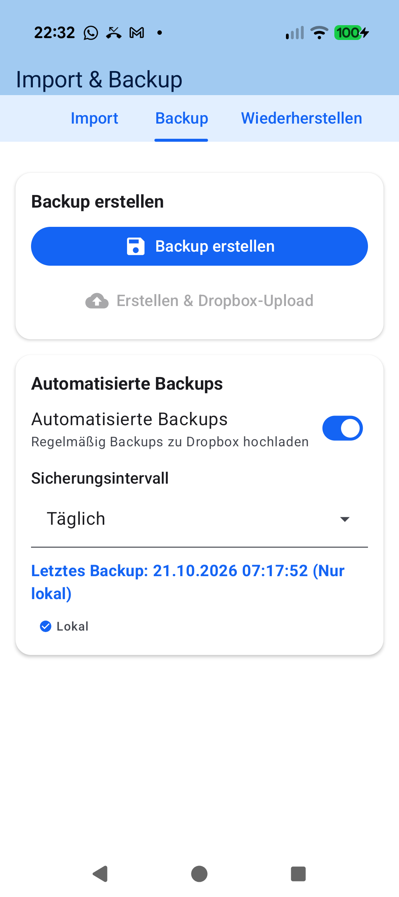
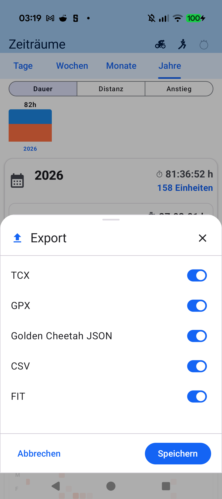
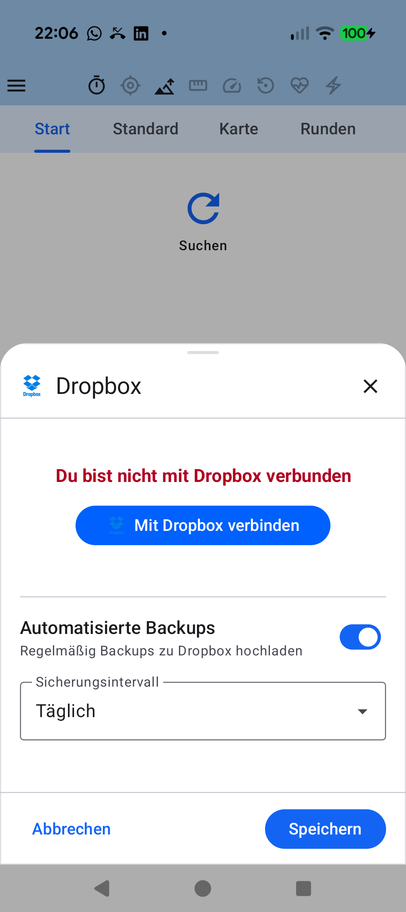

# Chapter 9: Data Sovereignty, Export & Cloud Sync

<table>
<tr>
<td width="65%" valign="top" markdown="1">

## 9.1 100% Local SQLite Data Sovereignty & Import

**aTrainingTracker** is built upon the foundational principle of strict privacy and total digital sovereignty:

- **Zero Mandatory Accounts**: No registration, no email address submission, and no cloud account requirement.
- **Local Database Architecture**: Every workout point, sensor calibration parameter, and gear item is stored inside a standard SQLite database directly on your smartphone.
- **Historic Workout Import**: Easily import existing `.fit`, `.tcx`, and `.gpx` activity files via **Import & Backup** to build your comprehensive history.
- **Zero Third-Party Telemetry**: Your biometric exertion and GPS traces never leave your smartphone without your explicit command.

</td>
<td width="35%" valign="top" align="center">
  
   <em>Import & Backup screen in settings drawer</em>
</td>
</tr>
</table>

---

<table>
<tr>
<td width="65%" valign="top" markdown="1">

## 9.2 Standard Interchange Formats: FIT, TCX, GPX, CSV & Golden Cheetah

Your athletic history remains completely portable across analytical suites and cycling head units via the **Export** dialog:

- **`.fit` (Flexible and Interoperable Data Transfer)**: Industry-standard binary format storing full sensor telemetry (power, cadence, heart rate, pedal balance).
- **`.tcx` (Training Center XML)**: XML schema preserving interval splits and GPS trackpoints.
- **`.gpx` (GPS Exchange Format)**: Universal spatial exchange standard for route planning tools and mapping platforms.
- **`Golden Cheetah JSON`**: Native JSON formatting for desktop analysis in Golden Cheetah.
- **`.csv`**: Raw tabular export for custom data analysis in spreadsheets or Python.

</td>
<td width="35%" valign="top" align="center">
  
   <em>Configuring active output formats in the Export dialog</em>
</td>
</tr>
</table>

---

<table>
<tr>
<td width="65%" valign="top" markdown="1">

## 9.3 Automated Backups (Dropbox / Google Drive) & Strava Sync

Protect your lifetime training achievements against device loss or system resets:

- **Automated Cloud Backups**: Configure scheduled daily backups directly into your personal **Dropbox** or **Google Drive** storage.
- **Wi-Fi Protection**: Conserve cellular data caps by restricting cloud uploads to active Wi-Fi connections.
- **Strava Synchronization**: Connect your Strava account for automatic one-tap uploads after finishing your workout.

</td>
<td width="35%" valign="top" align="center">
  
   <em>Automated database backup configuration to Dropbox</em>
</td>
</tr>
</table>

---

[Previous Chapter: Workout Aftermath & Periods](08-workout-aftermath-periods.md) | [Back to Table of Contents](index.md)
