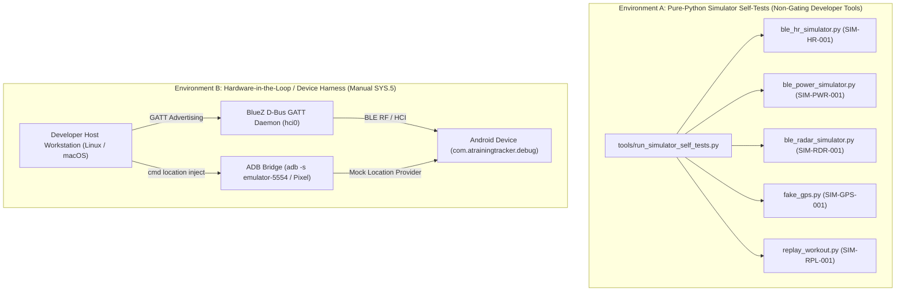

# External System Interfaces & Developer Sensor Simulator Specification

**Document ID**: `DOC-SYS-INT`  
**Version**: 2.1.0  
**ASPICE Process Areas**: SWE.5 / SYS.4 Interface Baseline & Simulator Self-Tests  
**Parent Epic**: [ATT-8138](https://rainerblind.atlassian.net/browse/ATT-8138) (*ASPICE 4.0 Audit Remediation 2026-11*)  
**Requirement Reference**: `REQ-PRO-068` (`REQ-PRO-068.1`–`REQ-PRO-068.4`), `REQ-PRO-112`  
**Test Reference**: `TST-PRO-068` (`TST-PRO-068.1`–`TST-PRO-068.4`), `TST-PRO-112`  
**Status**: Approved  
**Approver**: Rainer Blind (PO)  

---

> [!IMPORTANT]
> **Verification Boundary & Gap Disclosure (`REQ-PRO-112` / `ATT-8157`)**:
> 1. **Developer Simulator Self-Tests Only**: `tools/run_simulator_self_tests.py` (`tools/test_simulator_self_tests.py`) tests the Python simulator modules (`tools/ble_hr_simulator.py`, `tools/ble_power_simulator.py`, `tools/ble_radar_simulator.py`, `tools/fake_gps.py`, `tools/replay_workout.py`) ONLY. It does **NOT** execute the Android APK, ADB, or emulator and is **NOT** a release gate.
> 2. **Automated Android Software Integration**: Real app component boundaries are tested by Robolectric Level 1 suites (`INT-SWE-01..08` in `app/src/test/.../integration/`) and connected CI smoke tests (`AppSmokeAndroidTest.kt`).
> 3. **Physical Hardware System Verification (SYS.5)**: End-to-end RF/BLE/ANT+/GNSS physical sensor integration remains manual hardware-in-the-loop verification under `docs/system/sys_verification_protocol.md`.

## 1. Executive Summary & Purpose

This specification documents:
1. External system interfaces between the Android host application (`SYS-EL-01`) and external sensors (`SYS-EL-02`, `SYS-EL-03`), platform location services (`SYS-EL-04`), and cloud platforms (`SYS-EL-05`), traced to `SYSREQ-TRK-*` and `SYSREQ-DEX-*`.
2. Automated pure-Python developer simulator self-tests (`SIM-HR-001`, `SIM-PWR-001`, `SIM-RDR-001`, `SIM-GPS-001`, `SIM-RPL-001`) executed via `tools/run_simulator_self_tests.py` (`--output`, `--test`) and `tools/test_simulator_self_tests.py`.
3. Interactive hardware-in-the-loop simulator usage for manual developer desk testing against `emulator-5554` or physical Pixel test devices (`SYS.5`).

---

## 2. Simulator Architecture & Verification Boundaries



### 2.1 Test Environments Specification
1. **Pure-Python Simulator Self-Tests (`Environment A`, Non-Gating)**:
   - Runs headless via `python3 tools/run_simulator_self_tests.py` and `python3 -m unittest tools/test_simulator_self_tests.py`.
   - Validates payload builders, kinematics engines, and route geometry inside the Python developer tools ONLY (no Android code under test).
2. **Hardware-in-the-Loop Device Harness (`Environment B`, Manual SYS.5)**:
   - Used interactively by developers/PO against connected physical devices or local emulators with `tools/replay_workout.py`, `tools/ble_radar_simulator.py`, and `tools/fake_gps.py`.

---

## 3. External System Interfaces & Developer Simulator Self-Tests

### `SIM-HR-001`: BLE Heart Rate Simulator (`tools/ble_hr_simulator.py`)
* **Target Interface**: `SYS-IF-01` (BLE GATT Interface, Service `0x180D`, Characteristic `0x2A37`)
* **Interfacing Elements**: `SYS-EL-01` (App Core) $\longleftrightarrow$ `SYS-EL-02` (BLE HRM Peripheral)
* **Traced System Requirements**: `SYSREQ-TRK-001`, `SYSREQ-TRK-002`
* **Simulator Contract Verified**: `build_hr_payload()` flags (`0x00` no-RR, `0x10` uint16 LE RR in `1/1024s`) and `RrSynthesizer.tick_1hz(1000.0)` 60-second phase conservation drift $\le 5.0\text{ ms}$.

### `SIM-PWR-001`: BLE Cycling Power Simulator (`tools/ble_power_simulator.py`)
* **Target Interface**: `SYS-IF-01` (BLE GATT Interface, Service `0x1818`, Char `0x2A63`, `0x2A65`)
* **Interfacing Elements**: `SYS-EL-01` (App Core) $\longleftrightarrow$ `SYS-EL-02` (BLE Power Meter)
* **Traced System Requirements**: `SYSREQ-TRK-001`
* **Simulator Contract Verified**: Feature bitmask (`0x09`), 9-byte measurement frames (`50%`, `54%`, `40%` pedal balance, cumulative crank revs), and `handle_cli_command("w275", ...)`.

### `SIM-RDR-001`: BLE Garmin Varia Radar Simulator (`tools/ble_radar_simulator.py`)
* **Target Interface**: `SYS-IF-01` (BLE Custom GATT `6a4e3200`, Char `6a4e3204`, `6a4e3202`)
* **Interfacing Elements**: `SYS-EL-01` (App Core) $\longleftrightarrow$ `SYS-EL-02` (Garmin Varia Radar)
* **Traced System Requirements**: `SYSREQ-TRK-001`, `SYSREQ-TRK-002`
* **Simulator Contract Verified**: Empty all-clear frame `[0x02, 0x00]`, 11-byte V2 threat packing/unpacking, `compute_advertising_pdu_size()`, `RadarKinematicsEngine.spawn_preset("c")`, `RadarLightMode` opcodes, and `trigger_watchdog_starvation(4.5)`.

### `SIM-GPS-001`: Fake GPS Route Simulator (`tools/fake_gps.py`)
* **Target Interface**: `SYS-IF-03` (Android `LocationManager.GPS_PROVIDER` Mock Injection)
* **Interfacing Elements**: `SYS-EL-01` (App Core) $\longleftrightarrow$ `SYS-EL-04` (OS Location Platform)
* **Traced System Requirements**: `SYSREQ-TRK-003`, `SYSREQ-TRK-004`
* **Simulator Contract Verified**: `get_sample_route("munich")`, `haversine_distance()`, `calculate_bearing()`, `heading_to_cardinal()`, and `compute_off_route_point(..., offset_meters=75.0)`.

### `SIM-RPL-001`: TCX Workout Replay & HRV Curve Simulator (`tools/replay_workout.py`)
* **Target Interface**: `SYS-IF-01` (BLE GATT Replay) & `SYS-IF-03` (ADB GPS Replay)
* **Interfacing Elements**: `SYS-EL-01` (App Core) $\longleftrightarrow$ `SYS-EL-02`, `SYS-EL-04`
* **Traced System Requirements**: `SYSREQ-TRK-001`, `SYSREQ-TRK-003`
* **Simulator Contract Verified**: `build_power_payload()`, `build_hr_payload()`, `build_battery_payload()`, `compute_auto_hrv_params()`, and `haversine_distance()`.

### Unsimulated / Hardware-or-Integration Interfaces (`SYS-IF-02`, `SYS-IF-05`)
* **`SYS-IF-02` (ANT+ Radio IPC via `com.dsi.ant.plugins.antplus`, `SYS-EL-03`, `SYSREQ-TRK-001`)**: Requires physical ANT+ hardware/service; no headless emulator radio exists (`SYS.5` hardware-in-the-loop + Robolectric `INT-SWE-03..04` Java binder/device unit tests).
* **`SYS-IF-05` (Cloud Storage REST APIs / Strava, `SYS-EL-05`, `SYSREQ-DEX-001`, `SYSREQ-DEX-003`)**: Verified at the real uploader/SQLite/OkHttp boundary in `INT-SWE-08` (`CloudHealthConnectIntegrationTest.kt`), not via mock Python dicts.

---

## 4. Execution Procedures

### 4.1 Developer Simulator Self-Tests (Pure Python, Non-Gating)
```bash
python3 tools/run_simulator_self_tests.py --headless --output build/reports/simulator_self_tests.json
python3 -m unittest tools/test_simulator_self_tests.py
```

### 4.2 Interactive Simulator Execution (Desk Testing)
```bash
python3 tools/ble_hr_simulator.py --bpm 140 --rmssd 35.0
python3 tools/ble_power_simulator.py
python3 tools/ble_radar_simulator.py --preset car_passing
python3 tools/fake_gps.py --sample munich --speed 25
```

---

## 5. External Interface Traceability Matrix

| Interface | Interfacing Elements | System Requirements | Automated App Coverage | Simulator Tool / Self-Test (Non-Gating) |
| :--- | :--- | :--- | :--- | :--- |
| `SYS-IF-01` (BLE GATT) | `SYS-EL-01` $\longleftrightarrow$ `SYS-EL-02` | `SYSREQ-TRK-001`, `SYSREQ-TRK-002` | `INT-SWE-03..04` | `python3 tools/run_simulator_self_tests.py --test SIM-HR-001` / `SIM-PWR-001` / `SIM-RDR-001` |
| `SYS-IF-02` (ANT+ IPC) | `SYS-EL-01` $\longleftrightarrow$ `SYS-EL-03` | `SYSREQ-TRK-001` | `INT-SWE-03..04` | Manual HIL (`SYS.5`) |
| `SYS-IF-03` (GNSS / Loc) | `SYS-EL-01` $\longleftrightarrow$ `SYS-EL-04` | `SYSREQ-TRK-003`, `SYSREQ-TRK-004` | `INT-SWE-04`, `AppSmokeAndroidTest.kt` | `python3 tools/run_simulator_self_tests.py --test SIM-GPS-001` / `SIM-RPL-001` |
| `SYS-IF-05` (Cloud REST) | `SYS-EL-01` $\longleftrightarrow$ `SYS-EL-05` | `SYSREQ-DEX-001`, `SYSREQ-DEX-003` | `INT-SWE-08` | N/A (Real OkHttp `Interceptor` test) |

---

## 6. Release Gate Policy (`REQ-PRO-072`, `REQ-PRO-112`)
* Developer simulator self-tests (`tools/run_simulator_self_tests.py`) exit `0` when all 5 Python simulator self-tests pass, and are **never** a blocking release gate or substitute for Android execution.
* Release candidate gating (`docs/releases/<tag>/verification_summary.md` + `docs/releases/<tag>/sys_verification_record.md`) relies strictly on Gradle unit/integration suites (`INT-SWE-01..08`), CI `AppSmokeAndroidTest.kt`, and signed physical hardware-in-the-loop `SYS.5` verification.

---

## Change History

| Version | Date | Author | Ticket | Summary of Changes |
| :--- | :--- | :--- | :--- | :--- |
| `2.0.0` | 2026-11-16 | AI Agent | `ATT-6142` | Prior system specification baseline. |
| `2.1.0` | 2026-11-17 | AI Agent (`ATT-8164`) | `ATT-8164` | Standardized `DOC-SYS-INT` header, bumped version, reset status to `Reviewed` (`Pending PO Sign-Off`). |
