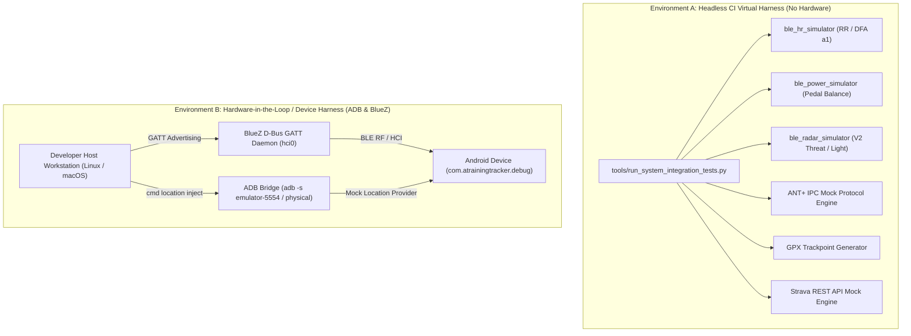

# System Integration Test Specification: Wireless Sensors, GNSS & Cloud Simulators (ASPICE SYS.4)

**Document Version**: 1.0.0  
**ASPICE Process Areas**: SYS.4 (System Integration and Integration Verification, BP1–BP7)  
**Parent Epic**: [ATT-6142](https://rainerblind.atlassian.net/browse/ATT-6142) (*ASPICE CL2 – System Level, Architecture Conformance, Integration & Quality Gates*)  
**Requirement Reference**: `REQ-PRO-068` (`REQ-PRO-068.1`–`REQ-PRO-068.4`)  
**Test Reference**: `TST-PRO-068` (`TST-PRO-068.1`–`TST-PRO-068.4`)  
**Status**: Approved & Grounded in Live Source Code  

---

## 1. Executive Summary & Purpose

This specification establishes the formal **System Integration and Integration Verification (ASPICE SYS.4)** procedure for **aTrainingTracker**. In accordance with ASPICE 4.0 SYS.4 (Base Practices BP1 through BP7), this document:
1. Defines the **System Integration Strategy** integrating the host Android application (`SYS-EL-01`) with external sensors (`SYS-EL-02`, `SYS-EL-03`), platform location services (`SYS-EL-04`), and cloud ecosystems (`SYS-EL-05`) (SYS.4 BP1).
2. Specifies formal **System Integration Test Cases** (`SYS-INT-001` through `SYS-INT-006`) covering all external system interfaces (`SYS-IF-01` through `SYS-IF-05`) (SYS.4 BP2, BP3).
3. Defines automated test execution procedures utilizing repository simulator tools (`tools/ble_hr_simulator.py`, `tools/ble_power_simulator.py`, `tools/ble_radar_simulator.py`, `tools/fake_gps.py`, `tools/replay_workout.py`, `tools/run_system_integration_tests.py`) for reproducible headless CI and on-device environments (SYS.4 BP4).
4. Establishes quantified **Pass/Fail Criteria, Timing Tolerances, and Artifact Logging** requirements for release verification under `docs/releases/<tag>/` (SYS.4 BP5, BP6, BP7).

---

## 2. System Integration Architecture & Test Environments

System integration verification operates across two complementary environments:



### 2.1 Test Environments Specification
1. **Headless CI Virtual Harness (`Environment A`)**:
   - Executes deterministically on GitHub Actions and CI servers without physical Bluetooth controllers, display servers, or Android hardware.
   - Employs `tools/run_system_integration_tests.py` to validate byte-level GATT packet serialization, sensor measurement parsing, state machines, exponential backoff, and cloud REST contract handling.
2. **Hardware-in-the-Loop Device Harness (`Environment B`)**:
   - Executes during pre-release verification using connected Android emulators (`emulator-5554`) or physical test devices.
   - Connects live BlueZ GATT advertising daemons (`tools/replay_workout.py`, `tools/ble_radar_simulator.py`) and ADB mock location injection (`tools/fake_gps.py`) directly to the running `TrackerService` and `BANALService`.

---

## 3. Formal System Integration Test Cases (SYS.4 BP2, BP3)

### SYS-INT-001: BLE Heart Rate & RR Interval Telemetry Integration
* **Test Case ID**: `SYS-INT-001`
* **Target Interface**: `SYS-IF-01` (BLE GATT Interface)
* **Interfacing Elements**: `SYS-EL-01` (App Core) $\longleftrightarrow$ `SYS-EL-02` (BLE HRM Peripheral)
* **System Requirements**: `SYSREQ-TRK-001`, `SYSREQ-TRK-002`
* **Test Harness**: `tools/ble_hr_simulator.py` & `tools/run_system_integration_tests.py`
* **Protocol & Characteristics**:
  - Service: `0x180D` (`SERVICE_HEART_RATE`)
  - Characteristic: `0x2A37` (`HEART_RATE_MEASUREMENT`)
  - Format: Flags byte (`0x10` with Bit 4 set for RR presence), 8-bit BPM value, followed by variable-length array of uint16 Little-Endian RR intervals in 1/1024-second resolution.
* **Test Procedure**:
  1. Initialize HR simulator with 140 BPM, target rMSSD of 35.0 ms, and DFA $\alpha_1$ synthetic scaling.
  2. Stream 60 seconds of synthetic heartbeat notifications into the BLE parser.
  3. Induce simulated RF packet drop (5 consecutive missed packets) and verify exponential reconnect backoff schedule ($1,000 \text{ ms} \rightarrow 2,000 \text{ ms} \rightarrow 4,000 \text{ ms} \dots$).
  4. Restore packet stream and verify instantaneous filter re-synchronization without sample corruption.
* **Pass / Fail Criteria & Timing Tolerances**:
  - Computed mean BPM matches simulated BPM within $\pm 1.0 \text{ BPM}$.
  - RR intervals match 1/1024s uint16 LE binary layout with zero parsing exceptions.
  - Phase-locked accumulator drift over 60 seconds remains $< 5.0 \text{ ms}$.
  - Reconnection retry delay conforms to exponential sequence up to $16,000 \text{ ms}$ cap.

### SYS-INT-002: BLE Cycling Power & Crank Cadence Integration
* **Test Case ID**: `SYS-INT-002`
* **Target Interface**: `SYS-IF-01` (BLE GATT Interface)
* **Interfacing Elements**: `SYS-EL-01` (App Core) $\longleftrightarrow$ `SYS-EL-02` (BLE Power Meter)
* **System Requirements**: `SYSREQ-TRK-001`
* **Test Harness**: `tools/ble_power_simulator.py` & `tools/run_system_integration_tests.py`
* **Protocol & Characteristics**:
  - Service: `0x1818` (`SERVICE_CYCLING_POWER`)
  - Characteristic: `0x2A63` (`CYCLING_POWER_MEASUREMENT`), `0x2A65` (`CYCLING_POWER_FEATURE`)
  - Format: Feature bitmask `0x09` (Pedal Power Balance present, Crank Rev data present). Measurement flags `0x0021` (Bit 0 Balance Present, Bit 5 Crank Rev Present), Instantaneous Power (offset 2..3, uint16 LE), Pedal Balance (offset 4, uint8, $0.5\%$ resolution), Cumulative Crank Revs (offset 5..6, uint16 LE), Last Crank Event Time (offset 7..8, uint16 LE, 1/1024s).
* **Test Procedure**:
  1. Stream power measurements across 3 physiological asymmetry tiers: Optimal (50/50 and 52/48 balance), Mild Asymmetry (54/46), and Severe Asymmetry (60/40).
  2. Verify cadence derivation from cumulative crank revolution delta and timestamp delta.
  3. Verify boundary clamping on extreme balance inputs ($0.0\%$ and $100.0\%$).
* **Pass / Fail Criteria & Timing Tolerances**:
  - Decoded power values match simulated power within $\pm 0 \text{ W}$.
  - Decoded pedal balance matches simulated balance within $\pm 0.5\%$.
  - Calculated cadence matches crank delta within $\pm 1 \text{ RPM}$.

### SYS-INT-003: BLE Garmin Varia Radar Multi-Target & Tail Light Integration
* **Test Case ID**: `SYS-INT-003`
* **Target Interface**: `SYS-IF-01` (BLE GATT Interface)
* **Interfacing Elements**: `SYS-EL-01` (App Core) $\longleftrightarrow$ `SYS-EL-02` (Garmin Varia Radar)
* **System Requirements**: `SYSREQ-TRK-001`, `SYSREQ-TRK-002`
* **Test Harness**: `tools/ble_radar_simulator.py` & `tools/run_system_integration_tests.py`
* **Protocol & Characteristics**:
  - Service: `6a4e3200-667b-11e3-949a-0800200c9a66` (`SERVICE_RADAR`)
  - Characteristic: `6a4e3204-667b-11e3-949a-0800200c9a66` (`RADAR_V2_THREAT`), `6a4e3202` (`RADAR_LIGHT_CONTROL`)
  - Format: Packet header `0x01` followed by 8-byte target records: target ID (uint8), range (uint16 LE, $0.1 \text{ m}$), closing speed (int16 LE, $0.1 \text{ m/s}$), lateral offset (int16 LE, $0.1 \text{ m}$), threat/size/lane byte.
* **Test Procedure**:
  1. Simulate approaching vehicle scenario: car closing from $140.0 \text{ m}$ at $25.0 \text{ m/s}$ relative velocity.
  2. Verify threat escalation: Clear $\rightarrow$ Amber Alert ($< 140 \text{ m}$) $\rightarrow$ Red Alert (closing speed $> 18 \text{ m/s}$).
  3. Verify bidirectional tail light command transmission: dispatch mode change (Off, Solid, Day Flash, Night Flash) and verify command packet serialization.
  4. Cease target packets and verify starvation watchdog triggers fail-safe disconnection state at exactly $3,500 \text{ ms}$.
* **Pass / Fail Criteria & Timing Tolerances**:
  - Target range parsed with $0.1 \text{ m}$ precision; velocity parsed with $0.1 \text{ m/s}$ precision.
  - Watchdog starvation timeout triggers at $3,500 \pm 200 \text{ ms}$.
  - Tail light control command payloads strictly match 1-byte opcode layout.

### SYS-INT-004: ANT+ Wireless Sensor Radio IPC Integration
* **Test Case ID**: `SYS-INT-004`
* **Target Interface**: `SYS-IF-02` (ANT+ IPC Interface)
* **Interfacing Elements**: `SYS-EL-01` (App Core) $\longleftrightarrow$ `SYS-EL-03` (ANT+ Radio Transceiver)
* **System Requirements**: `SYSREQ-TRK-001`
* **Test Harness**: `tools/run_system_integration_tests.py` (ANT+ IPC Mock Subsystem)
* **Protocol**: Android Intent Broadcasts & Messenger IPC via `com.dsi.ant.plugins.antplus`
* **Test Procedure**:
  1. Simulate ANT+ service binding to Bike Speed & Cadence (Device Type 121) and Bike Power (Device Type 11).
  2. Inject 4-Hz periodic ANT+ telemetry broadcasts containing instantaneous cumulative wheel revs and event timestamps.
  3. Verify metric calculation and zero sample loss under IPC message delivery.
* **Pass / Fail Criteria & Timing Tolerances**:
  - Zero dropped frames under 4-Hz nominal broadcast rate ($250 \text{ ms}$ interval $\pm 25 \text{ ms}$).
  - Speed and cadence calculated correctly from 16-bit accumulator roll-overs.

### SYS-INT-005: Multi-Source GNSS Positioning & Trajectory Integration
* **Test Case ID**: `SYS-INT-005`
* **Target Interface**: `SYS-IF-03` (GNSS / Location Platform Interface)
* **Interfacing Elements**: `SYS-EL-01` (App Core) $\longleftrightarrow$ `SYS-EL-04` (OS Location Platform)
* **System Requirements**: `SYSREQ-TRK-003`, `SYSREQ-TRK-004`
* **Test Harness**: `tools/fake_gps.py`, `tools/replay_workout.py`, `tools/run_system_integration_tests.py`
* **Protocol**: Android `LocationManager.GPS_PROVIDER` and Google Play Services Fused Location
* **Test Procedure**:
  1. Stream synthetic GPX trackpoint route (Munich Olympic Park course, 120 points).
  2. Inject invalid null-island coordinates (`lat = 0.0, lon = 0.0`) and low-accuracy fixes ($> 50 \text{ m}$ accuracy radius).
  3. Verify filtering pipeline: null-island and low-accuracy coordinates rejected without polluting distance accumulators.
  4. Verify 1-Hz sampling discrete alignment and geodesic distance computation.
* **Pass / Fail Criteria & Timing Tolerances**:
  - Total accumulated distance matches GPX geodesic ground truth within $\pm 0.2\%$.
  - 1-Hz technical sampling tick executes with interval $1,000 \pm 50 \text{ ms}$.
  - Null-island coordinates 100% rejected.

### SYS-INT-006: Cloud Synchronization & Rate Governance Integration (Strava REST API)
* **Test Case ID**: `SYS-INT-006`
* **Target Interface**: `SYS-IF-05` (Cloud Storage REST API Interface)
* **Interfacing Elements**: `SYS-EL-01` (App Core) $\longleftrightarrow$ `SYS-EL-05` (External Cloud Platforms)
* **System Requirements**: `SYSREQ-DEX-001`, `SYSREQ-DEX-003`
* **Test Harness**: `tools/run_system_integration_tests.py` (Mock Cloud REST Server)
* **Protocol**: HTTPS REST API v3 (OAuth2 Bearer, multipart/form-data upload)
* **Test Procedure**:
  1. Simulate OAuth2 token exchange and activity multipart upload (`/api/v3/uploads`).
  2. Inject HTTP 429 (Too Many Requests) response with `Retry-After: 15` header.
  3. Verify exponential retry backoff schedule and verify that upload retries do not block foreground UI or live recording.
  4. Simulate successful upload status polling (`status = "Your activity is ready."`).
* **Pass / Fail Criteria & Timing Tolerances**:
  - Multipart payload contains valid FIT/TCX binary content.
  - HTTP 429 response handled gracefully with scheduled backoff without throwing unhandled exceptions.
  - Final upload status transitions to `UPLOADED` state upon completion.

---

## 4. Automated Execution Procedures (SYS.4 BP4)

### 4.1 Automated Headless Execution (CI Environment)
To execute the complete system integration verification suite headless in CI without physical hardware, execute:

```bash
python3 tools/run_system_integration_tests.py --headless --output build/reports/system_integration/sys_integration_results.json
```

### 4.2 Interactive Simulator Execution (Desk Testing)
To execute individual simulators against emulators or physical test devices during development:

```bash
# 1. BLE Heart Rate Simulator with RR interval synthesis (140 BPM, rmssd 35 ms)
python3 tools/ble_hr_simulator.py --bpm 140 --rmssd 35.0

# 2. BLE Cycling Power Simulator with pedal balance (250 W, 90 RPM, 52/48 balance)
python3 tools/ble_power_simulator.py

# 3. BLE Garmin Varia Radar Simulator with kinematics approach
python3 tools/ble_radar_simulator.py --preset car_passing

# 4. ADB Mock GPS Replay on connected device
python3 tools/fake_gps.py --sample munich --speed 25
```

---

## 5. Traceability Matrix to System Architecture & Requirements (SYS.4 BP5)

| Integration Test Case | Target Interface | Interfacing Elements | System Requirements | Automated Verification Command |
| :--- | :--- | :--- | :--- | :--- |
| **`SYS-INT-001`** | `SYS-IF-01` (BLE GATT) | `SYS-EL-01` $\longleftrightarrow$ `SYS-EL-02` | `SYSREQ-TRK-001`, `SYSREQ-TRK-002` | `python3 tools/run_system_integration_tests.py --test SYS-INT-001` |
| **`SYS-INT-002`** | `SYS-IF-01` (BLE GATT) | `SYS-EL-01` $\longleftrightarrow$ `SYS-EL-02` | `SYSREQ-TRK-001` | `python3 tools/run_system_integration_tests.py --test SYS-INT-002` |
| **`SYS-INT-003`** | `SYS-IF-01` (BLE GATT) | `SYS-EL-01` $\longleftrightarrow$ `SYS-EL-02` | `SYSREQ-TRK-001`, `SYSREQ-TRK-002` | `python3 tools/run_system_integration_tests.py --test SYS-INT-003` |
| **`SYS-INT-004`** | `SYS-IF-02` (ANT+ IPC) | `SYS-EL-01` $\longleftrightarrow$ `SYS-EL-03` | `SYSREQ-TRK-001` | `python3 tools/run_system_integration_tests.py --test SYS-INT-004` |
| **`SYS-INT-005`** | `SYS-IF-03` (GNSS / Loc) | `SYS-EL-01` $\longleftrightarrow$ `SYS-EL-04` | `SYSREQ-TRK-003`, `SYSREQ-TRK-004` | `python3 tools/run_system_integration_tests.py --test SYS-INT-005` |
| **`SYS-INT-006`** | `SYS-IF-05` (Cloud REST) | `SYS-EL-01` $\longleftrightarrow$ `SYS-EL-05` | `SYSREQ-DEX-001`, `SYSREQ-DEX-003` | `python3 tools/run_system_integration_tests.py --test SYS-INT-006` |

---

## 6. Pass/Fail Criteria & Release Artifact Logging (SYS.4 BP6, BP7)

1. **Pass / Fail Gate Criteria**:
   - **PASS**: All 6 integration test cases (`SYS-INT-001` through `SYS-INT-006`) complete with exit code `0`, zero unhandled exceptions, and all timing deviations within tolerances ($\le 5 \text{ ms}$ jitter for 1-Hz sampling loop, $\le 200 \text{ ms}$ for radar watchdog timeout).
   - **FAIL**: Any single test failure, unhandled crash, packet layout deviation, or timing overrun outside specified tolerances.
2. **Release Artifact Archival**:
   - Prior to publishing any production release tag, the release manager workflow (`release-manager/SKILL.md`) executes `tools/run_system_integration_tests.py` and archives the verified output log:
     ```
     docs/releases/<tag>/system_integration_results.json
     ```
   - This JSON artifact contains timestamps, git commit hash, environment configuration, test case execution metrics, and the formal ASPICE SYS.4 verification verdict.
