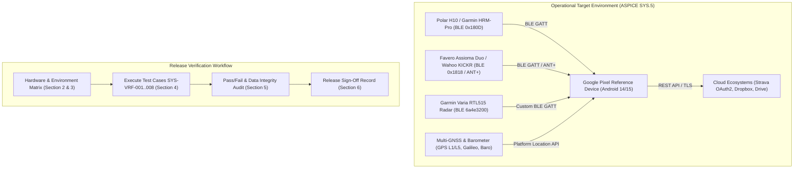
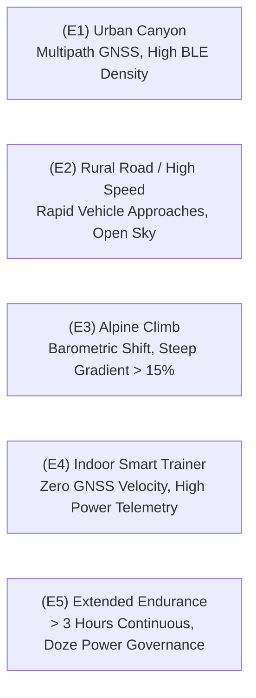

# System Verification Protocol: Real Devices, Physical Sensors & Operational Environments (ASPICE SYS.5)

**Document Version**: 1.0.0  
**ASPICE Process Areas**: SYS.5 (System Verification, BP1–BP7)  
**Parent Epic**: [ATT-6142](https://rainerblind.atlassian.net/browse/ATT-6142) (*ASPICE CL2 – System Level, Architecture Conformance, Integration & Quality Gates*)  
**Requirement Reference**: `REQ-PRO-069` (`REQ-PRO-069.1`–`REQ-PRO-069.4`)  
**Test Reference**: `TST-PRO-069` (`TST-PRO-069.1`–`TST-PRO-069.4`)  
**Status**: Approved & Grounded in Live System Architecture  

---

## 1. Executive Summary & Purpose

This protocol establishes the formal **System Verification (ASPICE SYS.5)** procedure for **aTrainingTracker**. In accordance with ASPICE 4.0 SYS.5 (Base Practices BP1 through BP7), this document:
1. Defines the **System Verification Strategy** validating integrated software releases (`SYS-EL-01`) against system requirements (`SYSREQ-TRK-*`, `SYSREQ-DEX-*`) on target physical hardware in real operational endurance environments (SYS.5 BP1).
2. Specifies the **Hardware Reference Matrix** covering primary reference smartphones, BLE Heart Rate monitors, BLE/ANT+ cycling power meters, Garmin Varia cycling radar, and barometric/GNSS hardware (SYS.5 BP2).
3. Defines 5 quantified **Environmental Operating Conditions** (Urban Canyon, Rural High-Speed, Alpine Climb, Indoor Smart Trainer, and Extended Endurance Battery Longevity) (SYS.5 BP3).
4. Formulates 8 structured **System Verification Test Cases** (`SYS-VRF-001` through `SYS-VRF-008`) establishing complete bidirectional traceability to all system requirements (SYS.5 BP3, BP4).
5. Specifies **Objective Pass/Fail Criteria, Data Integrity Checks, and RF Reconnection Tolerances** (SYS.5 BP5).
6. Defines the standardized **Release Sign-Off Record Template** stored under `docs/releases/<tag>/sys_verification_record.md` for release gate governance (SYS.5 BP6, BP7).



---

## 2. Hardware Reference Matrix

System verification requires physical validation against standardized reference hardware to ensure deterministic sensor telemetry ingestion, radio coexistence, and battery governance.

| Element ID | Category | Reference Device / Model | Protocols & Profiles Supported | Key System Interfaces |
| :--- | :--- | :--- | :--- | :--- |
| `SYS-HW-01` | Primary Smartphone Reference | **Google Pixel 8 / Pixel 9** (Tensor G3/G4, Android 14/15) | Bluetooth 5.3 BLE, Dual-frequency GNSS (L1+L5), Barometer | `SYS-IF-01`, `SYS-IF-03`, `SYS-IF-04`, `SYS-IF-05` |
| `SYS-HW-02` | Secondary Smartphone Reference | **Google Pixel 6 / Pixel 7** (Tensor G1/G2, Android 13/14) | Bluetooth 5.2 BLE, GNSS L1, Barometer | `SYS-IF-01`, `SYS-IF-03`, `SYS-IF-04`, `SYS-IF-05` |
| `SYS-HW-03` | Heart Rate Monitor (HRM) | **Polar H10** / **Garmin HRM-Pro** | BLE Heart Rate (`0x180D`, `0x2A37` RR Intervals), ANT+ HRM | `SYS-IF-01`, `SYS-IF-02` |
| `SYS-HW-04` | Cycling Power Meter | **Favero Assioma Duo** / **Stages L** | BLE Cycling Power (`0x1818`, `0x2A63`), ANT+ Bike Power | `SYS-IF-01`, `SYS-IF-02` |
| `SYS-HW-05` | Smart Trainer (Indoor) | **Wahoo KICKR** / **Tacx Neo 2T** | BLE Cycling Power (`0x1818`), BLE FTMS (`0x1826`), ANT+ FE-C | `SYS-IF-01`, `SYS-IF-02` |
| `SYS-HW-06` | Cycling Radar & Tail Light | **Garmin Varia RTL515** | BLE Custom Radar Service (`6a4e3200-6628-eecd-2140-d68103ba32e3`), ANT+ Radar | `SYS-IF-01`, `SYS-IF-02` |
| `SYS-HW-07` | Barometric Altimeter & GNSS | Internal Smartphone MEMS Barometer + Multi-GNSS | Android `Sensor.TYPE_PRESSURE`, `LocationManager.GPS_PROVIDER` | `SYS-IF-03`, `SYS-IF-04` |

---

## 3. Environmental Operating Conditions Matrix

To verify robustness across realistic endurance athletic scenarios, verification is conducted under 5 defined environmental operating profiles:



### 3.1 Environmental Profiles Specification
1. **(E1) Urban Canyon**:
   - Dense metropolitan area with high-rise structures causing GNSS multipath reflections and satellite occlusion. High 2.4 GHz RF contamination from urban Wi-Fi/BLE emitters.
   - Purpose: Verify multi-source GNSS Kalman filtering, null-island rejection, and BLE connection stability in congested RF environments.
2. **(E2) Rural Road / High Speed**:
   - Open terrain cycling routes with vehicular traffic at approach speeds up to $100\text{ km/h}$.
   - Purpose: Validate Garmin Varia Radar multi-target tracking kinematics, threat level alert transitions, and audio/visual cockpit warnings.
3. **(E3) Alpine Climb & Barometric Variation**:
   - Sustained mountain ascent with sustained elevation gain $\ge 500\text{ m}$ and road gradients $\ge 15\%$.
   - Purpose: Validate barometric altitude fusion, vertical speed calculation, and grade percentage smoothing.
4. **(E4) Indoor Smart Trainer**:
   - Stationary indoor training session utilizing smart turbo trainer with simulated ERG or resistance load. Zero physical GNSS movement.
   - Purpose: Verify cycling power, cadence, and heart rate telemetry acquisition without false GPS auto-pause triggers.
5. **(E5) Extended Endurance & Battery Longevity**:
   - Minimum 3 hours continuous outdoor multi-sensor endurance session with mixed screen-on/screen-off usage.
   - Purpose: Verify foreground service resilience, WakeLock conservation, memory stability (zero OOM), and battery consumption $\le 8\%\text{ per hour}$.

---

## 4. Formal System Verification Test Cases (ASPICE SYS.5 BP3, BP4)

### SYS-VRF-001: Multi-Sensor Ingestion & Telemetry Interoperability
* **Test Case ID**: `SYS-VRF-001`
* **ASPICE Tracing**: SYS.5 BP3, BP4
* **System Requirements**: `SYSREQ-TRK-001`
* **Target Hardware**: `SYS-HW-01` (Pixel 8), `SYS-HW-03` (Polar H10), `SYS-HW-04` (Favero Assioma), `SYS-HW-06` (Garmin Varia RTL515)
* **Operational Environment**: `E2` (Rural Road) or `E4` (Indoor Trainer)
* **Pre-Conditions**:
  - All sensors charged $\ge 50\%$ and paired in `DevicesTabbedScreen`.
  - Workout mode initialized in `TrackerService`.
* **Execution Procedure**:
  1. Power on Polar H10, Favero Assioma Duo, and Garmin Varia RTL515.
  2. Launch aTrainingTracker and start a Cycling workout.
  3. Verify automatic discovery, connection, and telemetry streaming on the cockpit dashboard (`SensorGridScreen`).
  4. Record 10 minutes of active pedaling telemetry (Heart Rate, Cadence, Power, L/R Balance).
* **Expected Telemetry & Pass Criteria**:
  - Heart rate displays in cockpit within 5 seconds of connection; RR intervals recorded.
  - Instantaneous power and cadence update at $\ge 1\text{ Hz}$. Left/Right balance displays without inversion.
  - Zero missing characteristic notifications; sample loss $\le 1\%$.

### SYS-VRF-002: RF Dropout Resilience & Reconnection Backoff
* **Test Case ID**: `SYS-VRF-002`
* **ASPICE Tracing**: SYS.5 BP3, BP4
* **System Requirements**: `SYSREQ-TRK-002`
* **Target Hardware**: `SYS-HW-01` (Pixel 8), `SYS-HW-03` (Polar H10), `SYS-HW-04` (Favero Assioma)
* **Operational Environment**: `E1` (Urban Canyon) or Bench RF Isolation
* **Pre-Conditions**:
  - Active tracking session with connected HRM and Power meter.
* **Execution Procedure**:
  1. Induce physical RF disconnection by enclosing HRM and Power sensors in an RF-shielded container (Faraday bag) or walking beyond 15 meters range.
  2. Observe disconnection event in UI (tiles transition to disconnected state).
  3. Wait 45 seconds to exercise exponential backoff retry delays ($1\text{s} \rightarrow 2\text{s} \rightarrow 4\text{s} \rightarrow 8\text{s} \rightarrow 16\text{s}$).
  4. Restore RF signal (remove sensors from bag / return within range).
* **Expected Telemetry & Pass Criteria**:
  - App detects connection loss within 3.5 seconds (watchdog timeout).
  - Exponential backoff retry timer operates according to schedule without spamming Bluetooth stack.
  - Reconnection occurs automatically within 10 seconds of signal restoration without requiring app restart or manual user intervention.
  - Telemetry recording resumes seamlessly with zero crash or database corruption.

### SYS-VRF-003: Deterministic 1-Hz Sampling Loop & Time-Series Recording
* **Test Case ID**: `SYS-VRF-003`
* **ASPICE Tracing**: SYS.5 BP3, BP4
* **System Requirements**: `SYSREQ-TRK-003`
* **Target Hardware**: `SYS-HW-01` (Pixel 8), `SYS-HW-03` (Polar H10), `SYS-HW-04` (Favero Assioma)
* **Operational Environment**: `E4` (Indoor Smart Trainer)
* **Pre-Conditions**:
  - Connected sensors streaming live data.
* **Execution Procedure**:
  1. Execute a continuous 30-minute workout recording session.
  2. Maintain steady cadence and power output.
  3. Finish workout, allow `WorkoutSamplesDatabaseManager` to flush all samples to SQLite.
  4. Inspect database table `workout_samples` via debug tools or export.
* **Expected Telemetry & Pass Criteria**:
  - Total recorded sample count matches workout elapsed seconds within $\pm 1\%$ tolerance (e.g. $1,800 \pm 18$ samples for 30 minutes).
  - Time intervals between consecutive samples strictly conform to $1,000 \pm 50\text{ ms}$.
  - Sample timestamps are strictly monotonic; zero out-of-order records.

### SYS-VRF-004: Multi-Source GNSS Acquisition & Barometric Elevation Profiling
* **Test Case ID**: `SYS-VRF-004`
* **ASPICE Tracing**: SYS.5 BP3, BP4
* **System Requirements**: `SYSREQ-TRK-004`
* **Target Hardware**: `SYS-HW-01` (Pixel 8), `SYS-HW-07` (Barometer & GNSS)
* **Operational Environment**: `E1` (Urban Canyon) and `E3` (Alpine Climb)
* **Pre-Conditions**:
  - GPS enabled with high-accuracy location permissions granted.
* **Execution Procedure**:
  1. Track a route through an urban environment with high-rise structures (E1), then ascend a hill/mountain segment $\ge 150\text{ m}$ elevation gain (E3).
  2. Observe track rendering in map view, elevation gain counter, and current grade.
  3. Finish workout and inspect trackpoints and elevation profile.
* **Expected Telemetry & Pass Criteria**:
  - GNSS acquisition locks within 30 seconds of starting.
  - Null-island coordinates (`0.0, 0.0`) are completely rejected by location filter.
  - Track accurately traces road contours without anomalous zig-zag jumps $> 50\text{ m}$.
  - Barometric altitude smoothly reflects elevation changes without vertical spikes; cumulative climb matches barometric delta within $\pm 5\%$.

### SYS-VRF-005: Foreground Service Execution, Doze Mode & Battery Longevity
* **Test Case ID**: `SYS-VRF-005`
* **ASPICE Tracing**: SYS.5 BP3, BP4
* **System Requirements**: `SYSREQ-TRK-005`
* **Target Hardware**: `SYS-HW-01` (Pixel 8)
* **Operational Environment**: `E5` (Extended Endurance)
* **Pre-Conditions**:
  - Battery charged to 100%. Connected to Polar H10 and Favero Assioma.
* **Execution Procedure**:
  1. Start outdoor workout tracking with screen set to turn off after 30 seconds.
  2. Allow device to enter Android Doze mode while tracking for 3 continuous hours.
  3. Check persistent foreground notification status periodically.
  4. End workout after 180 minutes and evaluate battery level.
* **Expected Telemetry & Pass Criteria**:
  - Foreground notification with live workout metrics remains visible throughout the entire test.
  - `TrackerService` runs uninterrupted; zero process terminations by OS memory killer (`ActivityManager`).
  - Total battery consumption over 3 hours is $\le 24\%$ (average battery drain rate $\le 8\%\text{ per hour}$).
  - All 10,800 seconds of workout telemetry are recorded without gaps.

### SYS-VRF-006: Real-Time Sensory Alerts, Cockpit Dashboard & Radar Warnings
* **Test Case ID**: `SYS-VRF-006`
* **ASPICE Tracing**: SYS.5 BP3, BP4
* **System Requirements**: `SYSREQ-TRK-006`
* **Target Hardware**: `SYS-HW-01` (Pixel 8), `SYS-HW-06` (Garmin Varia RTL515)
* **Operational Environment**: `E2` (Rural Road / High Speed)
* **Pre-Conditions**:
  - Garmin Varia Radar mounted and connected via BLE. Audio alerts enabled.
* **Execution Procedure**:
  1. Mount test device on bike handlebars. Ride on rural road with overtaking vehicular traffic.
  2. Monitor cockpit sidebar threat indicator and audio warning tones when vehicles approach from rear.
  3. Verify color transition from green (clear) to amber (approaching) to red (high speed approach $\ge 80\text{ km/h}$).
  4. Verify clear tone sounds when vehicle passes and radar returns to clear state.
* **Expected Telemetry & Pass Criteria**:
  - Threat indicator displays approaching vehicle distance and relative speed smoothly.
  - Audio alert sounds via `USAGE_ALARM` / `USAGE_MEDIA` stream within 500 ms of threat detection.
  - High-speed approach correctly triggers RED urgent threat alert.
  - Zero audio glitching or cockpit UI freezes during alert synthesis.

### SYS-VRF-007: Multi-Format Telemetry Export & Ingestion Deduplication
* **Test Case ID**: `SYS-VRF-007`
* **ASPICE Tracing**: SYS.5 BP3, BP4
* **System Requirements**: `SYSREQ-DEX-001`, `SYSREQ-DEX-002`
* **Target Hardware**: `SYS-HW-01` (Pixel 8)
* **Operational Environment**: Target Device Filesystem & External Software
* **Pre-Conditions**:
  - Completed workout containing GPS track, HR, Power, Cadence, and Altitude.
* **Execution Procedure**:
  1. Export the workout using `ExportManager` in all 4 supported formats: FIT (`.fit`), TCX (`.tcx`), GPX (`.gpx`), and CSV (`.csv`).
  2. Validate FIT file binary schema using official FIT SDK or GoldenCheetah parser.
  3. Validate XML schema validity of TCX and GPX files using standard XML validators.
  4. Perform import of exported FIT/TCX file back into a clean secondary device or test profile.
* **Expected Telemetry & Pass Criteria**:
  - All 4 exported files are generated without truncation.
  - FIT file binary structure has valid file header, data records, and 16-bit CRC checksum.
  - TCX and GPX parse cleanly without XML syntax errors.
  - Re-import correctly detects matching timestamp and bounding box, identifying duplicate workout and preventing double-counting (`SYSREQ-DEX-002`).

### SYS-VRF-008: Cloud Synchronization & Full State Disaster Recovery
* **Test Case ID**: `SYS-VRF-008`
* **ASPICE Tracing**: SYS.5 BP3, BP4
* **System Requirements**: `SYSREQ-DEX-003`, `SYSREQ-DEX-004`, `SYSREQ-DEX-005`, `SYSREQ-DEX-006`
* **Target Hardware**: `SYS-HW-01` (Pixel 8)
* **Operational Environment**: Target Device with Cloud Network Access
* **Pre-Conditions**:
  - Authorized Strava account and configured Dropbox/Google Drive backup destination.
* **Execution Procedure**:
  1. Complete a test workout and trigger Strava upload via `StravaUploader`.
  2. Trigger cloud backup to Dropbox / Google Drive.
  3. Create full application state backup `.attbackup` (`BACKUP_FILENAME`).
  4. Verify backup contents exclude sensitive credentials (`auth_credentials_prefs.xml`).
  5. Clear app data or uninstall/reinstall, then perform atomic restore from `.attbackup`.
* **Expected Telemetry & Pass Criteria**:
  - Strava activity sync succeeds with HTTP 201 Created and transitions to upload status 'ready'.
  - Cloud backup stores valid archive in designated remote directory.
  - Credentials and OAuth tokens are strictly excluded from backup archive (`SYSREQ-DEX-006`).
  - Secure zip extraction verifies path traversal safety (Zip Slip defense).
  - Restored database maintains 100% data integrity with all historic workouts intact.

---

## 5. Objective Pass/Fail Criteria & Quality Gating (SYS.5 BP5)

A system verification run for a release candidate SHALL only receive a **PASS** verdict when all of the following criteria are met:

1. **Test Case Completion**: 100% of defined verification test cases (`SYS-VRF-001` through `SYS-VRF-008`) executed and passed.
2. **Telemetry Completeness**: Data sample loss during active workout tracking remains $\le 1.0\%$.
3. **RF Reconnection Latency**: Disconnected sensors reconnect automatically within $10.0\text{ s}$ of RF signal recovery.
4. **Power Consumption**: Average battery drain during multi-sensor outdoor tracking is $\le 8.0\%\text{ per hour}$.
5. **Data File Integrity**: Exported FIT and TCX files pass 100% binary and XML structural schema validation with zero CRC errors.
6. **Zero Critical Defects**: Zero application crashes (ANR / Crash), zero database lockups, and zero credential leakage.

---

## 6. Release Verification Sign-Off Template (SYS.5 BP6, BP7)

Every release candidate verification run must be documented by copying this template to `docs/releases/<tag>/sys_verification_record.md`:

```markdown
# System Verification Sign-Off Record: Release <TAG> (ASPICE SYS.5)

**Release Tag**: `<TAG>` (e.g. `V5.0.0`)  
**Execution Date**: `YYYY-MM-DD`  
**Test Lead / Quality Engineer**: `<NAME>`  
**ASPICE Compliance**: Level 2 (SYS.5 BP1–BP7)  
**Overall Verdict**: **[ PASS / REVISION / FAIL ]**

## 1. Hardware & Environment Log
* **Primary Phone**: `<DEVICE_MODEL>` (Serial / Build: `<BUILD_NUMBER>`) - Android `<VERSION>`
* **HRM Sensor**: `<MODEL>` (FW: `<FIRMWARE_VER>`)
* **Power Meter**: `<MODEL>` (FW: `<FIRMWARE_VER>`)
* **Radar Sensor**: `<MODEL>` (FW: `<FIRMWARE_VER>`)
* **Environments Tested**: [ ] E1 Urban  [ ] E2 Rural  [ ] E3 Climb  [ ] E4 Indoor  [ ] E5 Longevity

## 2. Verification Test Results Matrix

| Test ID | Title | Traced Requirements | Environment | Result | Notes / Artifacts |
| :--- | :--- | :--- | :--- | :--- | :--- |
| `SYS-VRF-001` | Multi-Sensor Ingestion | `SYSREQ-TRK-001` | E2 / E4 | [ PASS / FAIL ] | |
| `SYS-VRF-002` | RF Dropout Reconnection | `SYSREQ-TRK-002` | E1 | [ PASS / FAIL ] | Reconnect time: `<X>` s |
| `SYS-VRF-003` | 1-Hz Sampling Loop | `SYSREQ-TRK-003` | E4 | [ PASS / FAIL ] | Total samples: `<N>` |
| `SYS-VRF-004` | GNSS & Barometer Fusion | `SYSREQ-TRK-004` | E1 / E3 | [ PASS / FAIL ] | Elevation gain: `<X>` m |
| `SYS-VRF-005` | Foreground & Battery | `SYSREQ-TRK-005` | E5 | [ PASS / FAIL ] | Drain rate: `<X>` %/hr |
| `SYS-VRF-006` | Radar & Cockpit Alerts | `SYSREQ-TRK-006` | E2 | [ PASS / FAIL ] | Audible warnings OK |
| `SYS-VRF-007` | FIT/TCX Export & Deduplication | `SYSREQ-DEX-001`, `SYSREQ-DEX-002` | Storage | [ PASS / FAIL ] | FIT CRC Valid |
| `SYS-VRF-008` | Cloud Sync & Restore | `SYSREQ-DEX-003..006` | Cloud | [ PASS / FAIL ] | Strava sync OK |

## 3. Deviations & Observations
* `<Document any minor deviations, RF anomalies, or environment-specific observations>`

## 4. Formal Sign-Off
* **System Verification Engineer**: ___________________________ Date: ____________
* **Process Owner / Quality Gatekeeper**: _____________________ Date: ____________
```
