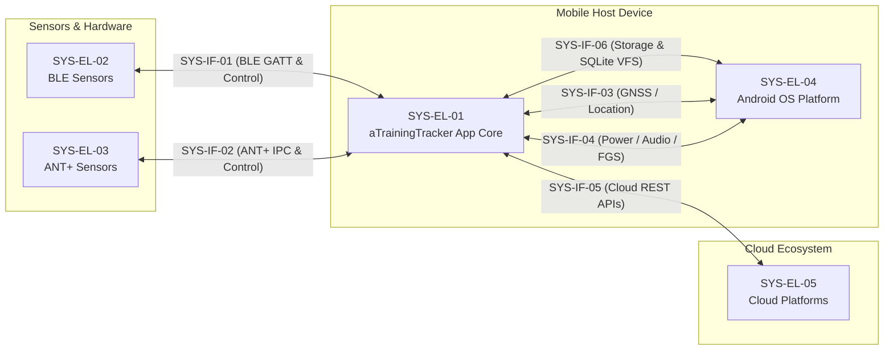
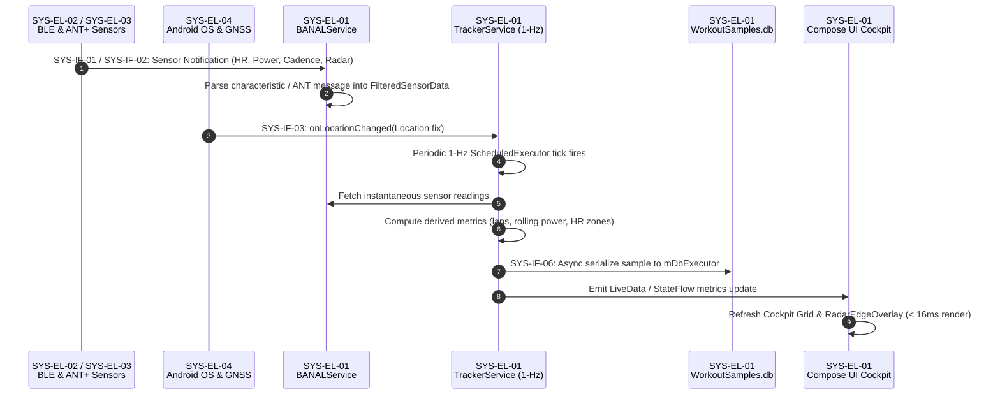
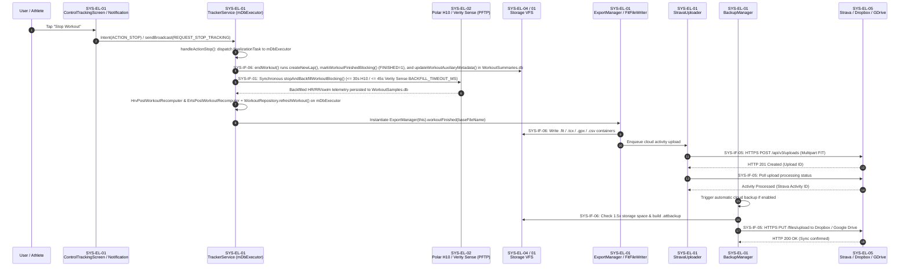

# System Architectural Design Specification (ASPICE SYS.3)

**Document ID**: `DOC-SYS-ARC`  
**Version**: 1.2.6  
**ASPICE Process Areas**: SYS.3 (System Architectural Design, BP1–BP6)  
**Parent Epic**: [ATT-6142](https://rainerblind.atlassian.net/browse/ATT-6142) / [ATT-8138](https://rainerblind.atlassian.net/browse/ATT-8138) (*ASPICE CL2 – System Level & Remediation*)  
**Requirement Reference**: `REQ-PRO-056` (`REQ-PRO-056.1`, `REQ-PRO-056.2`)  
**Test Reference**: `TST-PRO-056` (`TST-PRO-056.1`–`TST-PRO-056.4`)  
**Status**: Reviewed  
**Approver**: Pending PO Sign-Off  

---

## 1. Executive Summary & Purpose

This document establishes the formal **System Architectural Design (ASPICE SYS.3)** for **aTrainingTracker**. In accordance with ASPICE 4.0 SYS.3 (Base Practices BP1 through BP6), this specification:
1. Decomposes the complete system into bounded, coherent **System Elements** (`SYS-EL-01` through `SYS-EL-05`) spanning mobile device software, wireless sports peripherals, operating system platform services, and external cloud ecosystems (SYS.3 BP1).
2. Defines all internal and external **System Interfaces** (`SYS-IF-01` through `SYS-IF-06`), detailing protocol stacks, data payload schemas, and timing/rate constraints (SYS.3 BP3).
3. Models dynamic system behavior via formal Mermaid sequence diagrams for real-time telemetry processing and post-workout cloud synchronization (SYS.3 BP4).
4. Establishes a 100% complete **System Requirements Allocation Matrix** allocating all 21 system requirements across live tracking and cloud data exchange to designated system elements and interfaces (SYS.3 BP2, BP6).
5. Documents architectural design evaluation against real-time latency, battery efficiency, and privacy invariants (SYS.3 BP5).

---

## 2. System Elements Decomposition (SYS.3 BP1)

The aTrainingTracker system is partitioned into 5 primary System Elements across physical, wireless, OS platform, and cloud boundaries:

| Element ID | System Element Name | Physical Execution Boundary | Primary Roles & Capabilities |
| :--- | :--- | :--- | :--- |
| **`SYS-EL-01`** | **Android Smartphone Host Application** | Android Application Process (`com.atrainingtracker`, debug: `com.atrainingtracker.debug`) | Core mobile runtime containing foreground services (`TrackerService`, `BANALService`), background executors (`mDbExecutor`), local SQLite databases (`WorkoutSummaries.db`, `WorkoutSamples.db`), Jetpack Compose UI cockpit (`SensorGridScreen`, `RadarEdgeOverlay`), and domain viewmodels. |
| **`SYS-EL-02`** | **BLE Peripheral Sports Sensors** | External Wireless Hardware (Bluetooth Low Energy Peripherals) | External physical telemetry & actuation peripherals communicating over Bluetooth Smart GATT: Heart Rate Monitors, Cycling Speed/Cadence, Cycling Power Meters, Running Speed/Cadence, Device Information (`0x180A`), Peripheral Battery (`0x180F`), Garmin Varia Radar & Light Control (`6a4e3200`/`6a4e3202`/`6a4e2f00`), and Polar H10 / Verity Sense PFTP/PMD offline flash & IMU streaming (`0000feee`/`fb005c80`). |
| **`SYS-EL-03`** | **ANT+ Wireless Sensors & Radio IPC** | External ANT+ Hardware & Radio Transceiver Subsystem | External physical sensors transmitting/receiving over 2.4-GHz ANT-FS RF channels, bridged via Android ANT+ Wireless Transport and ANT+ Plugin Service IPC (`com.dsi.ant.plugins.antplus`) delivering Heart Rate, Bike Power, Speed/Cadence, ANT+ Radar (`0x28`, `ANTBikeRadarDevice.kt`), and bidirectional ANT+ Bike Lights (`0x23`, `ANTBikeLightDevice.kt`). |
| **`SYS-EL-04`** | **Android OS Platform Services** | Android System Server & Hardware Abstraction Layer (HAL) | Operating system platform services: Hardware GNSS provider (`LocationManager.GPS_PROVIDER`), Google Play Services Location (`SpeedAndLocationDevice_GoogleFused` via `GoogleApiClient` / `LocationListener`), Google Maps Android SDK v2 (`play-services-maps`, `ATrainingTrackerMap.kt`), On-Board Barometer (`Sensor.TYPE_PRESSURE`), Proximity (`Sensor.TYPE_PROXIMITY`), Ambient Light (`Sensor.TYPE_LIGHT`), Smartphone IMU (`Sensor.TYPE_ACCELEROMETER`, `Sensor.TYPE_GYROSCOPE`, `Sensor.TYPE_LINEAR_ACCELERATION`, `Sensor.TYPE_GRAVITY`, `Sensor.TYPE_ROTATION_VECTOR`, `Sensor.TYPE_GAME_ROTATION_VECTOR`), Power Management (`PowerManager.PARTIAL_WAKE_LOCK`), Foreground Service lifecycles, Audio Subsystem (`AudioAttributes`), PebbleKit (`pebblekit:4.0.1`), and Scoped Storage VFS. |
| **`SYS-EL-05`** | **External Cloud Platforms & Storage** | Remote SaaS Cloud Infrastructure | Third-party cloud REST endpoints, platform aggregators, and telemetry services accessed via HTTPS / SDK: Strava API v3, Dropbox API v2, Google Drive REST API v3, Open-Meteo Elevation API (`api.open-meteo.com/v1/elevation`, `ElevationService.kt`), Firebase Crashlytics & Analytics (`firebase-bom:34.18.0`), Google Play Services Auth & In-App Review (`play-services-auth`, `play:review-ktx`), and Android Health Connect on-device aggregator (`HealthConnectHrvImporter.kt`). |

---

## 3. System Interface Specifications (SYS.3 BP3)

Six authoritative System Interfaces interconnect the System Elements, defining communication protocols, data schemas, and timing bounds:

### SYS-IF-01: BLE GATT Telemetry & Peripheral Control Interface (Bidirectional)
* **Source / Target Elements**: Bidirectional between `SYS-EL-02` (BLE Peripheral Sports Sensors) and `SYS-EL-01` (Host Application via `BANALService`, `PolarOfflineGattCoordinator.kt`, `RadarLightDeviceClient.kt`)
* **Transport / Protocol**: Bluetooth 4.0/5.0 Low Energy, Generic Attribute Profile (GATT) ATT Notifications, Indications, Reads & Control Writes over ACL link.
* **Payload Schema**:
  - Heart Rate (`0x180D` / `0x2A37`): 8-bit/16-bit BPM value, RR-intervals, sensor contact flag.
  - Cycling Speed & Cadence (`0x1816` / `0x2A5B`): Cumulative wheel revolutions, last wheel event time, cumulative crank revolutions, last crank event time.
  - Cycling Power (`0x1818` / `0x2A63`): Instantaneous power (Watts), pedal power balance, accumulated torque.
  - Running Speed & Cadence (`0x1814` / `0x2A53`): Instantaneous speed (m/s), cadence (RPM), stride length.
  - Peripheral Battery (`0x180F` / `0x2A19`): Battery state-of-charge percentage (0–100%).
  - Device Information (`0x180A`): Manufacturer name, model number, firmware/hardware revision (`0x2A24`/`0x2A25`).
  - Garmin Varia Radar & Light Control (`6a4e3200-667b-11e3-949a-0800200c9a66` / `6a4e3203` V1, `6a4e3204` V2, `6a4e3202` Light Control; RearVue `6a4e2f00-667b-11e3-949a-0800200c9a66` write `6a4e2f11`, notify `6a4e2f14`): Target count, threat levels, relative distance/velocity, and bidirectional tail-light mode/brake actuation commands.
  - Polar BLE PFTP (`0000feee-0000-1000-8000-00805f9b34fb`) & PMD (`fb005c80-02e7-f387-1cad-8acd2d8df0c8`): Clock sync, flash recording arm/stop, post-workout backfill (H10 `30_000L` ms / `30s`, Verity Sense `45_000L` ms / `45s` `BACKFILL_TIMEOUT_MS`), and live IMU/PPG streaming (`PolarH10OfflineController.kt`, `PolarVeritySenseOfflineController.kt`).
* **Timing & Rate Bounds**: Periodic notifications at 1–4 Hz; autonomous 3,500 ms radar watchdog (`WATCHDOG_TIMEOUT_MS`); reconnection retry with exponential backoff (1s initial to 16s cap); synchronous Polar PFTP stop/backfill bounded by `30s` (H10 `30_000L` ms) / `45s` (Verity Sense `45_000L` ms) `BACKFILL_TIMEOUT_MS`.

### SYS-IF-02: ANT+ Wireless IPC & Device Control Interface (Bidirectional)
* **Source / Target Elements**: Bidirectional between `SYS-EL-03` (ANT+ Wireless Sensors & Radio IPC) and `SYS-EL-01` (Host Application via `BANALService`, `ANTBikeRadarDevice.kt`, `ANTBikeLightDevice.kt`)
* **Transport / Protocol**: Android AIDL / Intent IPC to ANT+ Plugin Service (`com.dsi.ant.plugins.antplus`) over 2.4-GHz ANT RF channel.
* **Payload Schema**: Standard ANT+ device broadcast frames (instantaneous HR, wheel/crank ticks, power/torque), ANT+ Bike Radar (`0x28`) target threat frames, and bidirectional ANT+ Bike Lights (`0x23`) mode/brake-light control commands.
* **Timing & Rate Bounds**: Channel transmission period 4 Hz (245.76 ms interval per ANT+ channel standard); asynchronous non-blocking dispatch to application sampling filters and light controllers.

### SYS-IF-03: GNSS & Location Provider Interface
* **Source Element**: `SYS-EL-04` (Android OS Platform Services)
* **Target Element**: `SYS-EL-01` (Host Application via `SpeedAndLocationDevice_GPS` / `SpeedAndLocationDevice_GoogleFused`)
* **Transport / Protocol**: Android Framework Callback APIs (`android.location.LocationListener` / `com.google.android.gms.location.LocationListener`).
* **Payload Schema**: `android.location.Location` containing WGS-84 latitude/longitude, altitude (meters MSL), horizontal accuracy (meters), speed (m/s), bearing (degrees), and epoch UTC timestamp.
* **Timing & Rate Bounds**: Continuous 1-Hz cadence (`minTime = 1000ms`, `minDistance = 0m`); null-island filter (`lat=0.0, lng=0.0` rejected); horizontal accuracy threshold filtering (< 50m).

### SYS-IF-04: Platform Lifecycle, Onboard Sensors, Maps, Power & Audio Interface
* **Source / Target**: Bidirectional between `SYS-EL-01` (Host App) and `SYS-EL-04` (Android OS)
* **Transport / Protocol**: Android System Services (`PowerManager`, `NotificationManager`, `AudioManager`, `SensorManager`, `Service`), Google Maps SDK v2 (`play-services-maps`), and PebbleKit (`pebblekit:4.0.1`).
* **Timing & Rate Bounds**: WakeLock held during ACTIVE tracking; notification at 1-Hz tick; acoustic safety alert latency < 100 ms.
* **Payload Schema**:
  - Power & FGS: `PARTIAL_WAKE_LOCK` tokens; `ACTION_REQUEST_IGNORE_BATTERY_OPTIMIZATIONS`; `Notification` parcel with `FOREGROUND_SERVICE_TYPE_LOCATION`, `FOREGROUND_SERVICE_TYPE_HEALTH`, and post-workout `FOREGROUND_SERVICE_TYPE_SHORT_SERVICE` (`WorkoutPostProcessingService.kt`, `WorkoutPostProcessingCoordinator.kt`, `WorkoutPostProcessingNotificationManager.kt`; API 34+, zero new manifest permissions).
  - Onboard Sensors: Barometer (`Sensor.TYPE_PRESSURE`), Proximity (`Sensor.TYPE_PROXIMITY`), Ambient Light (`Sensor.TYPE_LIGHT`), Smartphone IMU (`Sensor.TYPE_ACCELEROMETER`, `Sensor.TYPE_GYROSCOPE`, `Sensor.TYPE_LINEAR_ACCELERATION`, `Sensor.TYPE_GRAVITY`, `Sensor.TYPE_ROTATION_VECTOR`, `Sensor.TYPE_GAME_ROTATION_VECTOR`), and opportunistically permission-gated Step Detector (`Sensor.TYPE_STEP_DETECTOR`).
  - Maps, Audio & Watch: Vector/lite-mode map polylines (`ATrainingTrackerMap.kt`), `AudioAttributes.USAGE_ALARM`/`USAGE_MEDIA`, and Pebble dictionary telemetry.

### SYS-IF-05: Cloud REST, DEM Elevation, Health Connect & Telemetry Services Interface
* **Source / Target Elements**: Bidirectional between `SYS-EL-01` (Host Application via `StravaUploader`, `DropboxBackupManager`, `GoogleDriveBackupManager`, `ElevationService.kt`, `HealthConnectHrvImporter.kt`) and `SYS-EL-05` (External Cloud Platforms & On-Device Health Connect)
* **Transport / Protocol**: HTTPS REST over TLS 1.3 (OAuth2 Bearer) and Android Health Connect / Play Services / Firebase SDK IPC.
* **Payload Schema**:
  - Cloud Sync & Backup: Strava multipart `.fit` upload (`/api/v3/uploads`), gear/routes/segments JSON; Dropbox `/2/files/upload`; Google Drive multipart upload (`/upload/drive/v3/files`).
  - DEM, Health & Telemetry: Open-Meteo DEM (`api.open-meteo.com/v1/elevation`), Health Connect (`ExerciseSessionRecord`, HRV/RHR permissions), Firebase (`Crashlytics`/`Analytics`), Google Play Auth & In-App Review.
* **Timing & Rate Bounds**: Triggered asynchronously post-workout or via `WorkManager` with offline-first fallback and exponential retry backoff on HTTP 429/5xx.

### SYS-IF-06: Persistent Storage & SQLite VFS Interface
* **Source / Target**: Bidirectional between `SYS-EL-01` (Host App) and `SYS-EL-04` (OS Linux VFS & SQLite Engine)
* **Transport / Protocol**: Android SQLite C-library interface & Scoped Storage File I/O APIs.
* **Payload Schema**:
  - SQLite Relational Tables: `WorkoutSummaries.db` (session summaries, sport types, lap metrics), `WorkoutSamples.db` (1-Hz time-series records: timestamp, speed, cadence, HR, power, lat, lng, altitude).
  - Archive Files: Compressed `.attbackup` ZIP containers, exported `.fit`, `.tcx`, `.gpx`, and `.csv` files.
* **Timing & Rate Bounds**: 1-Hz batch insertions serialized onto dedicated background `mDbExecutor` thread without UI looper contention; backup pre-flight verification of 1.5x disk space; Zip Slip path traversal validation.

---

## 4. Dynamic Behavior Models (SYS.3 BP4)

### 4.1 1-Hz Live Telemetry Acquisition & Sampling Loop

The sequence below illustrates the deterministic 1-Hz telemetry acquisition and recording cycle during active workouts:

### 4.2 Post-Workout Cloud Synchronization & Backup Pipeline

The sequence below illustrates activity finalization, multi-format export, cloud activity synchronization, and disaster recovery archiving:

---

## 5. System Requirements Allocation Matrix (SYS.3 BP2, BP6)

Every system requirement across both functional domains is allocated to designated System Elements (`SYS-EL-*`) and System Interfaces (`SYS-IF-*`) with complete forward and backward traceability:

### 5.1 Domain 1: Tracking Loop & Session Lifecycle (SYSREQ-TRK-001..013)

| Requirement ID | Requirement Title | Allocated Elements | Allocated Interfaces | Software Component Realization | Verification Method |
| :--- | :--- | :--- | :--- | :--- | :--- |
| **`SYSREQ-TRK-001`** | Multi-Sensor Profile Interoperability | `SYS-EL-01`, `SYS-EL-02`, `SYS-EL-03` | `SYS-IF-01`, `SYS-IF-02` | `BANALService`, `BluetoothConstants`, `MySensorManager`, `DeviceType.java`, `BTLERadarDevice`, `SensorBatteryNotificationManager`, `MyANTDevice` subclasses | Test / `SystemLiveTrackingRequirementsContractTest` |
| **`SYSREQ-TRK-002`** | Connection Resilience & Watchdog | `SYS-EL-01`, `SYS-EL-02` | `SYS-IF-01` | `MyBTLEDevice` (`INITIAL_RECONNECT_DELAY_MS`, `MAX_RECONNECT_DELAY_MS`), `BTLERadarDevice.WATCHDOG_TIMEOUT_MS`, `FilterManager` | Test / `SystemLiveTrackingRequirementsContractTest` |
| **`SYSREQ-TRK-003`** | Deterministic 1-Hz Sampling Loop | `SYS-EL-01`, `SYS-EL-04` | `SYS-IF-06` | `TrackerService`, `ScheduledExecutorService`, `WorkoutSamplesDatabaseManager` | Test / `SystemLiveTrackingRequirementsContractTest` |
| **`SYSREQ-TRK-004`** | Multi-Source GNSS Positioning | `SYS-EL-01`, `SYS-EL-04` | `SYS-IF-03` | `SpeedAndLocationDevice_GPS` (`LocationManager.GPS_PROVIDER`), `SpeedAndLocationDevice_GoogleFused` (`GoogleApiClient`, `LocationListener`) | Test / `SystemLiveTrackingRequirementsContractTest` |
| **`SYSREQ-TRK-005`** | Foreground Service & Power Management | `SYS-EL-01`, `SYS-EL-04` | `SYS-IF-04` | `TrackerService`, `TrainingApplication`, `PowerManager.PARTIAL_WAKE_LOCK`, `FOREGROUND_SERVICE_TYPE_LOCATION`, `FOREGROUND_SERVICE_TYPE_HEALTH` | Test / `SystemLiveTrackingRequirementsContractTest` |
| **`SYSREQ-TRK-006`** | Real-Time Alerts & Cockpit Feedback | `SYS-EL-01`, `SYS-EL-04` | `SYS-IF-04` | `SensorGridScreen`, `RadarEdgeOverlay`, `RadarAlertManager`, `RadarAudioSynthesizer`, `NavigationAudioAlertManager`, `BikeBellAudioSynthesizer` | Test / `SystemLiveTrackingRequirementsContractTest` |
| **`SYSREQ-TRK-007`** | Bidirectional Radar & Light Actuation | `SYS-EL-01`, `SYS-EL-02`, `SYS-EL-03`, `SYS-EL-04` | `SYS-IF-01`, `SYS-IF-02`, `SYS-IF-04` | `RadarLightController.kt`, `RadarLightDeviceClient.kt`, `SmartRadarLightEngine.kt`, `SmartBrakeLightDetector.kt`, `ANTBikeRadarDevice.kt`, `ANTBikeLightDevice.kt` | Test / `SystemLiveTrackingRequirementsContractTest` |
| **`SYSREQ-TRK-008`** | Barometer, EKF & Climb/Segment Fusion | `SYS-EL-01`, `SYS-EL-04` | `SYS-IF-03`, `SYS-IF-04`, `SYS-IF-06` | `AltitudeFromPressureDevice.java`, `KinematicAltitudeSlopeEkf.kt`, `ClimbDetector.kt`, `LiveClimbsRepository.kt`, `LiveClimbSheet.kt`, `LiveSegmentsRepository.kt` | Test / `SystemLiveTrackingRequirementsContractTest` |
| **`SYSREQ-TRK-009`** | GPX Follow-Me & Turn Audio Navigation | `SYS-EL-01`, `SYS-EL-04` | `SYS-IF-03`, `SYS-IF-04` | `GpxRouteImporter.kt`, `TurnByTurnNavigationEngine.kt`, `RouteDivergenceDetector.kt`, `NavigationAudioAlertManager.kt`, `ATrainingTrackerMap.kt` | Test / `SystemLiveTrackingRequirementsContractTest` |
| **`SYSREQ-TRK-010`** | Smartphone IMU Kinematics, Carriage Classification, Cadence & iTPMS | `SYS-EL-01`, `SYS-EL-04` | `SYS-IF-04`, `SYS-IF-06` | `SpeedAndLocationDevice_ATTFused.kt`, `PhoneCarriageMode.kt`, `PhoneCarriageClassifier.kt`, `ImuCadenceDsp.kt`, `SmartphoneImuCadenceEstimator.kt`, `KinematicSportTypeDiscriminator.kt`, `MultisportTransitionDetector.kt`, `MultisportTransitionBridge.kt`, `MultisportLapCoordinator.kt`, `PolarLiveRunningCadenceEstimator.kt`, `MySensorManager.java`, `DeviceType.java`, `QuaternionGyroProjector.kt`, `AltitudeAndSlopeDevice_ATTFused.kt`, `BarometricAltitudeFilter.kt`, `ErtsPostWorkoutRecomputer.kt`, `SpeedAndLocationDevice.java`, `IndirectTpmsEstimator.kt`, `DualWheelTpmsEstimator.kt` | Test / `SystemLiveTrackingRequirementsContractTest` |
| **`SYSREQ-TRK-011`** | Swimming Telemetry & Lap Adjustment | `SYS-EL-01`, `SYS-EL-02` | `SYS-IF-01`, `SYS-IF-06` | `SwimWorkoutAdjustCard.kt`, `SwimmingSection.kt`, `PolarVeritySenseOfflineController.kt`, `FitFileWriter.kt` | Test / `SystemLiveTrackingRequirementsContractTest` |
| **`SYSREQ-TRK-012`** | Live HRV & DFA Alpha-1 Thresholds | `SYS-EL-01`, `SYS-EL-02` | `SYS-IF-01`, `SYS-IF-04`, `SYS-IF-06` | `DfaCalculator.kt`, `HRVMetricsDevice.kt`, `HrvSignalQualityAnalyzer.kt`, `HrvRampTestScreen.kt`, `HrvThresholdEstimator.kt`, `HrvPostWorkoutRecomputer.kt` | Test / `SystemLiveTrackingRequirementsContractTest` |
| **`SYSREQ-TRK-013`** | Process-Death Session Recovery | `SYS-EL-01`, `SYS-EL-04` | `SYS-IF-04`, `SYS-IF-06` | `TrackerService.java`, `StartOrResumeDialog.kt`, `StartOrResumeInterface.java`, `WorkoutSamplesDatabaseManager.java` | Test / `SystemLiveTrackingRequirementsContractTest` |

### 5.2 Domain 2: Data Exchange & Cloud Sync (SYSREQ-DEX-001..008)

| Requirement ID | Requirement Title | Allocated Elements | Allocated Interfaces | Software Component Realization | Verification Method |
| :--- | :--- | :--- | :--- | :--- | :--- |
| **`SYSREQ-DEX-001`** | Multi-Format Telemetry Export | `SYS-EL-01`, `SYS-EL-04` | `SYS-IF-06` | `ExportManager`, `FitFileWriter`, `TCXFileWriter`, `GPXFileWriter`, `CSVFileWriter` | Test / `SystemDataExchangeRequirementsContractTest` |
| **`SYSREQ-DEX-002`** | Multi-Format Workout Ingestion | `SYS-EL-01`, `SYS-EL-04` | `SYS-IF-06` | `LegacyImportEngine`, `StravaBulkExportImporter`, `WorkoutDataMapper` | Test / `SystemDataExchangeRequirementsContractTest` |
| **`SYSREQ-DEX-003`** | Cloud Activity Sync (Strava) | `SYS-EL-01`, `SYS-EL-05` | `SYS-IF-05` | `StravaUploader`, `StravaEquipmentSyncWorker`, OAuth2 Bearer token | Test / `SystemDataExchangeRequirementsContractTest` |
| **`SYSREQ-DEX-004`** | Cloud Storage Sync (Dropbox & GDrive) | `SYS-EL-01`, `SYS-EL-05` | `SYS-IF-05` | `DropboxBackupManager`, `GoogleDriveBackupManager` | Test / `SystemDataExchangeRequirementsContractTest` |
| **`SYSREQ-DEX-005`** | Full State Backup & Atomic Recovery | `SYS-EL-01`, `SYS-EL-04` | `SYS-IF-06` | `BackupManager`, `SecureZipExtractor` (1.5x space check, Zip Slip protection) | Test / `SystemDataExchangeRequirementsContractTest` |
| **`SYSREQ-DEX-006`** | Security Isolation & Credentials Shield | `SYS-EL-01`, `SYS-EL-04` | `SYS-IF-06` | `AuthCredentialsStore`, `full_backup_content.xml` (exclude credentials from OS backup) | Test / `SystemDataExchangeRequirementsContractTest` |
| **`SYSREQ-DEX-007`** | Polar BLE PFTP/PMD Offline Backfill | `SYS-EL-01`, `SYS-EL-02`, `SYS-EL-04` | `SYS-IF-01`, `SYS-IF-06` | `PolarH10OfflineController.kt`, `PolarVeritySenseOfflineController.kt`, `PolarOfflineGattCoordinator.kt`, `TrackerService.java` | Test / `SystemDataExchangeRequirementsContractTest` |
| **`SYSREQ-DEX-008`** | External Elevation Model (Open-Meteo DEM) | `SYS-EL-01`, `SYS-EL-04`, `SYS-EL-05` | `SYS-IF-05`, `SYS-IF-06` | `ElevationService.kt`, `ElevationCacheDatabaseManager.kt`, `ElevationResult.kt` | Test / `SystemDataExchangeRequirementsContractTest` |

---

## 6. Architecture Evaluation & Invariants (SYS.3 BP5)

### 6.1 Architectural Quality Attributes
1. **Deterministic Latency**: The 1-Hz sampling loop (`TrackerService`) runs with guaranteed periodic precision by delegating SQLite disk I/O to a dedicated single-threaded executor (`mDbExecutor`), preventing Android UI main thread jank.
2. **Energy Efficiency**: Peripheral reconnections utilize exponential backoff (up to 16s) to prevent radio frequency thrashing; partial WakeLocks are acquired exclusively during active recording states and released on teardown.
3. **Safety & Fail-Safe Operation**: Rearview radar sensors employ an autonomous 3,500 ms packet watchdog. If vehicle telemetry ceases, the sensor immediately transitions to a warning state and triggers acoustic alerts to prevent silent failure.
4. **Data Integrity & Security**: Backup restorations enforce pre-flight free space checks (1.5x archive size) and strict Zip Slip canonical path validation. OAuth tokens are sequestered in dedicated storage excluded from Android cloud backups (`full_backup_content.xml`).

### 6.2 Bidirectional Traceability Verification (SYS.3 BP6)
* **To System Requirements (SYS.2)**: 100% of all 21 `SYSREQ-*` requirements map to $\ge 1$ system element and interface.
* **To Software Architecture (SWE.2)**: System Elements `SYS-EL-01` through `SYS-EL-05` trace directly to SWE.2 component definitions in `docs/architecture.md`.
* **To Verification Tests**: Every system interface and allocation is verified by automated contract tests under `app/src/test/.../build/` without reading production source files (ATT-6186).

---

## Change History

| Version | Date | Author | Ticket | Summary of Changes |
| :--- | :--- | :--- | :--- | :--- |
| `1.0.0` | 2026-11-16 | AI Agent | `ATT-6142` | Prior system specification baseline. |
| `1.1.0` | 2026-11-17 | AI Agent (`ATT-8164`) | `ATT-8164` | Standardized `DOC-SYS-ARC` header, bumped version, reset status to `Reviewed` (`Pending PO Sign-Off`). |
| `1.2.0` | 2026-11-18 | AI Agent (`ATT-8201`) | `ATT-8201` | Synchronized `SYS-EL-01..05` and `SYS-IF-01/02/04/05` with `system_context.md` (IMU, Polar PFTP/PMD, Varia RearVue/Light Control, ANT+ `0x28`/`0x23`, Open-Meteo, Maps v2, Firebase, Play Auth/Review, PebbleKit), modeled synchronous Polar backfill in §4.2, and allocated all `21` `SYSREQ-*` items in §5. |
| `1.2.1` | 2026-11-18 | AI Agent (`ATT-8201`) | `ATT-8201` | Cold Stage 6 heal: added `Sensor.TYPE_LIGHT`, distinguished H10 `30_000L` vs. Verity Sense `45_000L` `BACKFILL_TIMEOUT_MS`, aligned §4.2 `endWorkout()` sequence (`FINISHED=1` before Polar backfill, then HRV/ERTS recompute & `ExportManager.workoutFinished()`), and removed nonexistent `autoExport()`. |
| `1.2.2` | 2026-11-18 | AI Agent (`ATT-8890`, `--as agent1`) | `ATT-8890` | Added optional `Sensor.TYPE_STEP_DETECTOR` in `SYS-IF-04` and allocated `PhoneCarriageMode.kt`, `PhoneCarriageClassifier.kt`, `BarometricAltitudeFilter.kt`, `AltitudeAndSlopeDevice_ATTFused.kt`, and `ErtsPostWorkoutRecomputer.kt` under `SYSREQ-TRK-010` (`REQ-FIL-028`). |
| `1.2.3` | 2026-11-18 | AI Agent (`ATT-8895`, `--as agent1`) | `ATT-8895` | Allocated `ImuCadenceDsp.kt`, `SmartphoneImuCadenceEstimator.kt`, `PolarLiveRunningCadenceEstimator.kt`, `MySensorManager.java`, and `DeviceType.java` under `SYSREQ-TRK-001` and `SYSREQ-TRK-010` (`REQ-FIL-029`). |
| `1.2.4` | 2026-11-19 | AI Agent (`ATT-8891`, `--as agent1`) | `ATT-8891` | Allocated `KinematicSportTypeDiscriminator.kt` under `SYSREQ-TRK-010` (`REQ-FIL-030`). |
| `1.2.5` | 2026-11-19 | AI Agent (`ATT-8917`, `--as agent1`) | `ATT-8917` | Allocated `MultisportTransitionDetector.kt`, `MultisportTransitionBridge.kt`, and `MultisportLapCoordinator.kt` under `SYSREQ-TRK-010` (`REQ-FIL-031`). |
| `1.2.6` | 2026-11-20 | Lane A Author (`ATT-9154`, `--as agent1`) | `ATT-9154` | Updated `SYS-IF-04` FGS payload schema to include post-workout `FOREGROUND_SERVICE_TYPE_SHORT_SERVICE` (API 34+, zero new manifest permissions; `REQ-TRK-091`, new `.kt` filenames deferred until Stage 4 per `Rule 81`). |
