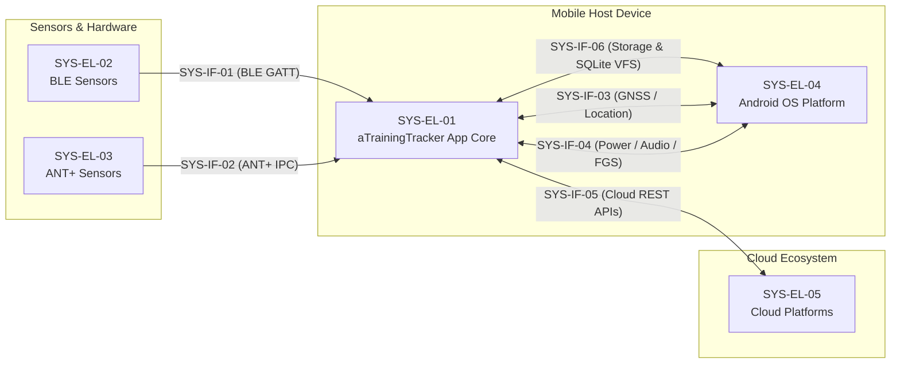
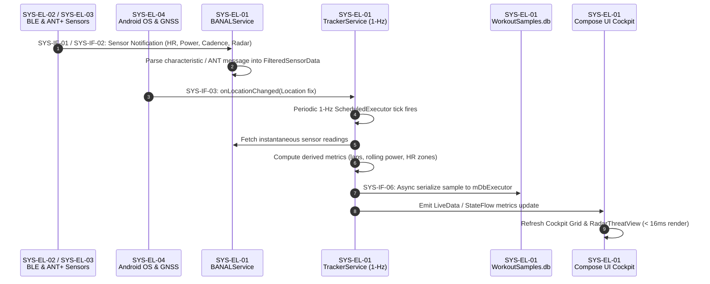
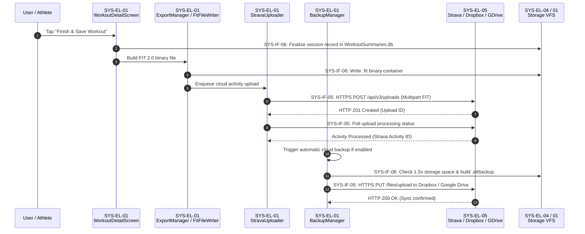

# System Architectural Design Specification (ASPICE SYS.3)

**Document Version**: 1.0.0  
**ASPICE Process Areas**: SYS.3 (System Architectural Design, BP1–BP6)  
**Parent Epic**: [ATT-6142](https://rainerblind.atlassian.net/browse/ATT-6142) (*ASPICE CL2 – System Level, Architecture Conformance, Integration & Quality Gates*)  
**Requirement Reference**: `REQ-PRO-056` (`REQ-PRO-056.1`, `REQ-PRO-056.2`)  
**Test Reference**: `TST-PRO-056` (`TST-PRO-056.1`–`TST-PRO-056.4`)  
**Status**: Approved & Grounded in Live Source Code  

---

## 1. Executive Summary & Purpose

This document establishes the formal **System Architectural Design (ASPICE SYS.3)** for **aTrainingTracker**. In accordance with ASPICE 4.0 SYS.3 (Base Practices BP1 through BP6), this specification:
1. Decomposes the complete system into bounded, coherent **System Elements** (`SYS-EL-01` through `SYS-EL-05`) spanning mobile device software, wireless sports peripherals, operating system platform services, and external cloud ecosystems (SYS.3 BP1).
2. Defines all internal and external **System Interfaces** (`SYS-IF-01` through `SYS-IF-06`), detailing protocol stacks, data payload schemas, and timing/rate constraints (SYS.3 BP3).
3. Models dynamic system behavior via formal Mermaid sequence diagrams for real-time telemetry processing and post-workout cloud synchronization (SYS.3 BP4).
4. Establishes a 100% complete **System Requirements Allocation Matrix** allocating all 24 system requirements across telemetry acquisition, tracking lifecycle, peripheral resilience, platform environment, and cloud data exchange to designated system elements and interfaces (SYS.3 BP2, BP6).
5. Documents architectural design evaluation against real-time latency, battery efficiency, and privacy invariants (SYS.3 BP5).

---

## 2. System Elements Decomposition (SYS.3 BP1)

The aTrainingTracker system is partitioned into 5 primary System Elements across physical, wireless, OS platform, and cloud boundaries:

| Element ID | System Element Name | Physical Execution Boundary | Primary Roles & Capabilities |
| :--- | :--- | :--- | :--- |
| **`SYS-EL-01`** | **Android Smartphone Host Application** | Android Application Process (`com.atrainingtracker.trainingtracker`) | Core mobile runtime containing foreground services (`TrackerService`, `BANALService`), background executors (`mDbExecutor`), local SQLite databases (`WorkoutSummaries.db`, `WorkoutSamples.db`), Jetpack Compose UI cockpit (`SensorGridScreen`, `RadarThreatView`), and domain viewmodels. |
| **`SYS-EL-02`** | **BLE Peripheral Sports Sensors** | External Wireless Hardware (Bluetooth Low Energy Peripherals) | External physical telemetry peripherals communicating over Bluetooth Smart GATT (Heart Rate Monitors, Cycling Speed/Cadence, Cycling Power Meters, Running Speed/Cadence, Garmin Varia Radar, Peripheral Battery Service). |
| **`SYS-EL-03`** | **ANT+ Wireless Sensors & Radio IPC** | External ANT+ Hardware & Radio Transceiver Subsystem | External physical sensors transmitting over 2.4-GHz ANT-FS RF channels, bridged via Android ANT+ Wireless Transport and ANT+ Plugin Service IPC (`com.dsi.ant.plugins.antplus`) delivering Heart Rate, Bike Power, and Speed/Cadence streams. |
| **`SYS-EL-04`** | **Android OS Platform Services** | Android System Server & Hardware Abstraction Layer (HAL) | Operating system platform services: Hardware GNSS provider (`LocationManager.GPS_PROVIDER`), Google Play Services Location (`FusedLocationProviderClient`), Power Management (`PowerManager.PARTIAL_WAKE_LOCK`), Foreground Service lifecycles, Audio Subsystem (`AudioAttributes`), and Scoped Storage VFS. |
| **`SYS-EL-05`** | **External Cloud Platforms & Storage** | Remote SaaS Cloud Infrastructure | Third-party cloud REST endpoints and cloud storage providers accessed via HTTPS: Strava API v3, Dropbox API v2, Google Drive REST API v3, and Android Health Connect on-device aggregator. |

---

## 3. System Interface Specifications (SYS.3 BP3)

Six authoritative System Interfaces interconnect the System Elements, defining communication protocols, data schemas, and timing bounds:

### SYS-IF-01: BLE GATT Telemetry Interface
* **Source Element**: `SYS-EL-02` (BLE Peripheral Sports Sensors)
* **Target Element**: `SYS-EL-01` (Host Application via `BANALService`)
* **Transport / Protocol**: Bluetooth 4.0/5.0 Low Energy, Generic Attribute Profile (GATT) ATT Notifications & Indications over ACL link.
* **Payload Schema**:
  - Heart Rate (`0x180D` / `0x2A37`): 8-bit/16-bit BPM value, RR-intervals, sensor contact flag.
  - Cycling Speed & Cadence (`0x1816` / `0x2A5B`): Cumulative wheel revolutions, last wheel event time, cumulative crank revolutions, last crank event time.
  - Cycling Power (`0x1818` / `0x2A63`): Instantaneous power (Watts), pedal power balance, accumulated torque.
  - Running Speed & Cadence (`0x1814` / `0x2A53`): Instantaneous speed (m/s), cadence (RPM), stride length.
  - Peripheral Battery (`0x180F` / `0x2A19`): Battery state-of-charge percentage (0–100%).
  - Garmin Varia Radar (`6a4e3200-667b-11e3-949a-0800200c9a66` / `6a4e3204-667b-11e3-949a-0800200c9a66`): Target count, threat level (0=clean, 1=approaching, 2=high speed), relative distance (m), relative closing velocity (m/s).
* **Timing & Rate Bounds**: Periodic notifications at 1–4 Hz; autonomous 3,500 ms radar watchdog (`WATCHDOG_TIMEOUT_MS`); reconnection retry with exponential backoff (1s initial to 16s cap).

### SYS-IF-02: ANT+ Wireless IPC Interface
* **Source Element**: `SYS-EL-03` (ANT+ Wireless Sensors & Radio IPC)
* **Target Element**: `SYS-EL-01` (Host Application via `BANALService`)
* **Transport / Protocol**: Android AIDL / Intent IPC to ANT+ Plugin Service (`com.dsi.ant.plugins.antplus`) over 2.4-GHz ANT RF channel.
* **Payload Schema**: Standard ANT+ device broadcast frames: instantaneous heart rate, cumulative wheel/crank tick counts, computed torque and power event metrics.
* **Timing & Rate Bounds**: Channel transmission period 4 Hz (245.76 ms interval per ANT+ channel standard); asynchronous non-blocking dispatch to application sampling filters.

### SYS-IF-03: GNSS & Location Provider Interface
* **Source Element**: `SYS-EL-04` (Android OS Platform Services)
* **Target Element**: `SYS-EL-01` (Host Application via `SpeedAndLocationDevice_GPS` / `SpeedAndLocationDevice_GoogleFused`)
* **Transport / Protocol**: Android Framework Callback APIs (`LocationListener` / `LocationCallback`).
* **Payload Schema**: `android.location.Location` containing WGS-84 latitude/longitude, altitude (meters MSL), horizontal accuracy (meters), speed (m/s), bearing (degrees), and epoch UTC timestamp.
* **Timing & Rate Bounds**: Continuous 1-Hz cadence (`minTime = 1000ms`, `minDistance = 0m`); null-island filter (`lat=0.0, lng=0.0` rejected); horizontal accuracy threshold filtering (< 50m).

### SYS-IF-04: Platform Lifecycle, Power & Audio Interface
* **Source / Target**: Bidirectional between `SYS-EL-01` (Host App) and `SYS-EL-04` (Android OS)
* **Transport / Protocol**: Android System Services (`PowerManager`, `NotificationManager`, `AudioManager`, `Service`).
* **Payload Schema**:
  - Power: `PARTIAL_WAKE_LOCK` acquire/release tokens; `ACTION_REQUEST_IGNORE_BATTERY_OPTIMIZATIONS` system intent.
  - Foreground Service: `Notification` parcel with ongoing session metrics; FGS flags `FOREGROUND_SERVICE_TYPE_LOCATION`, `FOREGROUND_SERVICE_TYPE_HEALTH`, `FOREGROUND_SERVICE_TYPE_CONNECTED_DEVICE`.
  - Audio Alerts: Tone and synthesised acoustic cues routed through `AudioAttributes.USAGE_ALARM` / `USAGE_MEDIA`.
* **Timing & Rate Bounds**: WakeLock held continuously during ACTIVE workout state; notification updated at 1-Hz sampling tick; acoustic safety alert generation latency < 100 ms from radar trigger event.

### SYS-IF-05: Cloud REST & OAuth2 Synchronization Interface
* **Source Element**: `SYS-EL-01` (Host Application via `StravaUploader`, `DropboxBackupManager`, `GoogleDriveBackupManager`)
* **Target Element**: `SYS-EL-05` (External Cloud Platforms & Storage)
* **Transport / Protocol**: HTTPS REST over TLS 1.3 with OAuth2 Bearer token authorization headers.
* **Payload Schema**:
  - Strava: Multipart/form-data activity upload with Garmin FIT 2.0 binary container (`.fit`); JSON REST responses for upload status polling (`/api/v3/uploads/{id}`) and gear query (`/api/v3/athlete/activities`).
  - Dropbox: Dropbox API v2 `/2/files/upload` chunked binary stream; JSON metadata response.
  - Google Drive: Google Drive REST API v3 multipart upload (`/upload/drive/v3/files?uploadType=multipart`).
* **Timing & Rate Bounds**: Triggered asynchronously post-workout; governed by platform rate quotas (e.g. Strava 100 requests per 15 minutes, 1,000 per day); exponential retry backoff on HTTP 429/5xx responses.

### SYS-IF-06: Persistent Storage & SQLite VFS Interface
* **Source / Target**: Bidirectional between `SYS-EL-01` (Host App) and `SYS-EL-04` (OS Linux VFS & SQLite Engine)
* **Transport / Protocol**: Android SQLite C-library interface & Scoped Storage File I/O APIs.
* **Payload Schema**:
  - SQLite Relational Tables: `WorkoutSummaries.db` (session summaries, sport types, lap metrics), `WorkoutSamples.db` (1-Hz time-series records: timestamp, speed, cadence, HR, power, lat, lng, altitude).
  - Archive Files: Compressed `.attbackup` ZIP containers, exported `.fit`, `.tcx`, `.gpx`, and `.csv` files.
* **Timing & Rate Bounds**: 1-Hz batch insertions serialized onto dedicated background `mDbExecutor` thread without UI looper contention; backup pre-flight verification of 1.5x disk space; Zip Slip path traversal validation.

---

## 4. Dynamic Behavior Models (SYS.3 BP4)

### 4.1 1-Hz Live Telemetry Acquisition & Sampling Loop

The sequence below illustrates the deterministic 1-Hz telemetry acquisition and recording cycle during active workouts:

### 4.2 Post-Workout Cloud Synchronization & Backup Pipeline

The sequence below illustrates activity finalization, multi-format export, cloud activity synchronization, and disaster recovery archiving:

---

## 5. System Requirements Allocation Matrix (SYS.3 BP2, BP6)

Every system requirement across all 5 functional domains is allocated to designated System Elements (`SYS-EL-*`) and System Interfaces (`SYS-IF-*`) with complete forward and backward traceability:

### 5.1 Domain 1: Telemetry Acquisition (SYSREQ-ACQ-001..005)

| Requirement ID | Requirement Title | Allocated Elements | Allocated Interfaces | Software Component Realization | Verification Method |
| :--- | :--- | :--- | :--- | :--- | :--- |
| **`SYSREQ-ACQ-001`** | Heart Rate Telemetry Acquisition | `SYS-EL-01`, `SYS-EL-02`, `SYS-EL-03` | `SYS-IF-01`, `SYS-IF-02` | `BANALService`, `BluetoothConstants.SERVICE_HEART_RATE`, `HeartRateData` | Test / `SystemArchitectureDesignContractTest` |
| **`SYSREQ-ACQ-002`** | Cycling Speed & Cadence Acquisition | `SYS-EL-01`, `SYS-EL-02`, `SYS-EL-03` | `SYS-IF-01`, `SYS-IF-02` | `BANALService`, `BluetoothConstants.SERVICE_CYCLING_SPEED_AND_CADENCE` | Test / `SystemArchitectureDesignContractTest` |
| **`SYSREQ-ACQ-003`** | Cycling Power Meter Telemetry | `SYS-EL-01`, `SYS-EL-02`, `SYS-EL-03` | `SYS-IF-01`, `SYS-IF-02` | `BANALService`, `BluetoothConstants.SERVICE_CYCLING_POWER`, `PowerData` | Test / `SystemArchitectureDesignContractTest` |
| **`SYSREQ-ACQ-004`** | Running Stride & Speed Telemetry | `SYS-EL-01`, `SYS-EL-02`, `SYS-EL-03` | `SYS-IF-01`, `SYS-IF-02` | `BANALService`, `BluetoothConstants.SERVICE_RUNNING_SPEED_AND_CADENCE` | Test / `SystemArchitectureDesignContractTest` |
| **`SYSREQ-ACQ-005`** | Rearview Radar Threat Telemetry | `SYS-EL-01`, `SYS-EL-02` | `SYS-IF-01` | `BANALService`, `BTLERadarDevice`, `BluetoothConstants.SERVICE_RADAR` | Test / `SystemArchitectureDesignContractTest` |

### 5.2 Domain 2: Tracking Loop & Session Lifecycle (SYSREQ-TRK-001..006)

| Requirement ID | Requirement Title | Allocated Elements | Allocated Interfaces | Software Component Realization | Verification Method |
| :--- | :--- | :--- | :--- | :--- | :--- |
| **`SYSREQ-TRK-001`** | Multi-Sensor Profile Interoperability | `SYS-EL-01`, `SYS-EL-02`, `SYS-EL-03` | `SYS-IF-01`, `SYS-IF-02` | `BANALService`, `BluetoothConstants`, `MySensorManager` | Test / `SystemLiveTrackingRequirementsContractTest` |
| **`SYSREQ-TRK-002`** | Connection Resilience & Watchdog | `SYS-EL-01`, `SYS-EL-02` | `SYS-IF-01` | `MyBTLEDevice`, `BTLERadarDevice`, `FilterManager` | Test / `SystemLiveTrackingRequirementsContractTest` |
| **`SYSREQ-TRK-003`** | Deterministic 1-Hz Sampling Loop | `SYS-EL-01`, `SYS-EL-04` | `SYS-IF-06` | `TrackerService`, `ScheduledExecutorService`, `WorkoutSamplesDatabaseManager` | Test / `SystemLiveTrackingRequirementsContractTest` |
| **`SYSREQ-TRK-004`** | Multi-Source GNSS Positioning | `SYS-EL-01`, `SYS-EL-04` | `SYS-IF-03` | `SpeedAndLocationDevice_GPS`, `SpeedAndLocationDevice_GoogleFused` | Test / `SystemLiveTrackingRequirementsContractTest` |
| **`SYSREQ-TRK-005`** | Foreground Service & Power Management | `SYS-EL-01`, `SYS-EL-04` | `SYS-IF-04` | `TrackerService`, `TrainingApplication`, `PowerManager.PARTIAL_WAKE_LOCK` | Test / `SystemLiveTrackingRequirementsContractTest` |
| **`SYSREQ-TRK-006`** | Real-Time Alerts & Cockpit Feedback | `SYS-EL-01`, `SYS-EL-04` | `SYS-IF-04` | `SensorGridScreen`, `RadarThreatView`, `SoundEngine`, `BikeBellAudioSynthesizer` | Test / `SystemLiveTrackingRequirementsContractTest` |

### 5.3 Domain 3: Peripherals & Resilience (SYSREQ-PER-001..005)

| Requirement ID | Requirement Title | Allocated Elements | Allocated Interfaces | Software Component Realization | Verification Method |
| :--- | :--- | :--- | :--- | :--- | :--- |
| **`SYSREQ-PER-001`** | BLE GATT Service Discovery & Pairing | `SYS-EL-01`, `SYS-EL-02` | `SYS-IF-01` | `BANALService`, `MyBTLEDevice.discoverServices()` | Test / `SystemArchitectureDesignContractTest` |
| **`SYSREQ-PER-002`** | ANT+ Multi-Channel Network Binding | `SYS-EL-01`, `SYS-EL-03` | `SYS-IF-02` | `BANALService`, `AntPlusManager`, ANT+ Plugin IPC | Test / `SystemArchitectureDesignContractTest` |
| **`SYSREQ-PER-003`** | Exponential Backoff Radio Reconnect | `SYS-EL-01`, `SYS-EL-02` | `SYS-IF-01` | `MyBTLEDevice` (`INITIAL_RECONNECT_DELAY_MS`, `MAX_RECONNECT_DELAY_MS`) | Test / `SystemArchitectureDesignContractTest` |
| **`SYSREQ-PER-004`** | Sensor Packet Starvation Watchdog | `SYS-EL-01`, `SYS-EL-02` | `SYS-IF-01` | `BTLERadarDevice.WATCHDOG_TIMEOUT_MS` (3500ms fail-safe) | Test / `SystemArchitectureDesignContractTest` |
| **`SYSREQ-PER-005`** | Peripheral Battery State Monitoring | `SYS-EL-01`, `SYS-EL-02` | `SYS-IF-01` | `BluetoothConstants.SERVICE_BATTERY`, `BatteryLevelData` | Test / `SystemArchitectureDesignContractTest` |

### 5.4 Domain 4: Environment, Platform & UI (SYSREQ-ENV-001..003)

| Requirement ID | Requirement Title | Allocated Elements | Allocated Interfaces | Software Component Realization | Verification Method |
| :--- | :--- | :--- | :--- | :--- | :--- |
| **`SYSREQ-ENV-001`** | Platform Location Provider Arbitration | `SYS-EL-01`, `SYS-EL-04` | `SYS-IF-03` | `LocationManager.GPS_PROVIDER` vs `FusedLocationProviderClient` | Test / `SystemArchitectureDesignContractTest` |
| **`SYSREQ-ENV-002`** | System Power & WakeLock Governance | `SYS-EL-01`, `SYS-EL-04` | `SYS-IF-04` | `TrackerService`, `PowerManager.PARTIAL_WAKE_LOCK`, battery whitelist | Test / `SystemArchitectureDesignContractTest` |
| **`SYSREQ-ENV-003`** | Audio Notification & Acoustic Warnings | `SYS-EL-01`, `SYS-EL-04` | `SYS-IF-04` | `AudioAttributes.USAGE_ALARM`, `SoundEngine`, `ToneGenerator` | Test / `SystemArchitectureDesignContractTest` |

### 5.5 Domain 5: Data Exchange & Cloud Sync (SYSREQ-DEX-001..006)

| Requirement ID | Requirement Title | Allocated Elements | Allocated Interfaces | Software Component Realization | Verification Method |
| :--- | :--- | :--- | :--- | :--- | :--- |
| **`SYSREQ-DEX-001`** | Multi-Format Telemetry Export | `SYS-EL-01`, `SYS-EL-04` | `SYS-IF-06` | `ExportManager`, `FitFileWriter`, `TCXFileWriter`, `GPXFileWriter`, `CSVFileWriter` | Test / `SystemDataExchangeRequirementsContractTest` |
| **`SYSREQ-DEX-002`** | Multi-Format Workout Ingestion | `SYS-EL-01`, `SYS-EL-04` | `SYS-IF-06` | `LegacyImportEngine`, `StravaBulkExportImporter`, `WorkoutDataMapper` | Test / `SystemDataExchangeRequirementsContractTest` |
| **`SYSREQ-DEX-003`** | Cloud Activity Sync (Strava) | `SYS-EL-01`, `SYS-EL-05` | `SYS-IF-05` | `StravaUploader`, `StravaEquipmentSyncWorker`, OAuth2 Bearer token | Test / `SystemDataExchangeRequirementsContractTest` |
| **`SYSREQ-DEX-004`** | Cloud Storage Sync (Dropbox & GDrive) | `SYS-EL-01`, `SYS-EL-05` | `SYS-IF-05` | `DropboxBackupManager`, `GoogleDriveBackupManager` | Test / `SystemDataExchangeRequirementsContractTest` |
| **`SYSREQ-DEX-005`** | Full State Backup & Atomic Recovery | `SYS-EL-01`, `SYS-EL-04` | `SYS-IF-06` | `BackupManager`, `SecureZipExtractor` (1.5x space check, Zip Slip protection) | Test / `SystemDataExchangeRequirementsContractTest` |
| **`SYSREQ-DEX-006`** | Security Isolation & Credentials Shield | `SYS-EL-01`, `SYS-EL-04` | `SYS-IF-06` | `AuthCredentialsStore`, `backup_rules.xml` (exclude credentials from OS backup) | Test / `SystemDataExchangeRequirementsContractTest` |

---

## 6. Architecture Evaluation & Invariants (SYS.3 BP5)

### 6.1 Architectural Quality Attributes
1. **Deterministic Latency**: The 1-Hz sampling loop (`TrackerService`) runs with guaranteed periodic precision by delegating SQLite disk I/O to a dedicated single-threaded executor (`mDbExecutor`), preventing Android UI main thread jank.
2. **Energy Efficiency**: Peripheral reconnections utilize exponential backoff (up to 16s) to prevent radio frequency thrashing; partial WakeLocks are acquired exclusively during active recording states and released on teardown.
3. **Safety & Fail-Safe Operation**: Rearview radar sensors employ an autonomous 3,500 ms packet watchdog. If vehicle telemetry ceases, the sensor immediately transitions to a warning state and triggers acoustic alerts to prevent silent failure.
4. **Data Integrity & Security**: Backup restorations enforce pre-flight free space checks (1.5x archive size) and strict Zip Slip canonical path validation. OAuth tokens are sequestered in dedicated storage excluded from Android cloud backups (`backup_rules.xml`).

### 6.2 Bidirectional Traceability Verification (SYS.3 BP6)
* **To System Requirements (SYS.2)**: 100% of all 24 `SYSREQ-*` requirements map to $\ge 1$ system element and interface.
* **To Software Architecture (SWE.2)**: System Elements `SYS-EL-01` through `SYS-EL-05` trace directly to SWE.2 component definitions in `docs/architecture.md`.
* **To Verification Tests**: Every system interface and allocation is verified by automated contract tests under `app/src/test/.../build/` without reading production source files (ATT-6186).
