# System Context and External System Elements Specification

**Document ID**: `DOC-SYS-CTX`  
**Version**: 1.3.1  
**ASPICE Process Areas**: SYS.2 (System Requirements Analysis, BP1), SYS.3 (System Architectural Design)  
**Requirement Reference**: `REQ-PRO-053` (`REQ-PRO-053.1`, `REQ-PRO-053.2`)  
**Test Reference**: `TST-PRO-053` (`TST-PRO-053.1`–`TST-PRO-053.4`)  
**Author**: Antigravity Autonomous Engineering Pair  
**Status**: Reviewed  
**Approver**: Pending PO Sign-Off  

---

## 1. Executive Summary & Context Boundary

The **aTrainingTracker** system is an endurance sports telemetry acquisition, workout tracking, analysis, and cloud synchronization mobile application running on the Android platform.

To satisfy ASPICE CL2 (SYS.2 BP1: *Specify System Requirements* and SYS.3: *Establish System Architecture*), this document defines the formal system boundary separating the internal application software from its external operating environment, including hardware sensors, operating system platform services, mapping infrastructures, third-party cloud ecosystems, and athlete user interactions.

---

## 2. System Context Architecture Diagram

The following Mermaid system context diagram illustrates the authoritative system boundary, external actors, and external system elements interfacing with aTrainingTracker:

```mermaid
graph TD
    Athlete["Athlete / User<br/>(Physical User Interaction)"]

    subgraph SystemBoundary ["aTrainingTracker Application System Boundary"]
        AppCore["aTrainingTracker Core Application<br/>(TrackerService.java, BANALService.java, Compose UI, SQLite)"]
    end

    subgraph SensorsDomain ["Domain 1: Sensors & Peripherals"]
        BleSensors["Bluetooth Low Energy Peripherals<br/>(HRM 0x180D, CSC 0x1816, Power 0x1818, RSC 0x1814, Battery 0x180F, DIS 0x180A, Radar 6a4e3200/2f00, Polar PFTP/PMD)"]
        AntSensors["ANT+ Peripherals & Radio IPC<br/>(HRM, Bike Power, Speed/Cadence, Radar 0x28, Bike Lights 0x23)"]
        OnboardSensors["On-Board Android Hardware Sensors<br/>(Barometer TYPE_PRESSURE, Proximity TYPE_PROXIMITY, Ambient Light TYPE_LIGHT, IMU: Accelerometer, Gyroscope, Linear Accel, Gravity, Rotation/Game Rotation)"]
    end

    subgraph PlatformDomain ["Domain 2: Platform Frameworks"]
        AndroidOS["Android OS Platform (minSdk 26, targetSdk 37 Android 17)<br/>(PowerManager WakeLocks, FGS Lifecycles location|health)"]
        BatteryOpt["Battery Optimization Manager<br/>(ACTION_REQUEST_IGNORE_BATTERY_OPTIMIZATIONS)"]
    end

    subgraph LocationDomain ["Domain 3: Location & Mapping"]
        GnssProvider["Hardware GNSS Provider<br/>(LocationManager.GPS_PROVIDER)"]
        FusedLocation["Google Play Services Location<br/>(SpeedAndLocationDevice_GoogleFused.java, GoogleApiClient)"]
        GoogleMaps["Google Maps Android SDK v2<br/>(Vector Maps & Lite Mode Tile Providers)"]
    end

    subgraph CloudDomain ["Domain 4: Cloud Storage & Health Aggregators"]
        StravaCloud["Strava Cloud API v3<br/>(OAuth2 Telemetry, Routes & Equipment Sync)"]
        DropboxCloud["Dropbox API v2<br/>(OAuth2 Backup & FIT Export)"]
        GDriveCloud["Google Drive REST API v3<br/>(OAuth2 Backup & Recovery)"]
        HealthConnect["Android Health Connect API<br/>(Exercise & Biometrics Export/Import)"]
        OpenMeteo["Open-Meteo Elevation API<br/>(Digital Elevation Model DEM Queries)"]
        Firebase["Firebase Crashlytics & Analytics<br/>(Operational Crash Logging & Analytics)"]
        GooglePlay["Google Play In-App Review & Auth<br/>(play-services-auth, play:review-ktx)"]
        PebbleWatch["PebbleKit Smartwatch SDK<br/>(Pebble Watchapp Display)"]
    end

    subgraph DecommissionedDomain ["Domain 5: Decommissioned Legacy Interfaces"]
        RunkeeperCloud["Runkeeper HealthGraph API<br/>(PERMANENTLY DECOMMISSIONED)"]
        TrainingPeaksCloud["TrainingPeaks API<br/>(PERMANENTLY DECOMMISSIONED)"]
    end

    Athlete -->|"Touch, Gestures, UI Configuration"| AppCore
    AppCore -->|"Visual Feedback, Alerts, Audio Cues"| Athlete

    BleSensors <-->|"BLE GATT Notifications & Control (0x180D..0x180A, Radar 6a4e3202/2f00, Polar PFTP/PMD)"| AppCore
    AntSensors <-->|"ANT+ IPC Broadcasts, Socket API & Light/Radar Control (0x28/0x23)"| AppCore
    OnboardSensors -->|"SensorEventListener Telemetry"| AppCore

    AppCore -->|"WakeLock Acquisition, FGS Notification"| AndroidOS
    AndroidOS -->|"System Broadcasts, Process Lifecycle"| AppCore
    AppCore -->|"Battery Exemption Request Intent"| BatteryOpt

    GnssProvider -->|"Raw NMEA / Location Fixes"| AppCore
    FusedLocation -->|"High-Accuracy Location Updates"| AppCore
    AppCore -->|"Polyline Overlays, Spatial Markers"| GoogleMaps

    AppCore -->|"Activity Uploads, Gear Sync"| StravaCloud
    AppCore -->|"Automated FIT/Database Backups"| DropboxCloud
    AppCore -->|"Database Restore & Cloud Archive"| GDriveCloud
    AppCore -->|"Sync ExerciseSessionRecord"| HealthConnect
    HealthConnect -->|"Import HRV & Resting Heart Rate"| AppCore
    AppCore -->|"Query Reference Altitude"| OpenMeteo
    AppCore -->|"Crash Reporting & Telemetry"| Firebase
    AppCore -->|"Review Prompt & Google Auth"| GooglePlay
    AppCore -->|"Pebble Dictionary Data Stream"| PebbleWatch

    AppCore -.->|"Decommissioned Schema Preserved"| RunkeeperCloud
    AppCore -.->|"Decommissioned Schema Preserved"| TrainingPeaksCloud
```

---

## 3. External System Elements Inventory

### 3.1 Domain 1: Sensors & Peripherals
The application interfaces with wireless sports sensors and onboard hardware components via `BANALService.java` (Bluetooth & ANT+ Network Abstraction Layer):
1. **Bluetooth Low Energy (BLE) GATT Profiles**:
   - *Heart Rate Service* (`0x180D`, `SERVICE_HEART_RATE`): Provides real-time heart rate measurement notifications (`0x2A37`) and sensor contact status.
   - *Cycling Speed and Cadence Service* (`0x1816`, `SERVICE_CYCLING_SPEED_AND_CADENCE`): Delivers wheel revolutions, crank revolutions, and timestamp events.
   - *Cycling Power Service* (`0x1818`, `SERVICE_CYCLING_POWER`): Delivers instantaneous power, pedal balance, and torque effectiveness.
   - *Running Speed and Cadence Service* (`0x1814`, `SERVICE_RUNNING_SPEED_AND_CADENCE`): Delivers stride rate, instantaneous speed, and cadence.
   - *Battery Service* (`0x180F`, `SERVICE_BATTERY`): Reports peripheral battery state (`0x2A19`).
   - *Device Information Service* (`0x180A`, `SERVICE_DEVICE_INFORMATION`): Provides hardware revision, manufacturer name, and model number metadata queries (`0000180a-0000-1000-8000-00805f9b34fb`).
   - *Garmin Varia Radar Service* (`6a4e3200-667b-11e3-949a-0800200c9a66`, `SERVICE_RADAR`) & *RearVue Control Service* (`6a4e2f00-667b-11e3-949a-0800200c9a66`, `SERVICE_RADAR_CONTROL`): Delivers multi-target vehicle approach velocities and threat levels (`6a4e3204-667b-11e3-949a-0800200c9a66`, `CHARACTERISTIC_RADAR_V2` and `6a4e3203-667b-11e3-949a-0800200c9a66`, `CHARACTERISTIC_RADAR_V1`) and bidirectional bike tail light mode commands (`6a4e3202-667b-11e3-949a-0800200c9a66`, `CHARACTERISTIC_RADAR_LIGHT_CONTROL`; RearVue write `6a4e2f11-667b-11e3-949a-0800200c9a66`, notify `6a4e2f14-667b-11e3-949a-0800200c9a66`).
   - *Polar BLE PFTP & PMD Services* (`0000feee-0000-1000-8000-00805f9b34fb`, `SERVICE_POLAR_PFTP`; `fb005c80-02e7-f387-1cad-8acd2d8df0c8`, `SERVICE_POLAR_PMD`): Polar BLE SDK `8.6.0` (`com.github.polarofficial:polar-ble-sdk:8.6.0`) offline flash recording, clock sync, 30s (`30_000L` ms H10) / 45s (`45_000L` ms Verity Sense) post-workout backfill, and live IMU/PPG streaming (`PolarH10OfflineController.kt`, `PolarVeritySenseOfflineController.kt`, `PolarOfflineGattCoordinator.kt`, `PolarOnlineStreamingBridge.kt`).
2. **ANT+ IPC Services & Radio Socket**:
   - Communicates with ANT+ plugins through external Android packages (`com.dsi.ant.plugins.antplus`, `com.dsi.ant.service.socket`, `com.dsi.ant.usbservice`), including ANT+ Bike Radar (`0x28`, `ANTBikeRadarDevice.kt`) and bidirectional ANT+ Bike Lights control (`0x23`, `ANTBikeLightDevice.kt`).
   - Grounded in permissions: `com.dsi.ant.permission.ANT` and `com.dsi.ant.permission.ANT_ADMIN`.
3. **On-Board Android Hardware Sensors**:
   - *Barometer* (`Sensor.TYPE_PRESSURE`): Atmospheric pressure measurements for high-resolution altitude and grade calculation (`AltitudeFromPressureDevice.java`, `HavePressureSensor.java`).
   - *Proximity* (`Sensor.TYPE_PROXIMITY`): Detection of user proximity and pocket state for screen dimming and power conservation during active tracking (`BatterySaverController.kt`, `SmartRadarLightEngine.kt`).
   - *Ambient Light* (`Sensor.TYPE_LIGHT`): Ambient lux measurement for daylight/night automatic radar tail-light mode switching (`SmartRadarLightEngine.kt`).
   - *Smartphone IMU Kinematics* (`Sensor.TYPE_ACCELEROMETER`, `Sensor.TYPE_GYROSCOPE`, `Sensor.TYPE_LINEAR_ACCELERATION`, `Sensor.TYPE_GRAVITY`, `Sensor.TYPE_ROTATION_VECTOR`, `Sensor.TYPE_GAME_ROTATION_VECTOR`): Inertial attitude, rest-variance stationary pinning, fused odometry, and deceleration brake-light triggers (`SpeedAndLocationDevice_ATTFused.kt`, `QuaternionGyroProjector.kt`, `SmartBrakeLightDetector.kt`, `SpeedAndLocationDevice.java`).

### 3.2 Domain 2: Platform Frameworks & Operating System
The application operates within the Android application sandboxing model:
1. **Android OS Target Boundaries**:
   - `minSdkVersion`: **26** (Android 8.0 Oreo).
   - `targetSdkVersion`: **37** (Android 17).
2. **Execution & Power Governance**:
   - *Foreground Service Execution*: `TrackerService.java` and `BANALService.java` execute under `FOREGROUND_SERVICE_TYPE_LOCATION` and `FOREGROUND_SERVICE_TYPE_HEALTH` declared via `android:foregroundServiceType="location|health"` in `AndroidManifest.xml`.
   - *Partial WakeLock*: Maintained during active workout recording (`PowerManager.PARTIAL_WAKE_LOCK`) to prevent CPU suspension while the screen is off.
   - *Battery Optimization Exemption*: Requests system battery optimization whitelisting via `Settings.ACTION_REQUEST_IGNORE_BATTERY_OPTIMIZATIONS`.

### 3.3 Domain 3: Location & Mapping Services
1. **Location Providers**:
   - *Hardware GNSS*: Direct satellite navigation fixes via `LocationManager.GPS_PROVIDER`.
   - *Google Play Services Location*: High-accuracy fused location updates via `SpeedAndLocationDevice_GoogleFused.java` using `GoogleApiClient` and `LocationServices.FusedLocationApi` (`com.google.android.gms:play-services-location:21.4.0`).
2. **Map Rendering Infrastructures**:
   - *Google Maps Android SDK v2*: Full interactive vector map rendering in live tracking and lap analysis screens (`com.google.android.gms:play-services-maps:20.0.0`).
   - *Google Maps Lite Mode*: Non-interactive, memory-efficient bitmap tile rendering in scrollable route lists (`PathPreviewMap.kt`, `GoogleMapOptions().liteMode(true)`).

### 3.4 Domain 4: Cloud Storage & Health Aggregators
1. **Strava Cloud API v3**:
   - OAuth2 token exchange and automated activity upload (`StravaUploader.kt`).
   - Gear and equipment bidirectional synchronization (`StravaEquipmentSyncWorker.kt`).
   - Route and segment caching (`StravaRoutesSyncWorker.kt`, `StravaSegmentsSyncWorker.kt`).
2. **Dropbox Storage API v2**:
   - OAuth2 storage authorization and automated workout file export (`DropboxUploader.java`, `com.dropbox.core:dropbox-core-sdk:8.0.2`).
3. **Google Drive REST API v3**:
   - Cloud backup and automated database recovery (`GoogleDriveUploader.kt`, `GoogleDriveClient.kt`).
4. **Android Health Connect**:
   - Local on-device biometrics and exercise aggregation via `androidx.health.connect:connect-client:1.1.0`. Exports `ExerciseSessionRecord` and `HeartRateRecord` and imports biometric recovery indicators via `android.permission.health.READ_HEART_RATE_VARIABILITY` and `android.permission.health.READ_RESTING_HEART_RATE` (`HealthConnectHrvImporter.kt`).
5. **Open-Meteo Elevation API**:
   - Internet Digital Elevation Model (DEM) reference altitude retrieval and spatial cache healing via `https://api.open-meteo.com/v1/elevation` (`ElevationService.kt`, `ElevationCacheDatabaseManager.kt`).
6. **Firebase Cloud Services**:
   - Application crash logging and operational stability telemetry via `com.google.firebase:firebase-crashlytics` and `com.google.firebase:firebase-analytics` backed by `com.google.firebase:firebase-bom:34.18.0`.
7. **Google Play Services Auth & In-App Review**:
   - User identity token management via `com.google.android.gms:play-services-auth:21.3.0` and native in-app rating flow via `com.google.android.play:review-ktx:2.0.2`.
8. **PebbleKit Android SDK**:
   - Smartwatch companion app telemetry streaming via `com.getpebble:pebblekit:4.0.1`.

### 3.5 Domain 5: Decommissioned Legacy Interfaces
1. **Runkeeper HealthGraph API**:
   - Status: **PERMANENTLY DECOMMISSIONED**.
   - Rationale: Runkeeper API service sunset. Legacy database schema columns and preferences are maintained strictly to ensure backward compatibility and prevent SQLite migration corruption.
2. **TrainingPeaks API**:
   - Status: **PERMANENTLY DECOMMISSIONED**.
   - Rationale: TrainingPeaks API service retired. Legacy database schema columns and preferences are preserved for schema stability.

---

## 4. Operational Assumptions & Environmental Constraints

1. **Offline-First Resilience**:
   - The application SHALL operate completely autonomously without active internet connectivity. All telemetry samples, sensor readings, and trackpoints are written directly to local SQLite databases (`WorkoutSamplesDatabaseManager.java`).
2. **Sensor Disconnection & Auto-Failover**:
   - When external peripheral signals disconnect during an active workout, the sensor subsystem enters an automatic reconnection retry window (3.5 s) without blocking the 1-Hz tracking pipeline or interrupting data logging.
3. **Asynchronous Cloud Synchronization**:
   - Cloud uploads to Strava, Dropbox, and Google Drive execute asynchronously after workout completion, shielding the athlete from network latency and transient transmission failures.

---

## 5. Traceability Matrix to ASPICE & Living Requirements

| System Context Element | ASPICE Base Practice | Living Requirement | Verification Contract Test |
| :--- | :--- | :--- | :--- |
| System Boundary & Mermaid Diagram | SYS.2 BP1, SYS.3 | `REQ-PRO-053.1` | `SystemContextContractTest.testSystemContext_fileExistsAndContainsMermaidDiagram` |
| 5 Interface Domains Inventory | SYS.2 BP1, SYS.3 | `REQ-PRO-053.1` | `SystemContextContractTest.testSystemContext_coversAllFiveInterfaceDomains` |
| Live Code Grounding & Parity | SYS.3, ATT-5431 | `REQ-PRO-053.1`, `REQ-PRO-053.2` | `SystemContextContractTest.testSystemContext_codeGroundingParity` |
| Dynamic Filesystem Existence | SYS.3, ATT-5431 | `REQ-PRO-053.2` | `SystemContextContractTest.testSystemContext_allReferencedCodeFilesExistOnDisk` |
| Platform Symbols Grounding | SYS.3, ATT-5431 | `REQ-PRO-053.1`, `REQ-PRO-053.2` | `SystemContextContractTest.testSystemContext_referencedPlatformSymbolsGrounded` |
| Operational Assumptions | SYS.2 BP1 | `REQ-PRO-053.1` | `SystemContextContractTest.testSystemContext_documentsOperationalAssumptions` |

---

## Change History

| Version | Date | Author | Ticket | Summary of Changes |
| :--- | :--- | :--- | :--- | :--- |
| `1.1.0` | 2026-11-16 | AI Agent | `ATT-6142` | Prior system specification baseline. |
| `1.2.0` | 2026-11-17 | AI Agent (`ATT-8164`) | `ATT-8164` | Standardized `DOC-SYS-CTX` header, bumped version, reset status to `Reviewed` (`Pending PO Sign-Off`). |
| `1.3.0` | 2026-11-18 | AI Agent (`ATT-8201`) | `ATT-8201` | Added Smartphone IMU (`6` `Sensor.TYPE_*` channels), Polar BLE SDK `8.6.0` PFTP/PMD, Garmin Varia RearVue `6a4e2f00`, ANT+ `0x28`/`0x23`, and bidirectional sensor control edges. |
| `1.3.1` | 2026-11-18 | AI Agent (`ATT-8201`) | `ATT-8201` | Cold Stage 6 heal: added `Sensor.TYPE_LIGHT` (`SmartRadarLightEngine.kt`) and distinguished Polar H10 `30s` (`30_000L`) vs. Verity Sense `45s` (`45_000L`) `BACKFILL_TIMEOUT_MS`. |
