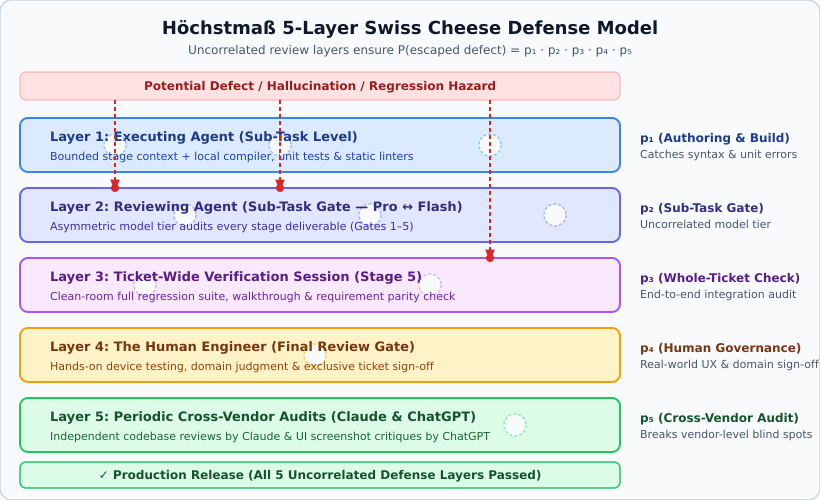

# Höchstmaß — The Agile Agentic ASPICE (AAA) Skill Set

> *„Power without control can become destructive. Power guided by intelligence becomes excellence.“*  
> — **ChatGPT**

---

### 📖 What does *Höchstmaß* mean?

> **Höchst·maß** `/ˈhøːçstˌmaːs/` *(noun, neuter)*  
> Origin: German. Composed of ***Höchst-*** (*highest / supreme / maximum*) + ***-maß*** (*measure / standard / precision*, as in *Maßarbeit* = bespoke precision craftsmanship).  
> **Definition**: The utmost degree of engineering precision, rigor, and reliability.  

---

## 1. Foundational Principles: Role Provenance & Multi-Model Adversarial Review

Modern AI-assisted development is frequently plagued by two extremes: **"Vibe Coding"** (unverified, hallucination-prone code generated without engineering discipline) and **unattributed AI prose** (passing off machine-generated text as human work). **Höchstmaß** establishes an entirely different paradigm based on two foundational principles:

### 1.1 Transparent Attribution & Clear Boundary
Unlike vibe coding or masquerading AI prose, **Höchstmaß** never passes off AI output as human authorship. Just as every transition, audit report, and commit in our workflow is strictly attributed to its true actor (`agent1`, `agent2`, `coordinator`, or `human`), we explicitly name the AI model as the source when quoting it. This establishes a crystal-clear boundary between the human engineer and the machine: the AI proposes and audits, but the human governs and signs off.

### 1.2 Live Cross-Model Adversarial Review (Breaking Shared Tunnel Vision)
A cornerstone of **Höchstmaß** is that whenever an AI model creates or designs something, a **different** model must audit it:
- **Intra-Sprint Diversity**: Alternating between distinct model tiers (e.g. `pro` for architectural reasoning and `flash` for specification and execution) ensures that the reviewing agent does not share the authoring agent's blind spots.
- **Cross-Vendor Adversarial Critique**: In real-world engineering workflows, pairing different model families breaks shared context tunnel vision:
  - When iterating on a UI component with **Gemini** until both the human engineer and Gemini are satisfied with the screenshot, handing that exact screenshot to **ChatGPT** for a cold, critical evaluation consistently surfaces subtle ergonomic flaws, accessibility oversights, and visual clutter that shared session context missed.
  - Beyond day-to-day sprint work, we conduct periodic independent codebase and architectural reviews using **Claude** to uncover systemic blind spots from a third model family's perspective.
- **Multi-Vendor Provenance in Practice**: We apply this multi-vendor review across code, UI, and methodology alike — co-developing in-sprint with **Gemini**, challenging designs and concepts with **ChatGPT**, and running recurring independent codebase audits with **Claude**.

---

## 2. The Swiss Cheese Multiplicative Defect Reduction Model

In safety-critical systems, James Reason's **Swiss Cheese Model** posits that catastrophic hazards are prevented by stacking multiple defensive barriers, each with imperfect holes. In **Höchstmaß**, defects can only escape into production if they penetrate all five defensive layers simultaneously:



### The 5 Defensive Layers in *Höchstmaß*:
1. **Layer 1 ($p_1$) — The Executing Agent (Sub-Task Level)**: Authors the stage deliverable (Analysis, Test Spec, Impl-Plan, Implementation, or Verification) within a clean, bounded context and validates it against local compilers, unit tests, and static linters.
2. **Layer 2 ($p_2$) — The Reviewing Agent (Sub-Task Gate Level)**: Audits every individual sub-task deliverable at Gates 1–5 before the next stage unlocks, using a different model tier (`pro` $\leftrightarrow$ `flash`) than the executing agent.
3. **Layer 3 ($p_3$) — Holistic Ticket Verification (Stage 5 Review Session)**: Verifies the entire ticket end-to-end across all stages — executing the full clean-room regression suite, checking requirement-to-test traceability parity, and compiling visual walkthrough evidence.
4. **Layer 4 ($p_4$) — The Human Engineer (Final Review Gate)**: Tests the integrated feature hands-on in the live application and holds exclusive authority to approve and close parent tickets during the Sprint-End Joint Review.
5. **Layer 5 ($p_5$) — Periodic Cross-Vendor Audits (Claude & ChatGPT)**: Independent codebase and architecture reviews by **Claude** alongside cold-eye UI/UX critiques by **ChatGPT** catch systemic issues that might otherwise persist across sprints.

### Why Model Alternation Is Essential for Statistical Decorrelation
Mathematically, the probability of an escaped defect is the product of individual layer failure rates — **but only if the layers are statistically uncorrelated**:

$$P(\text{escaped defect}) = \prod_{i=1}^{5} p_i = p_1 \cdot p_2 \cdot p_3 \cdot p_4 \cdot p_5$$

If the exact same model tier reviews content that it just generated itself, the authoring error and the reviewing error are **strongly correlated** ($P(\text{miss}_2 \mid \text{miss}_1) \gg p_2$), because the reviewer shares the exact same weights, biases, and blind spots as the author. That is one of the primary reasons why **Höchstmaß** strictly alternates between **Pro** and **Flash** models across every sub-task of a ticket, isolates conversational context between stages, and brings in external model families (**Claude** and **ChatGPT**) for cross-vendor reviews. When the layers are genuinely decorrelated, compounding even modest per-layer failure rates (e.g., $p_i \approx 0.1$) yields near-zero defect escape probabilities.

---

## 3. The 5-Stage Agile ASPICE Lifecycle with Gate Governance

Höchstmaß translates Automotive SPICE (ISO/IEC 33061 / VDA Scope) into a fast-paced agile development lifecycle:

| Stage | Process Phase | Author (`agent1`) | Auditor (`agent2`) | Gate Output & Progression |
| :---: | :--- | :---: | :---: | :--- |
| **Stage 1** | **Problem Domain & Root Cause Analysis** | `subagent_pro` | `subagent_flash` | **Gate 1 PASS**: Verifies problem formulation, scope bounding, and Chesterton's Fence archaeology. Advances to Test Spec. |
| **Stage 2** | **Requirement & Test Specification** | `subagent_flash` | `subagent_pro` | **Gate 2 PASS**: Verifies formal `SHALL`/`MUST` requirements, Given-When-Then criteria, and test traceability. Advances to Plan. |
| **Stage 3** | **Implementation Plan** | `subagent_pro` | `subagent_flash` | **Gate 3 PASS**: Verifies atomic construction steps, invariants, and architectural design. Releases Code Lock. |
| **Stage 4** | **Software Construction & Implementation** | `subagent_flash` / `subagent_pro` | `subagent_pro` / `subagent_flash` | **Gate 4 PASS**: Audits `git diff`, code quality, KDoc, and targeted tests against Stage 3 plan. Advances to Test. |
| **Stage 5** | **Verification & Walkthrough** | `subagent_flash` | `subagent_pro` | **Gate 5 PASS**: Full clean-room test suite, image inspection, and squashed atomic merge $\rightarrow$ Advances to **Final Review (Human)**. |

### Frictionless Human Code & Document Review During Parallel Agent Execution (`.reviews/` + Emacs)
When the human engineer wants to review or annotate **source code** (`.kt`, `.java`, `.py`, `.xml`) or **markdown documents** (specifications, architecture plans, presentations, or documentation) while autonomous agents are concurrently compiling code and switching Git branches in the main workspace, editing files directly inside the main working tree would cause build breaks or Git checkout/merge collisions. **Höchstmaß** resolves this via an **Isolated In-Place Review Sandbox (`.reviews/`)**:
1. **Isolated Mini-Git Repository**: `.reviews/` is excluded from the main repository via `.git/info/exclude` (making it 100% invisible to parallel code agents and Gradle/compiler runs) and maintains its own standalone Git repository (`git init`).
2. **Live Editor Integration (`emacsclient`) for Code & Docs**: The agent stages the target source files (e.g., all files modified by a ticket `ATT-XXXX` or specific `.kt`/`.md` files) into `.reviews/`, commits the baseline, and opens them directly in the human's running **Emacs** instance (`emacsclient -n` with full syntax highlighting, `gfm-mode`, and inline SVG rendering).
3. **In-Place Direct Edits & Inline Directives (`>>`)**: Right inside the code or text in Emacs, the human can directly modify lines *and* hammer in inline review directives (`>> ...` or `// >> ...`) at the exact line of interest without worrying about breaking a running build, then save (`C-x C-s`).
4. **Automated Diff Harvesting & Synchronization**: The agent inspects `git -C .reviews diff`, applies all direct human edits and executes every `>>` review directive against the actual codebase or document, runs verification tests, commits the updated state in `.reviews/`, and live-reloads the Emacs buffer.

---

## 4. Repository Structure & Starter Toolkit

This repository supplies the foundational building blocks to instantiate **Höchstmaß** in any software engineering project:

```
tools/hoechstmass/
├── README.md                                  # Framework manifesto, epigraph & mathematical model
├── docs/
│   ├── project_protocol.md                    # Core protocol, pillars & role definitions
│   ├── coding_standards.md                    # Universal software construction invariants (Starter Template)
│   ├── design_guidelines.md                   # Universal UI component selection heuristics (Starter Template)
│   └── community/                             # Community governance & contributing guidelines (Part 3)
├── .agents/
│   ├── rules/
│   │   └── aspice_governance.md               # Universal 8 Core In-Sprint Governance Rules
│   └── skills/                                # 10 project-agnostic agent skills
│       ├── stage1-analysis/SKILL.md
│       ├── stage2-req-test-spec/SKILL.md
│       ├── stage3-impl-plan/SKILL.md
│       ├── stage4-implementation/SKILL.md
│       ├── stage5-verification/SKILL.md
│       ├── sprint-planner/SKILL.md
│       ├── jira-workflow/SKILL.md
│       ├── regression-bisect/SKILL.md
│       ├── brainstormer/SKILL.md
│       └── release-manager/SKILL.md
├── templates/                                 # Standardized deliverable markdown templates
│   ├── analysis_template.md
│   ├── test_spec_template.md
│   ├── plan_template.md
│   ├── walkthrough_template.md
│   ├── backlog_ticket_template.md
│   └── sprint_retro_template.md
├── tools/                                     # Automation CLI & verification scripts (Part 2)
└── examples/                                  # Reference project scaffolds (Part 3)
    └── android-jetpack-compose/
```

---

## 5. Entry Barrier & Human Discipline: Why *Höchstmaß* Is Not for Everyone

While **Höchstmaß** delivers extraordinarily high development velocity and near-zero regression rates once established, it is **not** a zero-effort plug-and-play toy and is deliberately not for everyone:

1. **Significant Setup & Infrastructure Barrier**: Adopting **Höchstmaß** requires setting up a dedicated issue-tracking environment (such as a Jira project with custom stage transitions, sub-task types, dedicated role accounts for `agent1`, `agent2`, and `coordinator`, and CLI automation scripts).
2. **Demands Human Discipline & Patience**: Paradoxically, even though the workflow makes overall feature delivery remarkably fast, it demands strict discipline and patience from the human engineer:
   - Resisting the urge to "just quickly hack a line of code" outside an active sprint ticket.
   - Respecting the **Code Lock** until Analysis (Gate 1), Test Spec (Gate 2), and Implementation Plan (Gate 3) have been formally written and audited.
   - Investing focused human attention into Sprint-Start Screening (clarifying requirements upfront) and Sprint-End Final Review (testing every ticket before sign-off).

For engineers and teams willing to invest in that setup and discipline, the payoff is a deterministic, auditable, and remarkably fast engineering engine.

---

## 6. Quick Start: Adopting Höchstmaß in Your Project

1. Copy `.agents/` and `templates/` into your repository root.
2. Adapt `docs/coding_standards.md` and `docs/design_guidelines.md` to your technology stack.
3. Configure your project management CLI or issue tracker using `.agents/skills/jira-workflow/SKILL.md` (or your preferred ticketing integration).
4. Run sprints using the asymmetric zipper pair (`subagent_pro` and `subagent_flash`) across Stages 1–5.
